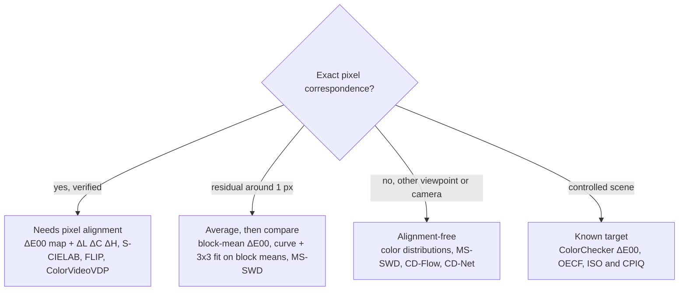

<!-- Generated by scripts/build.py from data/*.yaml. Edit the YAML files, not this file. -->

# Awesome Color Metrics 

**Metrics for color and contrast differences between images, sorted by whether they need a pixel-aligned reference, with links to code and toolbox implementations.**

     

**[Interactive page](https://ruilin.li/Awesome-Color-Metrics/) · [Code index](CODE.md) · [Color Metrics 101](guide/color-metrics-101.md) · [Contributing](CONTRIBUTING.md)**

A curated list of metrics that measure color and contrast differences between two images: color-difference formulas and uniform color spaces, spatial and visibility-based color difference, color-aware quality indices, contrast and tone metrics, learned color-difference measures for photographs, distribution-based and misalignment-robust metrics, white-balance error and test-chart standards. It is organized around one practical question: **does the metric need the reference and the test image to be pixel-aligned?** For every entry the list records how it handles misalignment, whether it actually sees color, what it outputs, and where to get code.

It currently holds **155 entries**, of which **89 have runnable code** (official, toolbox or third-party) and **58 tolerate misalignment** by design, plus 13 datasets. The [interactive page](https://ruilin.li/Awesome-Color-Metrics/) has the same data with search and filters by alignment, color sensitivity and code availability.

**Reading the tables.** Inside each section, entries are grouped by what they need from the image pair. Within a group, entries with code come first, then newest first.

| Alignment group | What it means |
|:--|:--|
| **Needs pixel alignment** | compares values at the same pixel or window; any residual misalignment adds a positive bias |
| **Tolerates small shifts** | designed or shown to tolerate sub-pixel to few-pixel misalignment (coarse scales, anti-aliasing, local search) |
| **Alignment-free** | compares global statistics or distributions, or a per-image measure; position is discarded |
| **Known target** | measured on a test chart against reference values; immune to small shifts when only patch centers are read |
| **Per color pair** | a formula for two colors or one stimulus; whether it needs alignment depends on how you aggregate it |

| Color label | What it means |
|:--|:--|
| **dedicated** | built and validated for color difference |
| **chromatic** | models chromatic channels or color values explicitly |
| **partial** | takes color input but was not designed or tested for color; may miss casts |
| **luminance only** | works on luminance; blind to color casts |

Under the color label is the output type (score, map, components, parameters or text). In the *Code* column, the official repository comes first and toolbox or package implementations follow in small print; "standard" marks a normative document and "—" means no public code was found.

## Contents

- [Color Metrics 101](#color-metrics-101)
- [Find a Metric by Alignment](#find-a-metric-by-alignment)
- [Research Threads](#research-threads)
- [Metrics](#metrics)
  - [Color-Difference Formulas & Uniform Color Spaces](#color-difference-formulas--uniform-color-spaces) (20 entries)
  - [Spatial & Visibility-Based Color Difference](#spatial--visibility-based-color-difference) (11 entries)
  - [Color-Aware Full-Reference IQA](#color-aware-full-reference-iqa) (10 entries)
  - [Contrast, Tone & Dynamic Range](#contrast-tone--dynamic-range) (10 entries, 2 misalignment-tolerant)
  - [Perceptual Color Difference of Photographs](#perceptual-color-difference-of-photographs) (11 entries, 7 misalignment-tolerant)
  - [Global Statistics & Color Histograms](#global-statistics--color-histograms) (10 entries, 10 misalignment-tolerant)
  - [Patch Distributions & Shift-Tolerant Structure](#patch-distributions--shift-tolerant-structure) (4 entries, 4 misalignment-tolerant)
  - [Deep-Feature Metrics Robust to Misalignment](#deep-feature-metrics-robust-to-misalignment) (28 entries, 27 misalignment-tolerant)
  - [Evaluation Protocols for Misaligned Ground Truth](#evaluation-protocols-for-misaligned-ground-truth) (16 entries, 3 misalignment-tolerant)
  - [White Balance & Illuminant Error](#white-balance--illuminant-error) (5 entries, 5 misalignment-tolerant)
  - [Test Charts & Camera Standards](#test-charts--camera-standards) (17 entries)
  - [Benchmarks, Psychophysics & Surveys](#benchmarks-psychophysics--surveys) (13 papers)
- [Datasets](#datasets)
- [Tools & Libraries](#tools--libraries)
- [Learning Resources](#learning-resources)
- [Related Lists](#related-lists)
- [Contributing](#contributing)
- [About This List](#about-this-list)
- [License](#license)

## Color Metrics 101

Write the test image as **I₂(x) = P[ I₁(T(x)) ] + n**: *T* is a geometric misalignment (a nuisance), *P* is the
color / contrast change you want to measure, *n* is noise. A per-pixel metric is only valid when *T* is gone; once a
residual of about one pixel remains, edges start to read as color differences, and because distances are never
negative this error is a **bias** that averaging over images does not remove. The cure is to **average, then
compare**: aggregate over regions or distributions first, compute the difference second. The
[full primer](guide/color-metrics-101.md) explains this with numbers, and [`shift_vs_cast.py`](guide/shift_vs_cast.py)
checks any metric on your own images.

| You want to know | Pixel-aligned pair | Misaligned pair |
|:--|:--|:--|
| How much did color change? | per-pixel ΔE00: mean, p95, max, % above threshold | ΔE00 of block means (blocks 16-32× the residual shift) or of image means |
| What changed: lightness, chroma or hue? | per-pixel ΔL\*, ΔC\*, ΔH\* | the same decomposition on block means |
| Which systematic transform? | fit tone curve + 3×3 matrix on pixel pairs | fit on block means; report the fit's ΔE00 on standard colors plus the residual |
| Did contrast change? | local contrast ratio map, tone-curve slopes | Michelson / RMS ratios, distribution distance of band-limited contrast |
| One perceptual number | [Spatial ΔE / VDP](#spatial--visibility-based-color-difference) (ColorVideoVDP, FLIP, iCID) | [Photo color difference](#perceptual-color-difference-of-photographs) (MS-SWD, CD-Flow, CD-Net) |
| Is the metric trustworthy here? | noise floor: two captures with no change | cast-vs-shift test: a visible cast must score far above a 1 px shift |

## Find a Metric by Alignment

Number of entries per section and alignment requirement. Tolerant classes are the middle two columns.

| Section | Needs pixel alignment | Tolerates small shifts | Alignment-free | Known target | Per color pair | Total |
|:--|--:|--:|--:|--:|--:|--:|
| [ΔE formulas](#color-difference-formulas--uniform-color-spaces) | · | · | · | · | [20](#color-difference-formulas--uniform-color-spaces) | 20 |
| [Spatial ΔE / VDP](#spatial--visibility-based-color-difference) | [11](#spatial--visibility-based-color-difference) | · | · | · | · | 11 |
| [Color FR-IQA](#color-aware-full-reference-iqa) | [10](#color-aware-full-reference-iqa) | · | · | · | · | 10 |
| [Contrast / tone](#contrast-tone--dynamic-range) | [7](#contrast-tone--dynamic-range) | · | [2](#contrast-tone--dynamic-range) | · | [1](#contrast-tone--dynamic-range) | 10 |
| [Photo color difference](#perceptual-color-difference-of-photographs) | [4](#perceptual-color-difference-of-photographs) | [5](#perceptual-color-difference-of-photographs) | [2](#perceptual-color-difference-of-photographs) | · | · | 11 |
| [Histograms / statistics](#global-statistics--color-histograms) | · | [1](#global-statistics--color-histograms) | [9](#global-statistics--color-histograms) | · | · | 10 |
| [Patch / shift-tolerant](#patch-distributions--shift-tolerant-structure) | · | [1](#patch-distributions--shift-tolerant-structure) | [3](#patch-distributions--shift-tolerant-structure) | · | · | 4 |
| [Deep, misalignment-robust](#deep-feature-metrics-robust-to-misalignment) | [1](#deep-feature-metrics-robust-to-misalignment) | [8](#deep-feature-metrics-robust-to-misalignment) | [19](#deep-feature-metrics-robust-to-misalignment) | · | · | 28 |
| [Protocols](#evaluation-protocols-for-misaligned-ground-truth) | [13](#evaluation-protocols-for-misaligned-ground-truth) | [2](#evaluation-protocols-for-misaligned-ground-truth) | [1](#evaluation-protocols-for-misaligned-ground-truth) | · | · | 16 |
| [WB error](#white-balance--illuminant-error) | · | · | [5](#white-balance--illuminant-error) | · | · | 5 |
| [Charts / standards](#test-charts--camera-standards) | [2](#test-charts--camera-standards) | · | · | [15](#test-charts--camera-standards) | · | 17 |
| **All** | **48** | **17** | **41** | **15** | **21** | **142** |

## Research Threads

- **From uniform patches to photographs.** Classical formulas were fitted to judgments of uniform patches. SPCD (2023) gave 30,000 rated pairs of real phone photos, and learned or distribution-based metrics now outperform per-pixel ΔE on them. Examples: CIEDE2000 → SPCD / CD-Net → CD-Flow → CD-iNet → MS-SWD → CD-Reasoning
- **Compare distributions, not pixels.** Tolerance to misalignment comes from discarding position: histograms and optimal transport for colors, patch distributions for local structure, feature statistics, order statistics or Gram matrices for deep features. Examples: Histogram / EMD → sliced Wasserstein → GPDM → MS-SWD · DISTS → DeepWSD → DOSS → DeepSSIM → DeepDC
- **Robust is not the same as color-sensitive.** Metrics that normalize local statistics (SSIM, CW-SSIM, deep Gram features) barely react to color casts, so they look stable under shifts for the wrong reason. Report sensitivity to a real change and the reading under misalignment alone. Examples: SSIM · CW-SSIM · DeepSSIM vs mean ΔE00 · Lab Wasserstein · MS-SWD
- **Visibility models gain color and displays.** Spatial ΔE grew into display-aware visible-difference predictors with chromatic contrast sensitivity, and into camera-based measurement of real displays with uncertainty estimates. Examples: S-CIELAB → FLIP → HDR-VDP-3 → castleCSF → ColorVideoVDP → CameraVDP
- **HDR and wide gamut have no settled ΔE.** PQ-based and appearance-based spaces extend color difference to high luminance and wide gamuts, but new psychophysical data show no model reaches the desired accuracy yet. Examples: ΔE ITP · Jzazbz · CAM16-UCS · sUCS · PCS26-UCS · Basova 2024
- **Context, layout and language.** Evidence is growing that averaging point-wise ΔE is not how people judge images: background, spatial pattern and content matter. In parallel, MLLM metrics explain differences in words, though general MLLMs still fail at fine color comparison. Examples: Becatti 2025 · Baek 2026 · High 2025 · Hammou 2026 · CD-Reasoning · DepictQA · Wu 2024
- **Other views as the reference.** Novel view synthesis has no ground truth at the test pose, so recent metrics score a rendered view against other views of the scene: cross-attention to nearby views, embeddings that ignore alignment, partial maps completed from the overlap, or a feature distribution of the whole scene. Examples: Puzzle Similarity → CrossScore → NOVA → PR-IQA → SCODA

## Metrics

### Color-Difference Formulas & Uniform Color Spaces

Formulas that turn two colors into one number. They know nothing about images: applied per pixel they need exact alignment, applied to region means or distributions they tolerate it. The thread runs from CIELAB ΔE\*ab through CIEDE2000 to color-appearance spaces (CAM16-UCS) and HDR / wide-gamut metrics (ΔE ITP, Jzazbz).

**Per color pair (20)**

| Metric | Venue | Color | Code |
|:--|:--|:--|:--|
| **[Helmlab](https://arxiv.org/abs/2602.23010)** Helmlab: A Two-Space Family of Analytical, Data-Driven Color Spaces for UI Design Systems Analytical XYZ-to-Lab transform with learned matrices, power compression, Fourier hue correction and a Helmholtz–Kohlrausch lightness term; its MetricSpace variant reports STRESS 22.5 on COMBVD versus 29.2 for CIEDE2000. <i>Note: Single-author preprint; the author reports a regression against CIEDE2000 on He et al. 2022 (3D-printed samples). GenSpace, the second space, targets gradients rather than color difference.</i> | arXiv 2026 | dedicated score | [GitHub](https://github.com/Grkmyldz148/helmlab) [pip · `helmlab`](https://pypi.org/project/helmlab/) |
| **[sUCS / sCAM](https://doi.org/10.1364/OE.510196)** Simple color appearance model (sCAM) based on simple uniform color space (sUCS) A structurally simple uniform space and appearance model that ranks first or second overall on 28 uniformity and 6 hue-linearity data sets. | Opt Express 2024 | dedicated score | [colour · `XYZ_to_sUCS` / `sCAM`](https://github.com/colour-science/colour) |
| **[ZCAM](https://doi.org/10.1364/OE.413659)** ZCAM, a colour appearance model based on a high dynamic range uniform colour space Color appearance model built on Jzazbz that predicts ten appearance attributes for HDR content, with accuracy at least on par with CIECAM02 and CAM16. | Opt Express 2021 | dedicated components | [colour · `XYZ_to_ZCAM`](https://github.com/colour-science/colour) |
| **[HyAB](https://doi.org/10.1002/col.22451)** Distance metrics for very large color differences City-block lightness difference plus Euclidean a\*b\* distance; the best of the tested metrics for very large differences (about 10 ΔE\*ab or more). Used inside FLIP. | Color Res Appl 2020 | dedicated score | [colour · `HyAB` / `HyCH`](https://github.com/colour-science/colour) |
| **[Oklab](https://bottosson.github.io/posts/oklab/)** A perceptual color space for image processing IPT-like space (matrix, cube-root LMS, matrix) fitted to CAM16 lightness and chroma predictions and to IPT hue; its Euclidean distance (ΔEOK) is the color difference CSS Color 4 uses for gamut mapping. <i>Note: Fitted for uniform appearance and hue linearity, not to color-difference data; its STRESS on COMBVD is far worse than CIEDE2000 (see Oklch+).</i> | Blog 2020 | dedicated score | [colour · `XYZ_to_Oklab`](https://github.com/colour-science/colour) [CSS Color 4 · `oklab()` / ΔEOK](https://www.w3.org/TR/css-color-4/) |
| **[ΔE ITP](https://www.itu.int/rec/R-REC-BT.2124-0-201901-I/en)** ITU-R BT.2124-0: Objective metric for the assessment of the potential visibility of colour differences in television 720·‖Δ(I, T, P)‖ in ICtCp on BT.2100 PQ signals; 1 unit is about one just-noticeable difference at the most sensitive adaptation state. <i>Note: The recommendation PDF is free on itu.int.</i> | ITU-R Rec. 2019 | dedicated score | [colour · `ITP`](https://github.com/colour-science/colour) |
| **[CAM16-UCS](https://doi.org/10.1002/col.22131)** Comprehensive color solutions: CAM16, CAT16, and CAM16-UCS Simplified successor of CIECAM02 with the CAT16 chromatic adaptation transform and a uniform space for color differences under stated viewing conditions. | Color Res Appl 2017 | dedicated score | [colour · `CAM16-UCS / -LCD / -SCD`](https://github.com/colour-science/colour) |
| **[Jzazbz](https://doi.org/10.1364/OE.25.015131)** Perceptually uniform color space for image signals including high dynamic range and wide gamut PQ-based perceptually uniform space for HDR and wide-gamut signals with absolute luminance input, aiming to predict small and large color differences and hue linearity. | Opt Express 2017 | dedicated score | [colour · `XYZ_to_Jzazbz`](https://github.com/colour-science/colour) |
| **[Power functions](https://doi.org/10.1364/OE.23.000597)** Power functions improving the performance of color-difference formulas A power-law correction ΔE' = a·ΔE^b fitted per formula that improves agreement with visual data for CIEDE2000, CAM02-UCS and others. | Opt Express 2015 | dedicated score | [colour · `power_function_Huang2015`](https://github.com/colour-science/colour) |
| **[CAM02-UCS](https://doi.org/10.1002/col.20227)** Uniform colour spaces based on CIECAM02 colour appearance model Three uniform spaces derived from CIECAM02 for small (SCD), large (LCD) and general (UCS) color differences; accounts for viewing conditions. | Color Res Appl 2006 | dedicated score | [colour · `CAM02-UCS / -LCD / -SCD`](https://github.com/colour-science/colour) |
| **[DIN99](https://doi.org/10.1002/col.10066)** Uniform colour spaces based on the DIN99 colour-difference formula Logarithmic lightness and rotated, compressed chroma axes so that plain Euclidean distance approximates perceived differences (DIN99 and the DIN99b-d variants). | Color Res Appl 2002 | dedicated score | [colour · `DIN99`](https://github.com/colour-science/colour) |
| **[CIEDE2000](https://doi.org/10.1002/col.1049)** The development of the CIE 2000 colour-difference formula: CIEDE2000 Adds lightness, chroma and hue weighting functions, a chroma-hue interaction term for blues and a rescaled a\* axis for grays; the current CIE / ISO standard formula. <i>Note: Validate any implementation against the test data of Sharma, Wu and Dalal (Color Res Appl 2005, doi:10.1002/col.20070), which the code link hosts.</i> | Color Res Appl 2001 | dedicated score | [code](https://hajim.rochester.edu/ece/sites/gsharma/ciede2000/) MATLAB / Excel [colour · `CIE 2000`](https://github.com/colour-science/colour) [scikit-image · `deltaE_ciede2000`](https://github.com/scikit-image/scikit-image) [ciede2000-color-matching (40+ languages)](https://github.com/michel-leonard/ciede2000-color-matching) |
| **[CIE94](https://doi.org/10.1111/j.1478-4408.1995.tb01688.x)** CIE94 – a new colour-difference formula Chroma-dependent weighting of ΔC and ΔH on top of CIELAB; the CIE recommendation between ΔE\*ab and CIEDE2000 (CIE 116-1995). | J Soc Dyers Colourists 1995 | dedicated score | [colour · `CIE 1994`](https://github.com/colour-science/colour) [scikit-image · `deltaE_ciede94`](https://github.com/scikit-image/scikit-image) |
| **[CMC l:c](https://doi.org/10.1111/j.1478-4408.1984.tb00969.x)** Modification to the JPC79 Colour-difference Formula Weights lightness, chroma and hue differences by position in color space; l:c (usually 2:1) sets acceptability vs perceptibility. Asymmetric in its two inputs. | J Soc Dyers Colourists 1984 | dedicated score | [colour · `CMC`](https://github.com/colour-science/colour) [scikit-image · `deltaE_cmc`](https://github.com/scikit-image/scikit-image) |
| **[CIELAB ΔE\*ab (CIE76)](https://doi.org/10.25039/TR.015.2018)** CIE 015:2018 Colorimetry, 4th Edition (current definition of CIELAB and ΔE\*ab, introduced in 1976) Euclidean distance in CIELAB. Simple and still widely reported, but over-weights chroma differences of saturated colors. <i>Note: The link is the CIE 015:2018 report (paid); the formula itself is in every colorimetry textbook.</i> | CIE TR 1976 | dedicated score | [colour · `CIE 1976`](https://github.com/colour-science/colour) [scikit-image · `deltaE_cie76`](https://github.com/scikit-image/scikit-image) |
| **[ML color difference (COLIBRI)](https://arxiv.org/abs/2609.39130)** Perceptual Color Difference Modeling Using Machine Learning and Human Similarity Judgments Regression models trained on 2,000 color pairs rated by seven observers on a four-point scale; adding COLIBRI fuzzy color-category features to RGB / HSI differences gives the best fit (LightGBM, R² 0.70). | arXiv 2026 | dedicated score | — |
| **[Oklch+](https://arxiv.org/abs/2606.05255)** Oklch+: A Three-Parameter Extension of Oklab for Improved Color Difference Prediction Adds a power function on L and a Naka–Rushton compression on chroma to Oklab, with three parameters fitted to color-difference data; Euclidean distance reaches STRESS 29.1 on COMBVD, level with CIEDE2000 (Oklab 47.4). <i>Note: Evaluated only on sRGB-centered COMBVD data.</i> | arXiv 2026 | dedicated score | — |
| **[PCS26-UCS](https://doi.org/10.1109/ACCESS.2026.3728597)** PCS26-UCS: a perceptually uniform color space preserving additive color mixture Uniform space that keeps additive mixtures on straight lines while reaching CAM16-UCS-level uniformity and better hue linearity. | IEEE Access 2026 | dedicated score | — |
| **[HDR-WCG projection space](https://doi.org/10.1364/OE.530213)** Towards perceptual uniformity and HDR-WCG image processing: a projection-based color space Uniform space for HDR / wide-gamut processing built from two 3D projection matrices and a revised nonlinearity, evaluated with STRESS, PU-PSNR, PU-SSIM and HDR-VDP-3. | Opt Express 2024 | dedicated score | — |
| **[Riemannian sinusoidal ΔE](https://doi.org/10.1364/OE.520947)** Riemannian color difference metric for spatial sinusoidal color variations Riemannian color-difference metric for color variations that are sinusoidal in space, i.e. color difference that depends on spatial frequency rather than on two uniform patches. | Opt Express 2024 | dedicated score | — |

<a href="#contents">back to contents</a>

### Spatial & Visibility-Based Color Difference

Per-pixel color difference after modeling human spatial vision: contrast-sensitivity filtering (S-CIELAB, iCID), alternating-image differences (FLIP) and display-aware visible-difference predictors (HDR-VDP, ColorVideoVDP). They output error maps, so they assume pixel correspondence.

**Needs pixel alignment (11)**

| Metric | Venue | Color | Code |
|:--|:--|:--|:--|
| **[ColorVideoVDP-ML](https://doi.org/10.1109/ICMEW68306.2025.11152234)** ColorVideoVDP-ML: visual difference predictor with a neural regressor for image and video quality prediction Replaces the hand-designed pooling of ColorVideoVDP with a neural regressor for image and video quality prediction. <i>Note: Available in the ColorVideoVDP repository as `cvvdp-ml-saliency` and `cvvdp-ml-transformer`.</i> | ICMEW 2025 | dedicated score | [GitHub](https://github.com/gfxdisp/ColorVideoVDP) PyTorch |
| **[ColorVideoVDP](https://doi.org/10.1145/3658144)** ColorVideoVDP: a visual difference predictor for image, video and display distortions Full-reference metric built on a chromatic spatio-temporal CSF (castleCSF) and cross-channel masking; outputs a JOD score and per-pixel distortion maps for a given display. <i>Note: A 1 px shift is a visible difference to this model, so it is not meant for misaligned pairs (see the guide).</i> | ACM TOG (SIGGRAPH) 2024 | dedicated map | [GitHub](https://github.com/gfxdisp/ColorVideoVDP) PyTorch [pip · `cvvdp`](https://pypi.org/project/cvvdp/) |
| **[HDR-VDP-3](https://arxiv.org/abs/2304.13625)** HDR-VDP-3: a multi-metric for predicting image differences, quality and contrast distortions in high dynamic range and regular content Three tasks in one model, quality in JOD, visible-difference probability maps and contrast-distortion (loss / enhancement) maps, from display-calibrated input. <i>Note: Achromatic. Current release HDR-VDP-3.0.7 (GPLv2).</i> | arXiv 2023 | luminance only map | [SourceForge](https://sourceforge.net/projects/hdrvdp/) MATLAB / Octave |
| **[HDR-FLIP](https://doi.org/10.2312/egs.20211015)** Visualizing Errors in Rendered High Dynamic Range Images Extends FLIP to HDR images by tone mapping over a range of exposures and taking the maximum LDR-FLIP error per pixel. <i>Note: Shipped in the same repository as FLIP.</i> | Eurographics (short) 2021 | dedicated map | [GitHub](https://github.com/NVlabs/flip) Python / C++ / CUDA |
| **[FLIP](https://doi.org/10.1145/3406183)** FLIP: a difference evaluator for alternating images Error map approximating what a viewer sees when flipping between two images; CSF-filtered HyAB color pipeline combined with an edge / point feature pipeline. | ACM PACMCGIT 2020 | dedicated map | [GitHub](https://github.com/NVlabs/flip) Python / C++ / CUDA [pip · `flip-evaluator`](https://pypi.org/project/flip-evaluator/) |
| **[CD-IQA (Temel 2014)](https://doi.org/10.1109/GlobalSIP.2014.7032265)** Image quality assessment and color difference Studies how per-pixel color-difference equations perform as full-reference quality estimators and how to pool them. | GlobalSIP 2014 | dedicated score | [GitHub](https://github.com/olivesgatech/Color-Difference-for-IQA) MATLAB |
| **[HDR-VDP-2](https://doi.org/10.1145/2010324.1964935)** HDR-VDP-2: a calibrated visual metric for visibility and quality predictions in all luminance conditions Visual model of optics, photoreceptors, contrast sensitivity and masking that predicts visibility maps and quality for any luminance range, from absolute photometric input. <i>Note: Achromatic visual model; ColorVideoVDP is the color successor.</i> | ACM TOG 2011 | luminance only map | [SourceForge](https://sourceforge.net/projects/hdrvdp/) MATLAB |
| **[S-CIELAB](https://doi.org/10.1889/1.1985127)** A spatial extension of CIELAB for digital color-image reproduction Converts to an opponent space, blurs each channel with its own contrast-sensitivity filter, converts back and computes per-pixel ΔE; needs viewing distance in pixels per degree. <i>Note: The low-pass filters do not make it tolerant to misalignment (see the guide).</i> | J Soc Inf Display 1997 | dedicated map | [GitHub](https://github.com/wandell/SCIELAB-1996) MATLAB |
| **[MS-iCID](https://doi.org/10.1117/12.2078879)** Evaluating the multi-scale iCID metric Multi-scale version of iCID evaluated against subjective image-difference data. | Proc SPIE 2015 | dedicated score | — |
| **[iCID](https://doi.org/10.1109/TIP.2014.2302684)** Color-image quality assessment: from prediction to optimization Improved CID that can be used as an optimization target for gamut mapping without artifacts, while predicting subjective data better than CID. | IEEE TIP 2014 | dedicated components | — |
| **[CID](https://doi.org/10.1109/TIP.2012.2216279)** Image-difference prediction: from grayscale to color Normalize, extract lightness / chroma / hue / structure features, combine into an image-difference score with interpretable terms; tuned on gamut-mapped images. | IEEE TIP 2013 | dedicated components | — |

<a href="#contents">back to contents</a>

### Color-Aware Full-Reference IQA

General quality indices with a chromatic component, from FSIMc and VSI to LPIPS. They rank distortions well on aligned pairs but fold color, contrast and structure into one score, so they cannot say what changed.

**Needs pixel alignment (10)**

| Metric | Venue | Color | Code |
|:--|:--|:--|:--|
| **[LPIPS](https://openaccess.thecvf.com/content_cvpr_2018/html/Zhang_The_Unreasonable_Effectiveness_CVPR_2018_paper.html)** The Unreasonable Effectiveness of Deep Features as a Perceptual Metric Weighted L2 distance between normalized deep features at the same spatial positions, calibrated on human 2AFC judgments (BAPPS). <i>Note: Position-wise comparison makes it sensitive to shifts; see ST-LPIPS and E-LPIPS in the deep section.</i> | CVPR 2018 | partial map | [GitHub](https://github.com/richzhang/PerceptualSimilarity) PyTorch [pip · `lpips`](https://pypi.org/project/lpips/) [pyiqa · `lpips`](https://github.com/chaofengc/IQA-PyTorch) |
| **[PieAPP](https://openaccess.thecvf.com/content_cvpr_2018/html/Prashnani_PieAPP_Perceptual_Image-Error_CVPR_2018_paper.html)** PieAPP: Perceptual Image-Error Assessment through Pairwise Preference Learns a patch-wise perceptual error from pairwise preference probabilities and pools it with learned weights. | CVPR 2018 | partial score | [GitHub](https://github.com/prashnani/PerceptualImageError) TensorFlow / PyTorch [pyiqa · `pieapp`](https://github.com/chaofengc/IQA-PyTorch) [piq · `PieAPP`](https://github.com/photosynthesis-team/piq) |
| **[CSV](https://doi.org/10.1016/j.image.2016.08.008)** CSV: Image quality assessment based on color, structure, and visual system Combines CIEDE2000 differences, an Earth Mover's Distance between color-name descriptors, normalized structure maps and retinal contrast-sensitivity maps, targeting perceived rather than absolute color change. | Signal Process Image Commun 2016 | dedicated score | [GitHub](https://github.com/olivesgatech/CSV) MATLAB |
| **[MDSI](https://doi.org/10.1109/ACCESS.2016.2604042)** Mean deviation similarity index: efficient and reliable full-reference image quality evaluator Gradient similarity plus a joint chromaticity similarity in a Gaussian color model, pooled by deviation into one score (0 is perfect). | IEEE Access 2016 | chromatic score | [piq · `mdsi`](https://github.com/photosynthesis-team/piq) |
| **[PerSIM](https://doi.org/10.1109/ICIP.2015.7351087)** PerSIM: Multi-resolution image quality assessment in the perceptually uniform color domain Multi-resolution comparison of lightness and chroma channels in CIELAB with retina-inspired filtering. | ICIP 2015 | chromatic score | [GitHub](https://github.com/olivesgatech/PerSIM) MATLAB |
| **[VSI](https://doi.org/10.1109/TIP.2014.2346028)** VSI: a visual saliency-induced index for perceptual image quality assessment Uses a visual saliency map both as a similarity feature and as the pooling weight, combined with gradient and chrominance similarity in an opponent space. | IEEE TIP 2014 | chromatic score | [pyiqa · `vsi`](https://github.com/chaofengc/IQA-PyTorch) [piq · `vsi`](https://github.com/photosynthesis-team/piq) |
| **[FSIMc](https://doi.org/10.1109/TIP.2011.2109730)** FSIM: a feature similarity index for image quality assessment Phase congruency and gradient magnitude similarity on luminance, plus a chrominance similarity term in YIQ for the color version FSIMc. <i>Note: One score. Pixel-wise feature comparison makes it react strongly to sub-pixel shifts (see the guide).</i> | IEEE TIP 2011 | chromatic score | [pyiqa · `fsim`](https://github.com/chaofengc/IQA-PyTorch) [piq · `fsim`](https://github.com/photosynthesis-team/piq) |
| **[MaD-DLS](https://doi.org/10.1109/TMM.2020.3037482)** MaD-DLS: mean and deviation of deep and local similarity for image quality assessment Pools the mean and standard deviation of deep-feature and local similarity maps into a quality score. | IEEE TMM 2021 | partial score | — |
| **[DeepSim](https://doi.org/10.1016/j.neucom.2017.01.054)** DeepSim: deep similarity for image quality assessment Local similarity between pretrained CNN features at corresponding positions, pooled across layers; compares mean, deviation and percentile pooling. <i>Note: Not to be confused with DeepSSIM.</i> | Neurocomputing 2017 | partial score | — |
| **[QSSIM](https://doi.org/10.1109/TIP.2011.2181522)** Quaternion Structural Similarity: A New Quality Index for Color Images Treats each RGB pixel as a quaternion so that SSIM-style luminance, contrast and structure terms are computed jointly across color channels. | IEEE TIP 2012 | chromatic score | — |

<a href="#contents">back to contents</a>

### Contrast, Tone & Dynamic Range

Global and local contrast (RMS, Michelson, Peli band-limited contrast), the contrast term of SSIM, visibility-based contrast loss / amplification / reversal (DRIM), and metrics for tone-mapped HDR content. Most operate on luminance only.

**Needs pixel alignment (7)**

| Metric | Venue | Color | Code |
|:--|:--|:--|:--|
| **[TM metric adaptation](https://doi.org/10.1145/3799902.3811107)** Adapting Quality Metrics to Tone Mapping Converts HDR reference and tone-mapped SDR test to photometric values with a display model and re-encodes both with a perceptual transfer function, so general metrics beat tone-mapping-specific ones; introduces ColorVideoVDP-tm. <i>Note: Data: TMQ-ME (doi:10.17863/CAM.129808). Project page: kenchen10.github.io/projects/tmometric.</i> | SIGGRAPH 2026 | chromatic score | [GitHub](https://github.com/NYU-ICL/TM-metric-adaptation) PyTorch |
| **[GMSD](https://doi.org/10.1109/TIP.2013.2293423)** Gradient magnitude similarity deviation: a highly efficient perceptual image quality index Per-pixel similarity of Prewitt gradient magnitudes on luminance, pooled by its standard deviation into one score. | IEEE TIP 2014 | luminance only score | [pyiqa · `gmsd`](https://github.com/chaofengc/IQA-PyTorch) [piq · `gmsd`](https://github.com/photosynthesis-team/piq) |
| **[TMQI](https://doi.org/10.1109/TIP.2012.2221725)** Objective quality assessment of tone-mapped images Multi-scale structural fidelity against the HDR reference plus a statistical naturalness term for tone-mapped LDR images, computed on luminance only. | IEEE TIP 2013 | luminance only score | [code](https://eceweb.uwaterloo.ca/~z70wang/research/tmqi/) MATLAB |
| **[SSIM](https://doi.org/10.1109/TIP.2003.819861)** Image quality assessment: from error visibility to structural similarity Local luminance, contrast and structure comparison. The contrast term c = 2σxσy/(σx²+σy²) is symmetric and compressed, so it cannot tell a contrast increase from a decrease. <i>Note: Local normalization removes global photometric changes, so SSIM barely reacts to color casts (see the guide).</i> | IEEE TIP 2004 | partial map | [scikit-image · `structural_similarity`](https://github.com/scikit-image/scikit-image) [pyiqa · `ssim` / `ssimc`](https://github.com/chaofengc/IQA-PyTorch) |
| **[MS-SSIM](https://doi.org/10.1109/ACSSC.2003.1292216)** Multiscale structural similarity for image quality assessment SSIM contrast and structure terms evaluated over a dyadic pyramid, luminance term only at the coarsest scale, with psychophysically fitted scale weights. | Asilomar 2003 | luminance only score | [pyiqa · `ms_ssim`](https://github.com/chaofengc/IQA-PyTorch) [piq · `multi_scale_ssim`](https://github.com/photosynthesis-team/piq) |
| **[TMQI-II](https://doi.org/10.1109/TIP.2015.2436340)** High Dynamic Range Image Compression by Optimizing Tone Mapped Image Quality Index Revises the structural-fidelity and naturalness terms of TMQI and uses the improved index as an objective for tone-mapping optimization. | IEEE TIP 2015 | luminance only score | — |
| **[DRIM](https://doi.org/10.1145/1360612.1360668)** Dynamic range independent image quality assessment Reports three probability maps, loss of visible contrast, amplification of invisible contrast and contrast reversal, between images of different dynamic range. <i>Note: Insensitive to mild tone-curve changes by design; it reports changes in visibility, not in contrast magnitude.</i> | ACM TOG (SIGGRAPH) 2008 | luminance only map | — |

**Alignment-free (2)**

| Metric | Venue | Color | Code |
|:--|:--|:--|:--|
| **[Perceived contrast](https://doi.org/10.1167/13.13.3)** Perceived contrast in complex images Classification-image study of which spatial frequencies drive perceived contrast of photos (mainly 1–6 cycles/degree); a CSF alone is not enough, gain control toward low frequencies is needed. | J Vision 2013 | luminance only score | — |
| **[Peli band-limited contrast](https://doi.org/10.1364/JOSAA.7.002032)** Contrast in complex images Local band-limited contrast per pixel and per octave band (band-pass image divided by the low-pass image one octave below); also discusses RMS contrast. <i>Note: The contrast maps need alignment to be compared pixel by pixel; comparing their distributions per band does not (see the guide).</i> | JOSA A 1990 | luminance only map | — |

**Per color pair (1)**

| Metric | Venue | Color | Code |
|:--|:--|:--|:--|
| **[castleCSF](https://doi.org/10.1167/jov.24.4.5)** castleCSF — a contrast sensitivity function of color, area, spatiotemporal frequency, luminance and eccentricity Analytic CSF fitted to 18 data sets, covering spatial / temporal frequency, any color direction, luminance, background chromaticity, eccentricity and area; the sensitivity model inside ColorVideoVDP. <i>Note: Not an image metric on its own; it predicts whether a small chromatic or achromatic contrast is visible. Data are in the repository.</i> | J Vision 2024 | dedicated score | [GitHub](https://github.com/gfxdisp/castleCSF) MATLAB |

<a href="#contents">back to contents</a>

### Perceptual Color Difference of Photographs

Metrics built and validated for color differences between whole photographs, mostly on SPCD (smartphone photos, with a deliberately non-aligned subset). The closest thing to an answer for "how different are the colors" when pixels do not line up.

**Needs pixel alignment (4)**

| Metric | Venue | Color | Code |
|:--|:--|:--|:--|
| **[Photo CD (Niu 2026)](https://doi.org/10.1117/12.3117003)** Perceptual color difference measurement for photographic images Deep color-difference model trained with target-ranked contrastive learning so that predicted differences keep perceptual continuity and order. <i>Note: The abstract does not mention misalignment, data set or code.</i> | Proc SPIE 2026 | dedicated score | — |
| **[Reproduction difference model](https://doi.org/10.1002/col.22969)** Towards a model of color reproduction difference Whole-image model of the visual difference between gamut-mapped reproductions that depends on the output gamut and image content; predicts better than mean ΔE. | Color Res Appl 2025 | dedicated score | — |
| **[SDR–HDR Siamese CD](https://doi.org/10.1109/ISCAS58744.2024.10558454)** Calculating color differences of images via siamese neural network Siamese network (color-space conversion, feature extraction, color-difference head) trained on 504 SDR vs SDR-derived HDR image pairs. | ISCAS 2024 | dedicated score | — |
| **[Skin-tone CD](https://doi.org/10.1109/VCIP63160.2024.10849890)** Perceptual skin tone color difference measurement for portrait photography Large portrait skin-tone color-difference data set (40k triplets, 160k judgments) and a deep skin-tone color-difference metric trained on it. <i>Note: Data and code were announced but not found. Tolerance to misalignment is not discussed.</i> | VCIP 2024 | dedicated score | — |

**Tolerates small shifts (5)**

| Metric | Venue | Color | Code |
|:--|:--|:--|:--|
| **[CD-Reasoning](https://doi.org/10.1109/TIP.2024.3522802)** Harnessing Multi-modal Large Language Models for Measuring and Interpreting Color Differences Fine-tunes a multimodal LLM on M-SPCD (SPCD with text descriptions of seven attributes such as white balance, contrast, brightness and color) to output a score plus an explanation. <i>Note: Checkpoints on Baidu (code 6s5d); the M-SPCD text annotations are not linked separately.</i> | IEEE TIP 2025 | dedicated text + score | [GitHub](https://github.com/LongYu-LY/CD-Reasoning) PyTorch |
| **[CD-iNet](https://doi.org/10.1007/s11263-024-02087-7)** CD-iNet: deep invertible network for perceptual image color difference measurement An invertible network learns a color coordinate transform in which Euclidean distance is proportional to perceived color difference, giving local difference maps; reported robust to geometric distortions. <i>Note: Demo only; the training code is not released.</i> | IJCV 2024 | dedicated map | [GitHub](https://github.com/hellooks/CD-iNet) PyTorch |
| **[CD-Flow](https://doi.org/10.1109/CVPR52729.2023.02130)** Learning a Deep Color Difference Metric for Photographic Images Maps images to multi-scale features with a normalizing flow and takes the Euclidean distance; it learns to rely on coarse scales, which tolerate small geometric distortions. | CVPR 2023 | dedicated score | [GitHub](https://github.com/haoychen3/CD-Flow) PyTorch |
| **[CD-Net (SPCD)](https://doi.org/10.1109/TPAMI.2023.3262424)** Measuring Perceptual Color Differences of Smartphone Photographs Builds SPCD (30,000 rated pairs; 10,000 are shots of the same scene by six phones, only globally registered, the rest aligned edits) and trains a lightweight color-difference network on it. <i>Note: SPCD links are in the repository (Google Drive / Baidu / Kaggle). Most of the 33 compared methods do worse on the non-aligned pairs.</i> | IEEE TPAMI 2023 | dedicated score | [GitHub](https://github.com/hellooks/CDNet) PyTorch |
| **[CD-Attention](https://doi.org/10.3390/app15052704)** Attention-based color difference perception for photographic images CNN–Transformer fusion with deformable-convolution attention and high / low-frequency branches; reports the non-aligned SPCD subset separately. <i>Note: Code available from the first author on request, according to the paper.</i> | Appl Sci 2025 | dedicated score | — |

**Alignment-free (2)**

| Metric | Venue | Color | Code |
|:--|:--|:--|:--|
| **[Tone style scorer (ICTone)](https://arxiv.org/abs/2604.16114)** Towards In-Context Tone Style Transfer with a Large-Scale Triplet Dataset A learned tone-style embedding (contrastive pre-training, then 20k human rankings) whose cosine similarity says whether a result matches the tone of a reference with different content. <i>Note: Related to color difference but measures style match. Metric checkpoints are on Hugging Face (ToneStyle/MetricCkpt).</i> | ECCV 2026 | chromatic score | [GitHub](https://github.com/dengyuhai/ICTone) PyTorch |
| **[MS-SWD](https://doi.org/10.1007/978-3-031-73668-1_25)** Multiscale Sliced Wasserstein Distances as Perceptual Color Difference Measures Training-free. Sliced Wasserstein distance between the distributions of 11×11 CIELAB patches over a 5-level pyramid; sorting the projections discards position, so no alignment is needed. <i>Note: Also has a learned variant with trainable projections. Random projections make readings vary with the seed; fix it.</i> | ECCV 2024 | dedicated score | [GitHub](https://github.com/real-hjq/MS-SWD) PyTorch [pyiqa · `msswd`](https://github.com/chaofengc/IQA-PyTorch) |

<a href="#contents">back to contents</a>

### Global Statistics & Color Histograms

Classical retrieval-era measures that discard position entirely: color moments, colorfulness, histogram distances and optimal transport between color distributions. Immune to misalignment, blind to where a change happened.

**Tolerates small shifts (1)**

| Metric | Venue | Color | Code |
|:--|:--|:--|:--|
| **[MPEG-7 color layout](https://doi.org/10.1109/76.927424)** Color and texture descriptors Shrinks the image to an 8×8 grid of mean YCbCr colors, takes the DCT and compares a few low-frequency coefficients (6 for Y, 3 each for Cb and Cr). <i>Note: Coefficient selection as in Kasutani and Yamada, ICIP 2001 (doi:10.1109/ICIP.2001.959135).</i> | IEEE TCSVT 2001 | chromatic score | — |

**Alignment-free (9)**

| Metric | Venue | Color | Code |
|:--|:--|:--|:--|
| **[Sliced Wasserstein distance](https://doi.org/10.1007/978-3-642-24785-9_37)** Wasserstein barycenter and its application to texture mixing Projects the 3-D color distributions onto random directions, sorts each 1-D projection and averages the 1-D Wasserstein distances. Same idea as EMD, far cheaper. <i>Note: Theory: Bonneel et al., J Math Imaging Vis 2015 (doi:10.1007/s10851-014-0506-3). Using only the L\*, a\*, b\* axes gives the per-channel 1-D Wasserstein distance.</i> | SSVM 2011 | chromatic score | [POT · `ot.sliced_wasserstein_distance`](https://github.com/PythonOT/POT) [this repo · guide/shift_vs_cast.py](guide/shift_vs_cast.py) |
| **[Colorfulness](https://doi.org/10.1117/12.477378)** Measuring colorfulness in natural images One number from the mean and standard deviation of two opponent channels, fitted to colorfulness ratings. The ratio between two images tracks overall saturation changes. <i>Note: Ignores hue by design, so a hue rotation goes unnoticed.</i> | Proc SPIE 2003 | dedicated score | [this repo · guide/shift_vs_cast.py](guide/shift_vs_cast.py) |
| **[Earth Mover's Distance](https://doi.org/10.1023/a:1026543900054)** The Earth Mover's Distance as a metric for image retrieval Minimum cost of moving one color distribution (histogram or signature) onto the other; in CIELAB it reads as the average color difference that must be moved. <i>Note: Signatures built with k-means add run-to-run randomness; fixed bins are more stable but coarser.</i> | IJCV 2000 | chromatic score | [POT · `ot.emd2`](https://github.com/PythonOT/POT) [OpenCV · `EMD`](https://github.com/opencv/opencv) |
| **[Color moments](https://doi.org/10.1117/12.205308)** Similarity of color images Mean, standard deviation and skewness of each channel (nine numbers per image) compared with a weighted L1 distance. Crude but almost immune to misalignment. <i>Note: The paper computes the moments in HSV; CIELAB is the natural choice for color-difference work.</i> | Proc SPIE 1995 | chromatic score | [this repo · guide/shift_vs_cast.py](guide/shift_vs_cast.py) |
| **[Color histogram intersection](https://doi.org/10.1007/bf00130487)** Color indexing Overlap between two color histograms; the first widely used position-free color similarity, sensitive to the choice of bins and bounded above. | IJCV 1991 | chromatic score | [OpenCV · `compareHist`](https://github.com/opencv/opencv) [this repo · guide/shift_vs_cast.py](guide/shift_vs_cast.py) |
| **[Histogram intersection for image similarity](https://doi.org/10.1002/col.20122)** Evaluation of image similarity by histogram intersection Tests histogram intersection in several color spaces against visual similarity judgments; it is the histogram baseline (Lee05) in the SPCD and MS-SWD papers. | Color Res Appl 2005 | chromatic score | — |
| **[Color correlogram](https://doi.org/10.1109/cvpr.1997.609412)** Image indexing using color correlograms Probability that a pixel at distance k from a color-i pixel has color j; the experiments use the autocorrelogram (i = j), adding spatial color correlation to histograms. | CVPR 1997 | chromatic score | — |
| **[Color coherence vectors](https://doi.org/10.1145/244130.244148)** Comparing images using color coherence vectors Splits each color bin into pixels that belong to large connected regions and scattered pixels, then compares both histograms. | ACM MM 1996 | chromatic score | — |
| **[Quadratic-form histogram distance](https://doi.org/10.1109/34.391417)** Efficient color histogram indexing for quadratic form distance functions The QBIC histogram distance, with cross-bin color-similarity weights that soften bin-boundary effects; the paper adds cheap lower bounds to prefilter databases before computing it. | IEEE TPAMI 1995 | chromatic score | — |

<a href="#contents">back to contents</a>

### Patch Distributions & Shift-Tolerant Structure

Compare distributions of image patches or phase-based structure so that local re-arrangement is allowed: bidirectional similarity, patch-distribution matching, texture statistics and complex-wavelet SSIM.

**Tolerates small shifts (1)**

| Metric | Venue | Color | Code |
|:--|:--|:--|:--|
| **[CW-SSIM](https://doi.org/10.1109/TIP.2009.2025923)** Complex wavelet structural similarity: a new image similarity index SSIM on complex steerable-pyramid coefficients, where a small translation only rotates the phase; tolerant to shifts that are small relative to the filter size. <i>Note: Blind to color casts, which makes it look robust in shift tests for the wrong reason (see the guide).</i> | IEEE TIP 2009 | luminance only score | [pyiqa · `cw_ssim`](https://github.com/chaofengc/IQA-PyTorch) |

**Alignment-free (3)**

| Metric | Venue | Color | Code |
|:--|:--|:--|:--|
| **[GPDM](https://arxiv.org/abs/2203.11862)** Generating natural images with direct patch distributions matching A generative method whose loss is the sliced Wasserstein distance between multi-scale RGB patch distributions; usable as a position-free image distance. <i>Note: MS-SWD reuses parts of its code; the main differences are CIELAB vs RGB, patch size and number of scales.</i> | ECCV 2022 | chromatic score | [GitHub](https://github.com/ariel415el/GPDM) PyTorch |
| **[STSIM](https://doi.org/10.1109/tip.2013.2251645)** Structural texture similarity metrics for image analysis and retrieval Compares a small set of steerable-subband statistics globally or in sliding windows, explicitly allowing large point-by-point deviations between textures. | IEEE TIP 2013 | luminance only score | — |
| **[Bidirectional similarity (BDS)](https://doi.org/10.1109/CVPR.2008.4587842)** Summarizing visual data using bidirectional similarity Every patch of each image must have a close match somewhere in the other (completeness and coherence); a standard measure in image retargeting. <i>Note: The nearest-neighbor search also absorbs genuine color differences, so its resolution for color casts is modest.</i> | CVPR 2008 | chromatic score | — |

<a href="#contents">back to contents</a>

### Deep-Feature Metrics Robust to Misalignment

Learned or deep-feature metrics designed to tolerate shifts, content misalignment or geometrically disparate references: anti-aliased networks, feature statistics, distribution distances, order statistics, Gram matrices, contextual matching and foundation-model embeddings. Color sensitivity is rarely tested.

**Needs pixel alignment (1)**

| Metric | Venue | Color | Code |
|:--|:--|:--|:--|
| **[E-LPIPS](https://arxiv.org/abs/1906.03973)** E-LPIPS: robust perceptual image similarity via random transformation ensembles Averages LPIPS over random transformations (shifts, flips, axis swaps, downscaling, color permutation and scaling, dropout) applied identically to both images, mainly against adversarial attacks. <i>Note: Both images get the same transform, so it does not add tolerance to misalignment between them.</i> | arXiv 2019 | partial score | [GitHub](https://github.com/mkettune/elpips) TensorFlow |

**Tolerates small shifts (8)**

| Metric | Venue | Color | Code |
|:--|:--|:--|:--|
| **[DepictQA](https://doi.org/10.1007/978-3-031-72970-6_15)** Depicting beyond scores: advancing image quality assessment through multi-modal language models A multimodal LLM compares a reference with two test images in language; the authors note that score-based metrics disagree with people when images are misaligned. | ECCV 2024 | partial text + score | [GitHub](https://github.com/XPixelGroup/DepictQA) PyTorch |
| **[DeepWSD](https://doi.org/10.1145/3503161.3548193)** DeepWSD: Projecting Degradations in Perceptual Space to Wasserstein Distance in Deep Feature Space Training-free. 1-D Wasserstein distances between feature distributions in small windows of the image and of each VGG layer. <i>Note: Distribution comparison is local; robustness to misalignment is not claimed.</i> | ACM MM 2022 | partial score | [GitHub](https://github.com/Buka-Xing/DeepWSD) PyTorch |
| **[DISTS](https://doi.org/10.1109/TPAMI.2020.3045810)** Image quality assessment: unifying structure and texture similarity Compares spatial means (texture) and correlations (structure) of VGG feature maps; reported relatively insensitive to mild geometric transformations such as translation and dilation. | IEEE TPAMI 2022 | partial score | [GitHub](https://github.com/dingkeyan93/DISTS) PyTorch / TensorFlow [pip · `DISTS-pytorch`](https://pypi.org/project/DISTS-pytorch/) [pyiqa · `dists`](https://github.com/chaofengc/IQA-PyTorch) |
| **[ST-LPIPS](https://doi.org/10.1007/978-3-031-19797-0_6)** Shift-tolerant Perceptual Similarity Metric Redesigns the LPIPS backbone (anti-aliasing, pooling, strides, padding) so that imperceptible shifts of a few pixels barely change the score. <i>Note: The paper tests 1–3 px horizontal shifts.</i> | ECCV 2022 | partial score | [GitHub](https://github.com/abhijay9/ShiftTolerant-LPIPS) PyTorch [pip · `stlpips-pytorch`](https://pypi.org/project/stlpips-pytorch/) [pyiqa · `stlpips`](https://github.com/chaofengc/IQA-PyTorch) |
| **[A-DISTS](https://doi.org/10.1145/3474085.3475419)** Locally Adaptive Structure and Texture Similarity for Image Quality Assessment DISTS with locally adaptive weights between its texture and structure terms, set by a dispersion index of the local content. | ACM MM 2021 | partial score | [GitHub](https://github.com/dingkeyan93/A-DISTS) PyTorch |
| **[CoBi](https://doi.org/10.1109/CVPR.2019.00388)** Zoom to Learn, Learn to Zoom Contextual bilateral loss, contextual matching plus a spatial-distance penalty, applied to RGB patches and VGG features to train on mildly misaligned SR-RAW pairs. | CVPR 2019 | partial score | [GitHub](https://github.com/ceciliavision/zoom-learn-zoom) TensorFlow |
| **[MRFEM-KL](https://doi.org/10.1016/j.dsp.2026.106028)** Image quality assessment using multi-branch residual feature enhancement and adaptive distribution metric Adds a multi-branch residual enhancement module to VGG19 and compares feature distributions in sliding windows with KL divergence plus cosine distance. <i>Note: Cites MS-SWD but targets overall quality; tolerance to misalignment is not stated.</i> | Digit Signal Process 2026 | partial score | — |
| **[MIPM](https://doi.org/10.1007/978-981-99-8552-4_35)** Misalignment insensitive perceptual metric for full reference image quality assessment Wasserstein differences between deep-feature distributions in overlapping local windows (LOWD) with channel attention, aimed at misaligned GAN restoration results. | PRCV 2023 | partial score | — |

**Alignment-free (19)**

| Metric | Venue | Color | Code |
|:--|:--|:--|:--|
| **[CFM](https://openaccess.thecvf.com/content/CVPR2026/html/Fang_Too_Vivid_to_Be_Real_Benchmarking_and_Calibrating_Generative_Color_CVPR_2026_paper.html)** Too Vivid to Be Real? Benchmarking and Calibrating Generative Color Fidelity Single-image color-fidelity score from a multimodal encoder trained on the Color Fidelity Dataset, which orders real and generated images by color realism; it penalizes the exaggerated saturation and contrast that preference-trained metrics reward. <i>Note: No reference image. CFM-7B weights and the CFD data are on Hugging Face (Nineve/CFM_7B, Nineve/CFD_dataset).</i> | CVPR 2026 | dedicated score | [GitHub](https://github.com/ZhengyaoFang/CFM) PyTorch |
| **[DeepSSIM](https://doi.org/10.1109/TPAMI.2025.3627285)** Structural similarity in deep features: unified image quality assessment robust to geometrically disparate reference SSIM-style comparison of Gram matrices of VGG16 conv5_1 features; summing over positions discards location, which handles super-resolution and retargeting references. <i>Note: The paper does not discuss color; an informal test with substitute VGG weights found it responsive to tone changes but weak on white-balance casts. DeepSSIM-Lite (PyTorch) is for optimization.</i> | IEEE TPAMI 2026 | partial score | [GitHub](https://github.com/kekezhang112/DeepSSIM) MATLAB / PyTorch |
| **[MIIDP](https://doi.org/10.1016/j.eswa.2025.130385)** Misalignment-tolerant perceptual similarity metric for full reference image dehazing quality assessment Replaces continuous CNN features with a discrete VQ codebook representation that does not depend on position, for dehazing results that are misaligned with the reference. | Expert Syst Appl 2026 | partial score | [GitHub](https://github.com/CVhnu/MIIDP) PyTorch |
| **[NOVA](https://arxiv.org/abs/2511.08155)** Non-Aligned Reference Image Quality Assessment for Novel View Synthesis Cosine distance between LoRA-tuned DINOv2 embeddings of a rendered view and a nearby non-aligned reference view, trained with a contrastive triplet loss under DISTS / DeepDC supervision on synthetic distortions. <i>Note: Weights in the repository (synthetic-distortion and NVS-finetuned checkpoints); the NVS-NAR-IQA user-study set is listed under Datasets.</i> | WACV 2026 | partial score | [GitHub](https://github.com/stootaghaj/NOVA) PyTorch |
| **[PR-IQA](https://arxiv.org/abs/2604.04576)** PR-IQA: Partial-Reference Image Quality Assessment for Diffusion-Based Novel View Synthesis Computes a quality map in the region a generated view shares with a reference view taken from another pose, then completes it to a dense per-pixel map with a cross-attention U-Net. <i>Note: The overlap is found with 3D correspondence (DINOv2 + VGGT features), not pixel alignment. Checkpoint on Hugging Face (kakaomacao/PR-IQA).</i> | CVPR 2026 | partial map | [GitHub](https://github.com/Kakaomacao/PR-IQA) PyTorch |
| **[SCODA](https://arxiv.org/abs/2609.07346)** From Explicit References to Scene Manifolds: Distributional Fidelity and Realism for Radiance Field Quality Assessment Fits a multivariate Gaussian to deep features of clean views of a scene and scores a rendered view by its deviation from it (fidelity), fused with a patch-discriminator realism score; no reference needs to match the test pose. | arXiv 2026 | partial components | [code](https://gitlab.com/saeedmp/scoda) PyTorch |
| **[DeepDC](https://doi.org/10.1109/TIP.2025.3635025)** DeepDC: deep distance correlation as a perceptual image quality evaluator Distance correlation between deep feature channels treated as observations; does not require point-by-point alignment and is evaluated on a geometric-transformation set. | IEEE TIP 2025 | partial score | [GitHub](https://github.com/h4nwei/DeepDC) PyTorch [pip · `DeepDC-PyTorch`](https://pypi.org/project/DeepDC-PyTorch/) [pyiqa · `deepdc`](https://github.com/chaofengc/IQA-PyTorch) |
| **[Puzzle Similarity](https://doi.org/10.1109/ICCV51701.2025.02682)** Puzzle Similarity: a perceptually-guided cross-reference metric for artifact detection in 3D scene reconstructions Builds a patch-feature distribution from training views and localizes artifacts in novel views without an aligned reference. | ICCV 2025 | partial map | [GitHub](https://github.com/nihermann/PuzzleSim) PyTorch [pip · `puzzle_sim`](https://github.com/nihermann/PuzzleSim) |
| **[CrossScore](https://arxiv.org/abs/2404.14409)** CrossScore: Towards Multi-View Image Evaluation and Scoring Cross-attention network that predicts an SSIM map for a rendered view from other views of the same scene, trained on data collected during novel-view-synthesis optimization, so no aligned ground truth is needed. | ECCV 2024 | partial map | [GitHub](https://github.com/ActiveVisionLab/CrossScore) PyTorch |
| **[DOSS](https://doi.org/10.1109/tbc.2023.3294835)** Full-Reference Image Quality Assessment: Addressing Content Misalignment Issue by Comparing Order Statistics of Deep Features Sorts deep features before comparing them, so the order statistics no longer depend on where content sits. | IEEE TBC 2024 | partial score | [GitHub](https://github.com/Buka-Xing/DOSS) PyTorch |
| **[GRIDS](https://doi.org/10.1109/tip.2024.3390565)** Graph-represented distribution similarity index for full-reference image quality assessment Represents deep features as graphs and compares their distributions. <i>Note: Model weights on Baidu (code tmtj).</i> | IEEE TIP 2024 | partial score | [GitHub](https://github.com/Land5cape/GRIDS) PyTorch |
| **[DreamSim](https://arxiv.org/abs/2306.09344)** DreamSim: Learning New Dimensions of Human Visual Similarity using Synthetic Data Concatenated CLIP, OpenCLIP and DINO embeddings fine-tuned on human similarity triplets (NIGHTS); focuses on foreground objects and semantics while staying sensitive to color and layout. | NeurIPS 2023 | partial score | [GitHub](https://github.com/ssundaram21/dreamsim) PyTorch [pip · `dreamsim`](https://pypi.org/project/dreamsim/) |
| **[CVRKD](https://doi.org/10.1609/aaai.v36i3.20221)** Content-Variant Reference Image Quality Assessment via Knowledge Distillation Uses a high-quality image with different content as the reference; a student distilled from a full-reference teacher predicts quality from this non-aligned reference. | AAAI 2022 | partial score | [GitHub](https://github.com/guanghaoyin/CVRKD-IQA) PyTorch |
| **[Sliced Wasserstein texture loss](https://arxiv.org/abs/2006.07229)** A sliced Wasserstein loss for neural texture synthesis Sliced Wasserstein distance between VGG-19 feature distributions; the deep-feature counterpart of MS-SWD's pixel-patch distributions. | CVPR 2021 | partial score | [GitHub](https://github.com/tchambon/A-Sliced-Wasserstein-Loss-for-Neural-Texture-Synthesis) PyTorch |
| **[SIFID](https://arxiv.org/abs/1905.01164)** SinGAN: Learning a Generative Model from a Single Natural Image Single-image FID, the Fréchet distance between the means and covariances of internal deep features of two images. | ICCV 2019 | partial score | [GitHub](https://github.com/tamarott/SinGAN) PyTorch |
| **[STROTSS](https://arxiv.org/abs/1904.12785)** Style Transfer by Relaxed Optimal Transport and Self-Similarity Relaxed optimal-transport distance between two sets of deep features, used as a style loss; position-free by construction. | CVPR 2019 | partial score | [GitHub](https://github.com/nkolkin13/STROTSS) PyTorch |
| **[Contextual Loss](https://doi.org/10.1007/978-3-030-01264-9_47)** The contextual loss for image transformation with non-aligned data Each feature is matched to its most similar feature anywhere in the other image instead of the one at the same coordinates. | ECCV 2018 | partial score | [GitHub](https://github.com/roimehrez/contextualLoss) TensorFlow / PyTorch |
| **[Projected Distribution Loss](https://doi.org/10.1109/ICCP51581.2021.9466271)** Projected distribution loss for image enhancement Matches 1-D projections of deep-feature distributions without forcing features to sit at the same spatial positions. | ICCP 2021 | partial score | [GitHub (unofficial)](https://github.com/saurabh-kataria/projected-distribution-loss) PyTorch |
| **[MSDS](https://doi.org/10.1109/LSP.2026.3726843)** MSDS: deep structural similarity with multiscale representation Computes DeepSSIM on every pyramid level and fuses the scores with a few learned global weights; consistent gains over single-scale DeepSSIM. | IEEE SPL 2026 | partial score | — |

<a href="#contents">back to contents</a>

### Evaluation Protocols for Misaligned Ground Truth

How papers with imperfect ground truth (learned ISPs, real-world and burst super-resolution, deblurring, stitching, camera-captured displays) actually compute their numbers: align once, align per image with color correction and masks, search shifts, or switch to human ratings.

**Needs pixel alignment (13)**

| Metric | Venue | Color | Code |
|:--|:--|:--|:--|
| **[CameraVDP](https://doi.org/10.1145/3757377.3763825)** CameraVDP: perceptual display assessment with uncertainty estimation via camera and visual difference prediction Photographs a display, corrects the camera's geometry, MTF, vignetting and color (one-off spectroradiometer calibration), then runs a visual difference predictor with confidence intervals. <i>Note: Color is calibrated once, not fitted per image to the reference, so display color errors are kept.</i> | SIGGRAPH Asia 2025 | dedicated map | [GitHub](https://github.com/gfxdisp/CameraVDP) Python |
| **[BIPNet protocol](https://arxiv.org/abs/2110.03680)** Burst image restoration and enhancement Follows the BurstSR real-data protocol (flow alignment, color correction, masking) for burst super-resolution, plus standard metrics for denoising and low-light enhancement. | CVPR 2022 | partial score | [GitHub](https://github.com/akshaydudhane16/BIPNet) PyTorch |
| **[SelfDZSR protocol](https://arxiv.org/abs/2203.01325)** Self-supervised learning for real-world super-resolution from dual zoomed observations Matches the color and brightness of the ground truth to the input, warps it to the input, then computes full-reference metrics. | ECCV 2022 | partial score | [GitHub](https://github.com/cszhilu1998/SelfDZSR) PyTorch |
| **[Deep Burst SR protocol](https://doi.org/10.1109/CVPR46437.2021.00909)** Deep burst super-resolution Aligns the output to the ground truth with PWC-Net optical flow, fits a 3×3 color matrix on Gaussian-smoothed images, masks invalid pixels, then computes PSNR / SSIM / LPIPS. <i>Note: Smoothing before fitting the color matrix is "average, then compare"; but the fitted color difference is removed, not reported.</i> | CVPR 2021 | partial score | [GitHub](https://github.com/goutamgmb/deep-burst-sr) PyTorch |
| **[LiteISPNet protocol](https://doi.org/10.1109/ICCV48922.2021.00431)** Learning RAW-to-sRGB Mappings with Inaccurately Aligned Supervision Aligns outputs to the target geometrically only, without color correction, and also reports the unaligned numbers. | ICCV 2021 | partial score | [GitHub](https://github.com/cszhilu1998/RAW-to-sRGB) PyTorch |
| **[DRealSR protocol](https://arxiv.org/abs/2008.01928)** Component divide-and-conquer for real-world image super-resolution Five-DSLR multi-focal-length SR benchmark; SIFT then iterative patch registration with brightness matching and manual checks; PSNR on Y, SSIM / LPIPS on RGB. | ECCV 2020 | partial score | [GitHub](https://github.com/xiezw5/Component-Divide-and-Conquer-for-Real-World-Image-Super-Resolution) |
| **[PyNET protocol](https://arxiv.org/abs/2002.05509)** Replacing Mobile Camera ISP with a Single Deep Learning Model SIFT + RANSAC global alignment of phone RAW and DSLR photos, then a small shift / rotation search per 448×448 patch; patches with cross-correlation below 0.9 are discarded. <i>Note: The residual misalignment is assumed equal for all methods; absolute color errors are inflated by it.</i> | CVPRW 2020 | partial score | [GitHub](https://github.com/aiff22/PyNET) |
| **[RealBlur protocol](http://cg.postech.ac.kr/research/RealBlur/)** Real-world blur dataset for learning and benchmarking deblurring algorithms Evaluation script aligns each result to the ground truth with an ECC homography, scales intensity and masks invalid borders before PSNR / SSIM. <i>Note: Intensity scaling only; no color correction.</i> | ECCV 2020 | partial score | [GitHub](https://github.com/rimchang/RealBlur) |
| **[RealSR protocol](https://arxiv.org/abs/1904.00523)** Toward real-world single image super-resolution: a new benchmark and a new model Captures LR / HR pairs by changing focal length, registers them iteratively with mean / std luminance adjustment, then computes PSNR / SSIM on the Y channel. | ICCV 2019 | luminance only score | [GitHub](https://github.com/csjcai/RealSR) |
| **[ECC alignment](https://doi.org/10.1109/TPAMI.2008.113)** Parametric image alignment using enhanced correlation coefficient maximization Estimates a parametric warp by maximizing a correlation coefficient that is invariant to global brightness and contrast, the registration step behind several benchmarks. <i>Note: Photometric differences are cancelled, not estimated, so the warp step hides part of what a color metric should measure.</i> | IEEE TPAMI 2008 | luminance only parameters | [OpenCV · `findTransformECC`](https://github.com/opencv/opencv) |
| **[MAI 2021 ISP protocol](https://arxiv.org/abs/2105.07809)** Learned smartphone ISP on mobile NPUs with deep learning, Mobile AI 2021 challenge: report Phone RAW and Fujifilm sRGB are aligned with a dense correspondence network before PSNR / SSIM fidelity scoring and runtime measurement on NPUs. | CVPRW 2021 | partial score | — |
| **[NTIRE 2021 Burst SR protocol](https://arxiv.org/abs/2106.03839)** NTIRE 2021 challenge on burst super-resolution: methods and results The real-data track uses the aligned, color-corrected PSNR / SSIM / LPIPS of Deep Burst SR. | CVPRW 2021 | partial score | — |
| **[AIM 2020 ISP protocol](https://arxiv.org/abs/2011.04994)** AIM 2020 challenge on learned image signal processing pipeline Fidelity track scored by PSNR / SSIM on roughly aligned ZRR patches, perceptual track by mean opinion scores. | ECCVW 2020 | partial score | — |

**Tolerates small shifts (2)**

| Metric | Venue | Color | Code |
|:--|:--|:--|:--|
| **[cPSNR (PROBA-V)](https://arxiv.org/abs/2002.06460)** HighRes-net: recursive fusion for multi-frame super-resolution of satellite imagery Clear-pixel PSNR from the PROBA-V challenge, which crops borders, takes the best of 49 integer shifts and removes a brightness bias before scoring. <i>Note: Searching for the best shift biases errors downward, like a neighborhood-minimum ΔE.</i> | arXiv 2020 | luminance only score | [GitHub](https://github.com/ElementAI/HighRes-net) PyTorch |
| **[Seam-side color difference (stitching)](https://doi.org/10.3390/s25030732)** Parallax-tolerant weakly-supervised pixel-wise deep color correction for image stitching of pinhole camera arrays Besides PSNR / SSIM in overlaps, scores color consistency by comparing mean colors of thin strips on both sides of the seam, an average-then-compare measure that survives parallax. | Sensors 2025 | chromatic score | — |

**Alignment-free (1)**

| Metric | Venue | Color | Code |
|:--|:--|:--|:--|
| **[NTIRE 2022 Burst SR protocol](https://openaccess.thecvf.com/content/CVPR2022W/NTIRE/html/Bhat_NTIRE_2022_Burst_Super-Resolution_Challenge_CVPRW_2022_paper.html)** NTIRE 2022 Burst Super-Resolution Challenge Drops the aligned, color-corrected metric for the real track and ranks methods by human evaluation, because that metric favors methods trained with the same alignment loss. | CVPRW 2022 | partial score | — |

<a href="#contents">back to contents</a>

### White Balance & Illuminant Error

Errors between an estimated and a true illuminant or white point. A single chromaticity vector per image, so alignment does not matter; the debate is about which error matches what viewers see.

**Alignment-free (5)**

| Metric | Venue | Color | Code |
|:--|:--|:--|:--|
| **[Recovery angular error](https://doi.org/10.1364/JOSAA.23.001008)** Reevaluation of color constancy algorithm performance Angle between estimated and true illuminant RGB vectors, independent of intensity; argues for summarizing errors by the median rather than the mean and for statistical tests when comparing algorithms. <i>Note: Per-pixel RGB angles between two images are unstable in dark regions; compare region or image means instead.</i> | JOSA A 2006 | dedicated score | [this repo · guide/shift_vs_cast.py](guide/shift_vs_cast.py) |
| **[Beyond angular error](https://doi.org/10.1002/col.70084)** Beyond angular error: rethinking metric for white balance and its effect on image color appearance Splits the illuminant error in the camera (R/G, B/G) plane into components along and perpendicular to the Planckian locus and weights the perpendicular one more, matching color-appearance error better than angular error. <i>Note: Evidence comes from ColorChecker CIELAB ΔE, not a psychophysical experiment.</i> | Color Res Appl 2026 | dedicated components | — |
| **[MIS acceptability](https://doi.org/10.2352/cic.2025.33.1.6)** Testing the acceptability prediction of color difference models using the Multiple Illumination Scenarios (MIS) dataset 3,465 acceptability ratings of white-balance shifts in single- and multi-illuminant scenes; dark and low-chroma regions are more sensitive, motivating two corrections to color-difference formulas. | CIC 2025 | dedicated score | — |
| **[Reproduction angular error](https://doi.org/10.1109/TPAMI.2016.2582171)** The reproduction angular error for evaluating the performance of illuminant estimation algorithms Angle between the white surface as reproduced with the estimated illuminant and true achromatic white, which tracks the visible error in the corrected image rather than in the illuminant. <i>Note: First proposed at BMVC 2014 (doi:10.5244/C.28.70).</i> | IEEE TPAMI 2017 | dedicated score | — |
| **[Perceptual illuminant distances](https://doi.org/10.1364/JOSAA.26.002243)** Perceptual analysis of distance measures for color constancy algorithms Psychophysical test of how well distance measures between estimated and true illuminants, angular error among them, predict observers' judgments of the corrected images. | JOSA A 2009 | dedicated score | — |

<a href="#contents">back to contents</a>

### Test Charts & Camera Standards

Metrics computed on targets with known reference values: ColorChecker ΔE, OECF / tone curve, noise and dynamic range, shading, slanted-edge SFR and dead-leaves texture. Reading only the center of each patch makes them immune to small misregistration.

**Needs pixel alignment (2)**

| Metric | Venue | Color | Code |
|:--|:--|:--|:--|
| **[Dead leaves misregistration](https://doi.org/10.2352/issn.2470-1173.2017.12.iqsp-257)** The effects of misregistration on the dead leaves cross-correlation texture blur analysis Shows that misregistration as small as 0.15 px makes the real part of the cross-correlation MTF fluctuate strongly, and recommends the magnitude of the transfer function instead. | IS&T EI 2017 | luminance only components | — |
| **[Intrinsic dead leaves](https://doi.org/10.1117/12.2039689)** Description of texture loss using the dead leaves target: current issues and a new intrinsic approach Cross-spectrum between the captured image and the known chart pattern; robust to noise and recovers phase, but the reference must be registered exactly. | Proc SPIE 2014 | luminance only components | — |

**Known target (15)**

| Metric | Venue | Color | Code |
|:--|:--|:--|:--|
| **[Root-polynomial color correction](https://doi.org/10.1109/TIP.2015.2405336)** Color correction using root-polynomial regression Polynomial camera-to-XYZ regression on k-th roots of RGB products, which keeps the fit invariant to exposure scaling. <i>Note: The same model can fit the color mapping between two images from region means, giving interpretable parameters plus a residual.</i> | IEEE TIP 2015 | dedicated parameters | [colour · `polynomial_expansion_Finlayson2015`](https://github.com/colour-science/colour) |
| **[ColorChecker ΔE](https://www.babelcolor.com/colorchecker-2.htm)** A color-rendition chart Mean and maximum ΔE00 over the 24 patches, plus ΔC00 (no lightness), saturation ratio and gray-patch white-balance error; patch centers only. <i>Note: Paper: McCamy, Marcus and Davidson, J Appl Photogr Eng 2(3):95–99. The link gives reference data; the pigments changed in Nov 2014 (mean ΔE00 0.85 between versions), so match your chart.</i> | J Appl Photogr Eng 1976 | dedicated components | [colour-checker-detection](https://github.com/colour-science/colour-checker-detection) [OpenCV contrib · `mcc`](https://github.com/opencv/opencv_contrib/tree/4.x/modules/mcc) |
| **[ISO 12233 SFR](https://www.iso.org/standard/88626.html)** ISO 12233:2024 Digital cameras — Resolution and spatial frequency responses Slanted-edge SFR (contrast transfer vs spatial frequency) with 4× oversampled edge profiles; the edge position is fitted from the data, so ROI shifts do not matter. <i>Note: Algorithm background: Burns, PICS 2000; edition-4 update (polynomial edge fit, Tukey window): Burns et al., IS&T EI 2022 (doi:10.2352/ei.2022.34.9.iqsp-357).</i> | ISO 2024 | luminance only components | standard [sfrmat (MATLAB, BSD)](http://burnsdigitalimaging.com/software/sfrmat/) [MTF Mapper (C++, BSD)](https://sourceforge.net/projects/mtfmapper/) |
| **[IEEE 1858 CPIQ](https://standards.ieee.org/ieee/1858/6931/)** IEEE 1858-2023 Standard for Camera Phone Image Quality (CPIQ) Phone camera metrics (spatial frequency response, color uniformity, chroma level, lateral chromatic displacement, distortion, texture blur, visual noise), each converted to JND of quality loss. <i>Note: DOI 10.1109/IEEESTD.2023.10205967; supersedes IEEE 1858-2016.</i> | IEEE Std 2023 | chromatic components | standard |
| **[ISO 15739 noise](https://www.iso.org/standard/82233.html)** ISO 15739:2023 Photography — Electronic still-picture imaging — Noise measurements Signal-to-noise ratio, visual noise (opponent space with per-channel CSF weighting) and noise-limited dynamic range from uniform patches. | ISO 2023 | chromatic components | standard |
| **[ISO/TS 19567-2 dead leaves](https://www.iso.org/standard/70955.html)** ISO/TS 19567-2:2019 Photography — Digital cameras — Texture reproduction measurements — Part 2: Texture analysis using stochastic pattern Texture MTF from a dead-leaves (random occluding disks) chart, which exposes adaptive noise reduction that a slanted edge misses. | ISO/TS 2019 | luminance only components | standard |
| **[ISO 17957 shading](https://www.iso.org/standard/31974.html)** ISO 17957:2015 Photography — Digital cameras — Shading measurements Luminance and color shading (non-uniformity across the field) measured on a uniform target. | ISO 2015 | chromatic map | standard |
| **[ISO 19084 chromatic displacement](https://www.iso.org/standard/63894.html)** ISO 19084:2015 Photography — Digital cameras — Chromatic displacement measurements Defines chromatic displacement (the offset between color channels at the same edge, i.e. lateral chromatic aberration) and the test patterns, conditions and procedures for measuring it from camera output images. <i>Note: Sets no pass / fail limit; testing software is distributed through imaging.org. Confirmed in 2025.</i> | ISO 2015 | chromatic parameters | standard |
| **[ISO 17321-1](https://www.iso.org/standard/56537.html)** ISO 17321-1:2012 Graphic technology and photography — Colour characterisation of digital still cameras (DSCs) — Part 1: Stimuli, metrology and test procedures Stimuli, measurements and procedures for characterizing a camera's color response, i.e. fitting the camera-RGB-to-XYZ transform from targets. | ISO 2012 | dedicated parameters | standard [colour · `colour.characterisation`](https://github.com/colour-science/colour) |
| **[ISO 14524 OECF](https://www.iso.org/standard/43527.html)** ISO 14524:2009 Photography — Electronic still-picture cameras — Methods for measuring opto-electronic conversion functions (OECFs) Measures the tone curve (opto-electronic conversion function) from a gray-scale chart, i.e. the camera's contrast transfer from scene luminance to output values. | ISO 2009 | luminance only parameters | standard |
| **[Mahalanobis color separation](https://doi.org/10.2352/ei.2026.38.16.avm-112)** Mahalanobis distance as a robust color (signal) separation metric Noise-referenced separability of two color patches using the pooled noise covariance; invariant to white balance, CCM and other linear steps, unlike ΔE2000 or Δa\*b\*. | IS&T EI 2026 | chromatic score | — |
| **[CPIQ spatial metrics](https://doi.org/10.1117/12.905752)** Development of the I3A CPIQ spatial metrics How the CPIQ edge acutance, texture acutance and visual noise metrics were built from opponent-space CSF weighting and display / print MTFs. | Proc SPIE 2012 | chromatic score | — |
| **[Visual noise metric](https://doi.org/10.1117/12.871633)** Development of a perceptually calibrated objective metric of noise Objective noise metric calibrated in just-noticeable differences with a softcopy quality-ruler experiment on simulated phone noise. | Proc SPIE 2011 | chromatic score | — |
| **[Dead leaves texture MTF](https://doi.org/10.1117/12.838902)** Dead leaves model for measuring texture quality on a digital camera Texture MTF as the square root of the ratio of output to chart power spectra on a scale-invariant dead-leaves pattern; power spectra ignore phase, so position does not matter. <i>Note: Earlier version: Cao, Guichard and Hornung, Proc SPIE 7250, 2009 (doi:10.1117/12.805853).</i> | Proc SPIE 2010 | luminance only components | — |
| **[Noise-corrected dead leaves](https://doi.org/10.1117/12.838698)** Texture-based measurement of spatial frequency response using the dead leaves target: extensions, and application to real camera systems Subtracts the noise power measured on uniform patches from the output spectrum before forming the texture MTF. <i>Note: Assumes noise on gray patches equals noise on texture, which adaptive noise reduction breaks.</i> | Proc SPIE 2010 | luminance only components | — |

<a href="#contents">back to contents</a>

### Benchmarks, Psychophysics & Surveys

Evaluations of the metrics themselves: psychophysical tests of color-difference models, comparisons of histogram distances and retargeting metrics, MLLM benchmarks, and surveys of color image quality assessment.

| Paper | Venue | Code |
|:--|:--|:--|
| **[STRESS](https://doi.org/10.1364/JOSAA.24.001823)** Measurement of the relationship between perceived and computed color differences The STRESS index (0 is perfect) for testing a color-difference formula against visual data, with a statistical test for whether two formulas differ significantly. | JOSA A 2007 | [colour · `index_stress`](https://github.com/colour-science/colour) |
| **[ISO 20462-3 quality ruler](https://www.iso.org/standard/54617.html)** ISO 20462-3:2012 Photography — Psychophysical experimental methods for estimating image quality — Part 3: Quality ruler method Observers place a test image against a calibrated series of ruler images, giving scores on the Standard Quality Scale (SQS), whose unit is one just-noticeable difference; parts 1 and 2 cover the overview and the triplet comparison method. <i>Note: The JND scale of IEEE 1858 CPIQ is calibrated with this kind of experiment.</i> | ISO 2012 | standard |
| **[Hue non-uniformity perception](https://doi.org/10.17289/jkscs.40.3.2026.08.81)** A study on hue non-uniformity perception in the display – comparing perceptual data and color difference models 2AFC experiment on display color non-uniformity; perception depends on the spatial pattern of the differences, not only their mean, and neither CIEDE2000 nor a CSF-filtered variant predicts it fully. | J Korea Soc Color Stud 2026 | — |
| **[Low-level vision tests of metrics](https://doi.org/10.1109/qomex69967.2026.11618380)** Evaluating quality metrics through the lenses of psychophysical measurements of low-level vision Tests 34 metrics against contrast-sensitivity, masking and matching data; CIEDE2000 and HyAB are far more sensitive to achromatic than to chromatic contrast, while S-CIELAB, FLIP, MS-SWD and ΔE ITP behave the opposite way. <i>Note: arXiv:2503.16264.</i> | QoMEX 2026 | — |
| **[Uniformity error for color spaces](https://doi.org/10.2352/ei.2026.38.10.hvei-237)** A perceptual uniformity error metric for standard and high dynamic range colour spaces An error metric for how perceptually uniform a standard or HDR color space is. | IS&T EI 2026 | — |
| **[VLM psychophysics](https://arxiv.org/abs/2603.24578)** Evaluating vision-language models for image quality assessment using psychophysical data Controlled paired comparisons of contrast, colorfulness and preference show that VLM agreement with observers varies by attribute and that high self-consistency does not imply perceptual accuracy. | CIC 2026 | — |
| **[Color difference in context](https://doi.org/10.1007/978-3-031-72845-7_4)** Color difference in context: an experiment The same color pair on different backgrounds gives very different judged differences, suggesting that refining point-wise formulas further is of limited use without context. | CCIW (LNCS) 2025 | — |
| **[Color IQA survey](https://doi.org/10.3390/jimaging11090307)** Research progress on color image quality assessment Survey of color image quality assessment methods, data sets and open problems. | J Imaging 2025 | — |
| **[MLLM IQA study](https://doi.org/10.1007/978-3-031-72904-1_9)** A comprehensive study of multimodal large language models for image quality assessment Benchmarks MLLMs on quality tasks; on SPCD color differences GPT-4V reaches an SRCC of only 0.122 and all models struggle with fine-grained comparison. | ECCV 2024 | — |
| **[WCG / HDR ΔE evaluation](https://doi.org/10.3390/jimaging10120317)** Evaluation of color difference models for wide color gamut and high dynamic range New psychophysical data over wide gamut, high luminance and small-to-large differences; CAM16-UCS with a power correction generalizes best up to 1611 cd/m², but no model reaches the desired accuracy. | J Imaging 2024 | — |
| **[ΔE survey](https://mgv.sggw.edu.pl/mgv20)** Color difference ΔE - A survey Review of perceptually uniform color spaces and ΔE formulas up to CIEDE2000, discussing when two colors should be judged similar or distinct. | Mach Graph Vis 2011 | — |
| **[RetargetMe](https://doi.org/10.1145/1882261.1866186)** A comparative study of image retargeting User study of retargeting methods and of metrics that compare images with very different geometry; EMD and SIFT-flow rankings agree best with users, ahead of BDS and edge histograms. | ACM TOG (SIGGRAPH Asia) 2010 | — |
| **[Histogram distance benchmark](https://doi.org/10.1109/iccv.1999.790412)** Empirical evaluation of dissimilarity measures for color and texture Large-scale comparison of nine distribution dissimilarity measures (χ², Kolmogorov-Smirnov, EMD, quadratic form, intersection, ...) for color and texture classification, retrieval and segmentation. | ICCV 1999 | — |

<a href="#contents">back to contents</a>

## Datasets

| Dataset | Year | Content | Size | Used for | Link |
|:--|:--|:--|:--|:--|:--|
| **CIEDE2000 test data** Sharma, Wu, Dalal | 2005 | Color pairs with reference ΔE00 values chosen to expose implementation errors | 34 pairs | Validating any CIEDE2000 implementation | [link](https://hajim.rochester.edu/ece/sites/gsharma/ciede2000/) |
| **CID:IQ** Liu, Pedersen, Hardeberg | 2014 | 23 references × 6 distortions (including two gamut-mapping methods) × 5 levels, rated by 17 observers | 690 distorted images | Image-difference and gamut-mapping quality metrics | [link](https://doi.org/10.5281/zenodo.17376246) |
| **KADID-10k** Lin, Hosu, Saupe | 2019 | 81 references × 25 distortion types × 5 levels; color category with color diffusion, color shift, color quantization and two saturation changes | 10,125 distorted images | Testing FR-IQA on synthetic color distortions | [link](https://database.mmsp-kn.de/kadid-10k-database.html) |
| **TID2013** Ponomarenko et al. | 2015 | 25 references × 24 distortion types × 5 levels; color-related types are noise in color components, saturation change, color quantization and chromatic aberration | 3,000 distorted images | Testing FR-IQA, including color distortions | [link](https://www.ponomarenko.info/tid2013.htm) |
| **TMQ-ME** TM metric adaptation | 2026 | HDR references with tone-mapped SDR versions focused on basic tone-mapping operations, with quality scores | 3.04 GB (EXR) | Evaluating metrics for tone-mapped content | [link](https://doi.org/10.17863/CAM.129808) |
| **castleCSF data** castleCSF | 2024 | Contrast-detection thresholds pooled from 18 studies, any color direction, luminance and size | CSV tables | Fitting and testing chromatic / achromatic contrast-sensitivity models | [link](https://github.com/gfxdisp/castleCSF) |
| **SPCD** CD-Net | 2023 | Same scenes shot with six flagship phones (10k pairs only globally registered) plus ~20k aligned pairs from editing tools, filters and wrong color profiles | 15,335 images, 30,000 rated pairs | Main benchmark for photographic color difference, including a non-aligned subset (CD-Net, CD-Flow, MS-SWD, CD-Reasoning); Baidu Netdisk, code txeh (the Google Drive copy is gone) | [link](https://pan.baidu.com/s/18bzu-qhpMW3PqLTlVdoZRQ?pwd=txeh) |
| **CFD (Color Fidelity Dataset)** CFM | 2026 | Real photographs and text-to-image generations arranged in ordered levels of color realism | over 1.3M images | Training and testing color-fidelity (realism) scores for generated images | [link](https://huggingface.co/datasets/Nineve/CFD_dataset) |
| **NVS-NAR-IQA** NOVA | 2026 | Novel views rendered by three NeRF and two Gaussian-splatting models on 17 NeRFStudio scenes, judged against an aligned or a nearby non-aligned reference view | 1,035 triplets with expert forced-choice votes | Testing metrics that accept non-aligned references (NOVA, CrossScore, ST-LPIPS); access via a Google Form | [link](https://live.ece.utexas.edu/research/NVS_NAR_IQA/NVS-NAR-IQA.html) |
| **NIGHTS** DreamSim | 2023 | Synthetic image triplets with human similarity votes | 20k triplets (58 GB) | Training and testing embedding-based similarity | [link](https://github.com/ssundaram21/dreamsim) |
| **PIPAL** Gu et al. | 2020 | Outputs of traditional and GAN-based restoration with human ratings; GAN outputs often contain small misalignments | 250 references, ~29k distorted images | Metrics that tolerate texture and small geometric differences (MIPM, DISTS-style metrics) | [link](https://github.com/HaomingCai/PIPAL-dataset) |
| **ColorChecker reference data** BabelColor | 2014 | L\*a\*b\* and average spectra of the 24 patches, for charts made before and after November 2014 | Text / CGATS files | Reference values for ColorChecker ΔE | [link](https://www.babelcolor.com/colorchecker-2.htm) |
| **RetargetMe** Rubinstein et al. | 2010 | Images retargeted by several methods with user-study rankings | — | Metrics for references with very different geometry (DeepSSIM, BDS, EMD) | [link](https://people.csail.mit.edu/mrub/retargetme/) |

## Tools & Libraries

**Color Science Libraries**

- [colour](https://github.com/colour-science/colour) - Color science toolbox with every common ΔE (CIE 1976 / 1994 / 2000, CMC, DIN99, ITP, CAM02 / CAM16-UCS, HyAB, HyCH), uniform spaces (Jzazbz, ZCAM, sUCS, Oklab), camera characterization and the STRESS index. Python
- [scikit-image](https://github.com/scikit-image/scikit-image) - Lab conversion plus `deltaE_cie76`, `deltaE_ciede94`, `deltaE_ciede2000`, `deltaE_cmc` and `structural_similarity`. Python
- [ciede2000-color-matching](https://github.com/michel-leonard/ciede2000-color-matching) - Public-domain CIEDE2000 implementations with shared test suites. 40+ languages
- [coloraide](https://github.com/facelessuser/coloraide) - Color manipulation library with many color spaces and ΔE methods. Python
- [culori](https://github.com/Evercoder/culori) - Color library for the web with color-difference functions. JavaScript
- [OpenCV](https://github.com/opencv/opencv) - `compareHist` (intersection, χ², Bhattacharyya), `EMD`, and `findTransformECC` for photometric-invariant registration. C++ / Python

**IQA & Distance Toolboxes**

- [pyiqa (IQA-PyTorch)](https://github.com/chaofengc/IQA-PyTorch) - Largest IQA toolbox; includes `msswd`, `fsim`, `vsi`, `cw_ssim`, `lpips`, `stlpips`, `dists`, `deepdc`, `pieapp`, `ms_ssim` and `gmsd`. Non-commercial license. PyTorch
- [piq](https://github.com/photosynthesis-team/piq) - IQA metrics and losses, including FSIM, VSI, MDSI, GMSD, HaarPSI, LPIPS, DISTS and PieAPP. PyTorch
- [POT](https://github.com/PythonOT/POT) - Python Optimal Transport; exact EMD, 1-D Wasserstein and sliced Wasserstein distances for color or patch distributions. Python

**Standalone Perceptual Difference Tools**

- [ColorVideoVDP](https://github.com/gfxdisp/ColorVideoVDP) - Display-aware visible-difference predictor for images and video (`pip install cvvdp`); also hosts ColorVideoVDP-ML and PU-PSNR. PyTorch
- [HDR-VDP](https://sourceforge.net/projects/hdrvdp/) - HDR-VDP-3 (quality, visibility and contrast-distortion predictions from photometric input). MATLAB / Octave
- [FLIP](https://github.com/NVlabs/flip) - LDR and HDR FLIP error maps (`pip install flip-evaluator`). Python / C++ / CUDA
- [Butteraugli](https://github.com/google/butteraugli) - Psychovisual difference score and spatial difference map aimed at barely noticeable differences, used in JPEG XL encoding. C++
- [SSIMULACRA 2](https://github.com/cloudinary/ssimulacra2) - Perceptual metric for compression artifacts computed in a perceptual color space, tuned on CID22, TID2013, KADID-10k and KonFiG-IQA. C++

**Test-Chart Analysis**

- [colour-checker-detection](https://github.com/colour-science/colour-checker-detection) - Detects ColorChecker charts and extracts patch colors. Python
- [sfrmat](http://burnsdigitalimaging.com/software/sfrmat/) - Reference slanted-edge SFR implementation for ISO 12233 by Peter Burns (BSD). MATLAB
- [MTF Mapper](https://sourceforge.net/projects/mtfmapper/) - Open-source slanted-edge MTF measurement (BSD). C++
- [Imatest Colorcheck docs](https://docs.imatest.com/docs/colorcheck) - Documentation of chart-based ΔE00, ΔC00 and saturation measurements; useful even without the software. commercial
- [iQ-Analyzer-X](https://www.image-engineering.de/en/products/software/iq-analyzer-x) - Commercial analysis of SFR, texture, OECF, color, shading, distortion and noise charts. commercial

## Learning Resources

**Tutorials and guides**

- [Color Metrics 101 (this repository)](guide/color-metrics-101.md) - guide/color-metrics-101.md. ΔE and its decomposition, aligned vs misaligned measurement, average-then-compare, the cast-vs-shift sanity check and what to report.
- [CIEDE2000 implementation notes and test data](https://hajim.rochester.edu/ece/sites/gsharma/ciede2000/) - Gaurav Sharma (University of Rochester). MATLAB and Excel code with the test pairs that catch common implementation mistakes.
- [ColorVideoVDP project page](https://www.cl.cam.ac.uk/research/rainbow/projects/colorvideovdp/) - Rafał Mantiuk's group (Cambridge). Explains display models, JOD units and distortion maps for visible-difference prediction.
- [Using Colorcheck](https://docs.imatest.com/docs/colorcheck) - Imatest documentation. Practical chart-based color accuracy, ΔE vs ΔC, exposure and saturation pitfalls.
- [Understanding the In-Camera Rendering Pipeline and the Role of AI/Deep Learning](http://www.eecs.yorku.ca/~mbrown/ICCV2023_Brown.html) - Michael S. Brown (ICCV 2023 tutorial). Color science of the camera pipeline, the background for what ISP color metrics measure.

**Books**

- [Color Appearance Models, 3rd ed.](https://doi.org/10.1002/9781118653128) - Mark D. Fairchild (Wiley, 2013). Color appearance phenomena, CIECAM02 and the models behind modern uniform spaces.
- [Measuring Colour, 4th ed.](https://doi.org/10.1002/9781119975595) - R. W. G. Hunt and M. R. Pointer (Wiley, 2011). Colorimetry, color-difference formulas and their practical use.
- [Digital Color Imaging Handbook](https://doi.org/10.1201/9781420041484) - Gaurav Sharma (ed.), CRC Press. Color science for imaging systems, including color difference and device characterization.
- [Handbook of Image Quality](https://doi.org/10.1201/9780203910825) - Brian W. Keelan (CRC Press, 2002). Quality rulers, JND scales and the perceptual calibration behind CPIQ-style metrics.
- [Modern Image Quality Assessment](https://doi.org/10.1007/978-3-031-02238-8) - Zhou Wang and Alan C. Bovik (2006). Short monograph on full-reference IQA, from error visibility to structural similarity.

## Related Lists

- [chaofengc/Awesome-Image-Quality-Assessment](https://github.com/chaofengc/Awesome-Image-Quality-Assessment) - The main IQA paper list; its "Color IQA" subsection has MS-SWD and CD-Flow.
- [colour-science/awesome-colour](https://github.com/colour-science/awesome-colour) - General color science resources (libraries, books, articles).
- [RoryLi98/Awesome-Neural-ISP](https://github.com/RoryLi98/Awesome-Neural-ISP) - Neural camera ISPs with code and weights; the white-balance and color section is where these metrics are used.
- [iamsiddhantsahu/awesome-color-constancy](https://github.com/iamsiddhantsahu/awesome-color-constancy) - Color constancy and illuminant estimation papers (not updated since 2020).
- [shreshthsaini/Awesome-Perceptual-Quality](https://github.com/shreshthsaini/Awesome-Perceptual-Quality) - Tagged catalog of image / video / HDR quality methods and subjective data sets.
- [Papers using FLIP](https://github.com/NVlabs/flip/blob/main/misc/papersUsingFLIP.md) - NVIDIA's list of papers that use or cite FLIP.

## Contributing

Contributions are welcome: a missing metric, a new implementation, a correction to an alignment or color label, or a dead link. All content lives in the YAML files under [`data/`](data/); README.md, CODE.md and the interactive page are generated from them. See [CONTRIBUTING.md](CONTRIBUTING.md) for the entry format and the inclusion rules.

## About This List

**Why it exists.** A GitHub survey on 2026-10-11 found no curated list dedicated to color metrics. The closest are [Awesome-Image-Quality-Assessment](https://github.com/chaofengc/Awesome-Image-Quality-Assessment), whose "Color IQA" subsection has two entries, and [awesome-colour](https://github.com/colour-science/awesome-colour), which collects general color science resources without a metrics section. Neither says which metrics survive misaligned references.

**How entries were collected.** Starting points were the reference lists and citing papers of SPCD, CD-Flow, CD-iNet, MS-SWD, CD-Reasoning, ColorVideoVDP, HyAB, iCID and DeepSSIM (Semantic Scholar / OpenCitations), Crossref keyword searches, the evaluation sections of learned-ISP, burst and real-world super-resolution papers, ISO / IEEE camera standards, and the toolboxes listed above.

**How links and labels were checked.** Paper links were resolved through Crossref, arXiv or the publisher on 2026-10-11; repository READMEs were read to confirm official code and package names. Alignment labels follow what each paper claims or what its mechanism implies; *Tolerates small shifts* means sub-pixel to a few pixels, not arbitrary viewpoints. Color labels marked *partial* mean the paper does not test color. Please open an issue when a label is wrong or a link breaks.

**Known gaps.** Not a systematic review: IEEE Xplore and ACM DL were not searched exhaustively, and preprints that neither appear on arXiv nor cite the papers above may be missing. Out of scope: no-reference quality models without a color component, color constancy algorithms themselves (see Related Lists), colorization and color-transfer methods, and video-only temporal metrics.

## License

To the extent possible under law, the contributors have waived all copyright and related rights to this work. See [LICENSE](LICENSE).
