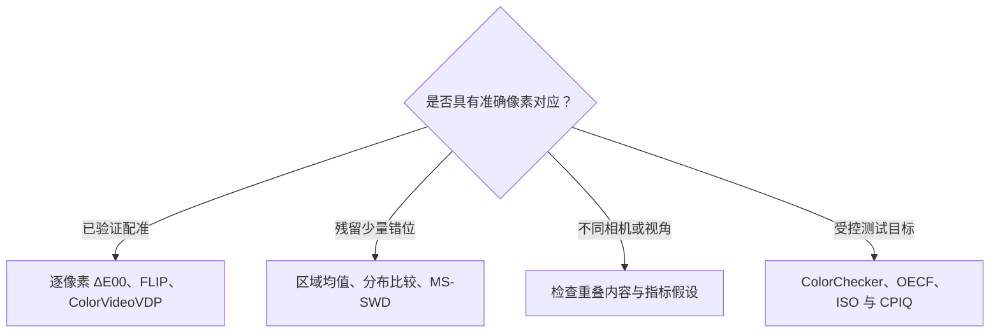

<!-- Generated by scripts/build.py from data/*.yaml and data/i18n/*.yaml. Edit the source data. -->

# Awesome Color Metrics 

**色差与对比度评测文献库，按像素配准要求组织，收录论文、代码与工具箱实现。**

  

**[English](README.md) · [简体中文](README.zh-CN.md) · [交互网页](https://ruilin.li/Awesome-Color-Metrics/zh-CN.html) · [实现索引](CODE.zh-CN.md) · [色差指标入门](guide/color-metrics-101.zh-CN.md) · [参与贡献](CONTRIBUTING.zh-CN.md)**

本列表围绕一个实际问题组织文献：**参考图像与待测图像是否必须逐像素配准？** 收录色差公式与均匀色空间、空间视觉模型、摄影图像感知色差、对比度与色调、分布与深度特征指标，以及白平衡误差、测试图卡和评测协议。每个条目注明配准要求、颜色敏感性、输出形式及实现来源。

现有 **164 条记录**，其中 **91 条带可用实现**（官方、工具箱或第三方），**58 条标为容忍小幅错位或无需像素配准**，另有 **15 个数据集**。每篇文献只归入一个主分类，导航分组不增加重复计数。

**文献更新：2026-11-06；全库链接检查：2026-10-11。** 两者分别记录；详见[来源与更新说明](guide/literature-update-2026-11-06.zh-CN.md)。

**阅读方式。** 正式英文标题用于核对文献，下方提供中文译名、摘要与备注。各分类按配准要求分组，组内优先列出有实现的条目，再按年份降序。专用色差、风格匹配、颜色真实感和语义相似性测量的对象不同，应结合备注使用。

## 目录

- [色差指标入门](#色差指标入门)
- [按配准要求选择指标](#按配准要求选择指标)
- [研究脉络](#研究脉络)
- [论文与指标](#论文与指标)
  - [色差公式与均匀色空间](#色差公式与均匀色空间)（23 条）
  - [空间视觉与可见性色差](#空间视觉与可见性色差)（11 条）
  - [考虑颜色的全参考图像质量评价](#考虑颜色的全参考图像质量评价)（11 条）
  - [对比度、色调与动态范围](#对比度色调与动态范围)（10 条）
  - [摄影图像的感知色差](#摄影图像的感知色差)（11 条）
  - [全局统计与颜色直方图](#全局统计与颜色直方图)（10 条）
  - [图像块分布与平移容忍结构](#图像块分布与平移容忍结构)（4 条）
  - [适应错位的深度特征指标](#适应错位的深度特征指标)（29 条）
  - [非配准真值的评测协议](#非配准真值的评测协议)（16 条）
  - [白平衡与光源估计误差](#白平衡与光源估计误差)（5 条）
  - [测试图卡与相机标准](#测试图卡与相机标准)（17 条）
  - [基准、心理物理与综述](#基准心理物理与综述)（17 条）
- [数据集](#数据集)
- [工具与程序库](#工具与程序库)
- [学习资料](#学习资料)
- [相关列表](#相关列表)
- [参与贡献](#参与贡献)
- [关于本列表](#关于本列表)
- [许可](#许可)

## 色差指标入门

将待测图像写为 **I₂(x) = P[I₁(T(x))] + n**：T 是希望排除的几何变化，P 是需要测量的颜色或对比度变化，n 是噪声。残留错位会让边缘混入色差；可先在区域或分布上聚合，再比较差异，同时报告空间细节被舍弃的代价。

详细说明见[中文指南](guide/color-metrics-101.zh-CN.md)，可用 [`shift_vs_cast.py`](guide/shift_vs_cast.py) 比较真实色偏与纯错位引起的读数。

## 按配准要求选择指标

| 配准要求 | 含义 |
|:--|:--|
| **需要像素配准** | 比较相同像素或窗口的数值，残留错位会影响读数。 |
| **容忍小幅错位** | 设计或实验支持亚像素至数像素范围的错位容忍能力。 |
| **无需像素配准** | 比较全局统计、分布或单幅图像特征，不依赖逐像素对应。 |
| **已知测试目标** | 在测试图卡上与已知参考值比较，读取色块中心可减少错位影响。 |
| **逐颜色对** | 比较两个颜色或单个刺激，图像配准要求取决于如何聚合。 |

| 颜色标签 | 含义 |
|:--|:--|
| **专用色差** | 针对色差设计并经过相关数据验证。 |
| **显式颜色建模** | 显式使用色度通道或颜色数值。 |
| **部分颜色敏感** | 接收彩色输入，但未经专用色差验证，可能忽略色偏。 |
| **仅亮度** | 只使用亮度信息，无法测量纯色度变化。 |

下表只统计具有配准标签的指标与协议，不含不适用这些标签的研究论文。

| 分类 | 需要配准 | 容忍小幅错位 | 无需像素配准 | 已知目标 | 逐颜色对 | 合计 |
|:--|--:|--:|--:|--:|--:|--:|
| ΔE 公式与色空间 | · | · | · | · | 23 | 23 |
| 空间色差与 VDP | 11 | · | · | · | · | 11 |
| 彩色全参考 IQA | 11 | · | · | · | · | 11 |
| 对比度与色调 | 7 | · | 2 | · | 1 | 10 |
| 摄影图像色差 | 4 | 5 | 2 | · | · | 11 |
| 直方图与全局统计 | · | 1 | 9 | · | · | 10 |
| 图像块与平移容忍 | · | 1 | 3 | · | · | 4 |
| 深度特征与错位 | 2 | 7 | 20 | · | · | 29 |
| 非配准评测协议 | 13 | 2 | 1 | · | · | 16 |
| 白平衡误差 | · | · | 5 | · | · | 5 |
| 图卡与相机标准 | 2 | · | · | 15 | · | 17 |
| **合计** | **50** | **16** | **42** | **15** | **24** | **147** |

## 研究脉络

- **从均匀色块走向摄影图像。** 经典色差公式拟合的是均匀色块判断。SPCD 提供 30,000 对真实手机照片评分，使学习式和分布式指标能够对照整图感知判断评价，并包含残留错位情形。 代表条目：CIEDE2000 → SPCD / CD-Net → CD-Flow → CD-iNet → MS-SWD → CD-Reasoning
- **通过分布放宽像素对应。** 颜色直方图、图像块分布、特征统计与 Gram 矩阵放宽逐像素对应；裁剪、场景变化和特征提取器仍会影响分数，舍弃位置不代表对所有几何变换不变。 代表条目：Histogram / EMD → sliced Wasserstein → GPDM → MS-SWD · DISTS → DeepWSD → DOSS → DeepSSIM → DeepDC
- **区分错位容忍与颜色敏感性。** 平移下稳定并不能证明对白平衡色偏或彩度误差敏感。归一化、仅亮度处理与语义特征可能削弱某些颜色变化，应在相同协议下分别测试真实颜色变化和仅有错位的对照。 代表条目：SSIM · CW-SSIM · DeepSSIM vs mean ΔE00 · Lab Wasserstein · MS-SWD
- **视觉模型扩展到颜色与真实显示。** 空间 ΔE 发展为具有彩色对比敏感度、考虑显示设备的可见差异预测器，也延伸到通过相机测量真实显示器并估计不确定度。 代表条目：S-CIELAB → FLIP → HDR-VDP-3 → castleCSF → ColorVideoVDP → CameraVDP
- **HDR、宽色域与高光适应。** 基于 PQ 和颜色外观的空间把色差扩展到高亮度与宽色域。超过漫反射白的高光判断推动 IPT-LCs 等修正；结果依赖亮度、适应状态和验证数据。 代表条目：ΔE ITP · Jzazbz · CAM16-UCS · sUCS · PCS26-UCS · IPT-LCs
- **上下文、空间布局与语言。** 背景、空间模式和图像内容都会影响颜色差异判断。多模态指标可用文字解释差异，TPIPS 还支持文本指定属性，但应区分差异幅度、属性相似性、风格和真实感。 代表条目：Color difference in context · Texture-dependent color tolerances · CD-Reasoning · TPIPS · ICTone · CFM
- **局部判别与可见图像差异。** 经验三维判别场、神经 Fisher 信息模型和简化黎曼线元描述局部颜色阈值；拟合判别数据并不能直接验证阈上摄影色差，评价模型的方法本身也需要考察。 代表条目：Empirical 3D color metric field · V1 Fisher color metric · Conformally-Euclidean line element · STRESS review
- **用其他视角作为参考。** 新视角合成缺少测试位姿的真值；近期方法利用邻近视角交叉注意力、不依赖对齐的嵌入、重叠区域质量图补全或整场景特征分布评价渲染结果。 代表条目：Puzzle Similarity → CrossScore → NOVA → PR-IQA → SCODA

## 论文与指标

### 色差公式与均匀色空间

将颜色对转换为差异数值。逐像素使用时需要准确配准，比较区域均值或分布时可放宽位置对应；涵盖 CIELAB、CIEDE2000、CAM16-UCS，以及 HDR 和宽色域度量。

**逐颜色对（23）**

| 论文与指标 | 发表信息 | 颜色与输出 | 实现 |
|:--|:--|:--|:--|
| **[Helmlab: A Two-Space Family of Analytical, Data-Driven Color Spaces for UI Design Systems](https://arxiv.org/abs/2602.23010)** Helmlab：面向界面设计系统的双空间解析与数据驱动色空间族 Helmlab · 以学习矩阵、幂压缩、傅里叶色相校正及 Helmholtz–Kohlrausch 明度项构造 XYZ 到 Lab 的解析变换；作者报告 MetricSpace 在 COMBVD 上的 STRESS 为 22.5，CIEDE2000 为 29.2。 <i>备注：单作者预印本；作者报告在 He 等人 2022 年的三维打印样本上弱于 CIEDE2000。另一空间 GenSpace 面向渐变生成。</i> | arXiv 2026 | 专用色差 分数 | [GitHub](https://github.com/Grkmyldz148/helmlab) [pip · `helmlab`](https://pypi.org/project/helmlab/) |
| **[Simple color appearance model (sCAM) based on simple uniform color space (sUCS)](https://doi.org/10.1364/OE.510196)** 基于简单均匀色空间 sUCS 的简单颜色外观模型 sCAM sUCS / sCAM · 采用较简单的均匀空间与外观模型结构，在 28 组均匀性和 6 组色相线性数据上，综合排名为第一或第二。 | Opt Express 2024 | 专用色差 分数 | [colour · `XYZ_to_sUCS` / `sCAM`](https://github.com/colour-science/colour) |
| **[ZCAM, a colour appearance model based on a high dynamic range uniform colour space](https://doi.org/10.1364/OE.413659)** ZCAM：基于高动态范围均匀色空间的颜色外观模型 ZCAM · 基于 Jzazbz 预测 HDR 内容的十种外观属性，论文报告其预测精度至少可与 CIECAM02、CAM16 相当。 | Opt Express 2021 | 专用色差 分项结果 | [colour · `XYZ_to_ZCAM`](https://github.com/colour-science/colour) |
| **[Distance metrics for very large color differences](https://doi.org/10.1002/col.22451)** 用于极大色差的距离度量 HyAB · 将明度的城市街区距离与 a\*b\* 平面的欧氏距离相加；在论文测试的极大色差（约 10 ΔE\*ab 以上）条件下表现较好，也用于 FLIP。 | Color Res Appl 2020 | 专用色差 分数 | [colour · `HyAB` / `HyCH`](https://github.com/colour-science/colour) |
| **[A perceptual color space for image processing](https://bottosson.github.io/posts/oklab/)** 面向图像处理的感知色空间 Oklab · 采用矩阵、LMS 立方根和矩阵组成的 IPT 类结构，拟合 CAM16 的明度和彩度及 IPT 的色相；欧氏距离 ΔEOK 用于 CSS Color 4 的色域映射。 <i>备注：优化目标是外观均匀性与色相线性，并非色差判断数据；其 COMBVD STRESS 明显高于 CIEDE2000，参见 Oklch+。</i> | Blog 2020 | 专用色差 分数 | [colour · `XYZ_to_Oklab`](https://github.com/colour-science/colour) [CSS Color 4 · `oklab()` / ΔEOK](https://www.w3.org/TR/css-color-4/) |
| **[ITU-R BT.2124-0: Objective metric for the assessment of the potential visibility of colour differences in television](https://www.itu.int/rec/R-REC-BT.2124-0-201901-I/en)** ITU-R BT.2124-0：电视颜色差异潜在可见性的客观评价指标 ΔE ITP · 对 BT.2100 PQ 信号计算 ICtCp 中的 720·‖Δ(I,T,P)‖；在最敏感适应状态下，1 单位约对应一个恰可察觉差异。 <i>备注：可从 itu.int 免费下载推荐文件的 PDF。</i> | ITU-R Rec. 2019 | 专用色差 分数 | [colour · `ITP`](https://github.com/colour-science/colour) |
| **[Comprehensive color solutions: CAM16, CAT16, and CAM16-UCS](https://doi.org/10.1002/col.22131)** 综合颜色解决方案：CAM16、CAT16 与 CAM16-UCS CAM16-UCS · 作为 CIECAM02 的简化后继模型，引入 CAT16 色适应变换，并在给定观察条件下通过均匀空间度量色差。 | Color Res Appl 2017 | 专用色差 分数 | [colour · `CAM16-UCS / -LCD / -SCD`](https://github.com/colour-science/colour) |
| **[Perceptually uniform color space for image signals including high dynamic range and wide gamut](https://doi.org/10.1364/OE.25.015131)** 面向高动态范围与宽色域图像信号的感知均匀色空间 Jzazbz · 采用 PQ 非线性与绝对亮度输入，面向 HDR 和宽色域信号，同时关注大小色差预测与色相线性。 | Opt Express 2017 | 专用色差 分数 | [colour · `XYZ_to_Jzazbz`](https://github.com/colour-science/colour) |
| **[Power functions improving the performance of color-difference formulas](https://doi.org/10.1364/OE.23.000597)** 利用幂函数提高色差公式的预测性能 Power functions · 分别为各公式拟合幂律修正 ΔE′ = a·ΔE^b，改善 CIEDE2000、CAM02-UCS 等公式与视觉判断的一致性。 | Opt Express 2015 | 专用色差 分数 | [colour · `power_function_Huang2015`](https://github.com/colour-science/colour) |
| **[Uniform colour spaces based on CIECAM02 colour appearance model](https://doi.org/10.1002/col.20227)** 基于 CIECAM02 颜色外观模型的均匀色空间 CAM02-UCS · 从 CIECAM02 推导适用于小色差（SCD）、大色差（LCD）与一般色差（UCS）的三种均匀空间，并考虑观察条件。 | Color Res Appl 2006 | 专用色差 分数 | [colour · `CAM02-UCS / -LCD / -SCD`](https://github.com/colour-science/colour) |
| **[Uniform colour spaces based on the DIN99 colour-difference formula](https://doi.org/10.1002/col.10066)** 基于 DIN99 色差公式的均匀色空间 DIN99 · 通过明度的对数变换，以及彩度轴旋转与压缩，使欧氏距离近似感知差异，包含 DIN99 及 DIN99b–d 变体。 | Color Res Appl 2002 | 专用色差 分数 | [colour · `DIN99`](https://github.com/colour-science/colour) |
| **[The development of the CIE 2000 colour-difference formula: CIEDE2000](https://doi.org/10.1002/col.1049)** CIE 2000 色差公式 CIEDE2000 的建立 CIEDE2000 · 加入明度、彩度和色相权重、蓝色区域的彩度与色相交互项，以及灰色区域 a\* 轴缩放，是现行 CIE / ISO 标准色差公式。 <i>备注：应使用 Sharma、Wu 与 Dalal 的测试数据验证实现（Color Res Appl 2005，DOI：10.1002/col.20070），代码链接同时提供该数据。</i> | Color Res Appl 2001 | 专用色差 分数 | [代码](https://hajim.rochester.edu/ece/sites/gsharma/ciede2000/) [colour · `CIE 2000`](https://github.com/colour-science/colour) [scikit-image · `deltaE_ciede2000`](https://github.com/scikit-image/scikit-image) [ciede2000-color-matching (40+ languages)](https://github.com/michel-leonard/ciede2000-color-matching) |
| **[CIE94 – a new colour-difference formula](https://doi.org/10.1111/j.1478-4408.1995.tb01688.x)** CIE94：一种新的色差公式 CIE94 · 在 CIELAB 基础上，按彩度对 ΔC 和 ΔH 加权；对应 CIE 116-1995，是 ΔE\*ab 与 CIEDE2000 之间的 CIE 推荐公式。 | J Soc Dyers Colourists 1995 | 专用色差 分数 | [colour · `CIE 1994`](https://github.com/colour-science/colour) [scikit-image · `deltaE_ciede94`](https://github.com/scikit-image/scikit-image) |
| **[Modification to the JPC79 Colour-difference Formula](https://doi.org/10.1111/j.1478-4408.1984.tb00969.x)** JPC79 色差公式的修订 CMC l:c · 依据颜色在色空间中的位置，为明度、彩度和色相差异加权；l:c（通常为 2:1）用于区分可接受性与可感知性，交换两个输入可能得到不同结果。 | J Soc Dyers Colourists 1984 | 专用色差 分数 | [colour · `CMC`](https://github.com/colour-science/colour) [scikit-image · `deltaE_cmc`](https://github.com/scikit-image/scikit-image) |
| **[CIE 015:2018 Colorimetry, 4th Edition (current definition of CIELAB and ΔE\*ab, introduced in 1976)](https://doi.org/10.25039/TR.015.2018)** CIE 015:2018《色度学》第四版：CIELAB 与 ΔE\*ab 的现行定义（1976 年提出） CIELAB ΔE\*ab (CIE76) · 计算 CIELAB 空间中的欧氏距离。公式简单、应用广泛，但会过度放大高饱和度颜色的色度差异。 <i>备注：链接指向需付费的 CIE 015:2018 报告；公式可在常用色度学教材中找到。</i> | CIE TR 1976 | 专用色差 分数 | [colour · `CIE 1976`](https://github.com/colour-science/colour) [scikit-image · `deltaE_cie76`](https://github.com/scikit-image/scikit-image) |
| **[A conformally-Euclidean Line Element for evaluating color differences](https://arxiv.org/abs/2606.12588)** 用于色差评价的共形欧氏线元 Conformally-Euclidean line element · 为简化局部颜色判别的几何结构，以依赖亮度的因子缩放欧氏线元，推导类似 CIELAB 的感知坐标，并拟合表面色判别数据。 <i>备注：面向局部判别，不等同于已验证的整幅摄影图像色差指标；采用 2026 年 9 月修订版。</i> | arXiv 2026 | 专用色差 分数 | — |
| **[Color difference characterization for stimuli with luminance beyond diffuse white](https://doi.org/10.1364/OE.609373)** 亮度超过漫反射白的刺激色差表征 IPT-LCs · 为度量 HDR 高光色差，在 203 cd/m² 的 D65 漫反射白下收集 980 对、亮度为 194–977 cd/m² 的颜色判断，将 IPT 优化为 IPT-LCs，并评价白点亮度上下的刺激。 <i>备注：实验针对指定适应条件下的色块，不是空间 HDR 图像质量评价。</i> | Opt Express 2026 | 专用色差 分数 | — |
| **[Perceptual Color Difference Modeling Using Machine Learning and Human Similarity Judgments](https://arxiv.org/abs/2609.39130)** 利用机器学习与人类相似性判断建立感知色差模型 ML color difference (COLIBRI) · 由七位观察者以四级量表评价 2,000 对颜色并训练回归模型；将 COLIBRI 模糊颜色类别特征与 RGB / HSI 差异结合时，LightGBM 达到 R² 0.70。 | arXiv 2026 | 专用色差 分数 | — |
| **[Oklch+: A Three-Parameter Extension of Oklab for Improved Color Difference Prediction](https://arxiv.org/abs/2606.05255)** Oklch+：改进色差预测的三参数 Oklab 扩展 Oklch+ · 为 Oklab 明度加入幂函数、为彩度加入 Naka–Rushton 压缩，使用三个参数拟合色差数据；COMBVD STRESS 为 29.1，与 CIEDE2000 相近，Oklab 为 47.4。 <i>备注：只在以 sRGB 为中心的 COMBVD 数据上评价。</i> | arXiv 2026 | 专用色差 分数 | — |
| **[PCS26-UCS: a perceptually uniform color space preserving additive color mixture](https://doi.org/10.1109/ACCESS.2026.3728597)** PCS26-UCS：保持加色混合性质的感知均匀色空间 PCS26-UCS · 让加色混合仍沿直线变化，同时达到接近 CAM16-UCS 的均匀性并改善色相线性。 | IEEE Access 2026 | 专用色差 分数 | — |
| **[A Metric for Three-Dimensional Color Discrimination Derived from V1 Population Fisher Information](https://arxiv.org/abs/2603.24356)** 从 V1 神经元群体 Fisher 信息推导三维颜色判别度量 V1 Fisher color metric · 为联系判别阈值与神经编码，从色适应、对立通道及 V1 群体 Fisher 信息推导黎曼度量；用四组阈值数据中的 96 种判别条件拟合 17 个参数。 <i>备注：预印本只拟合阈值数据，拟合统计量不足以证明其对大色差或摄影图像有效。</i> | arXiv 2026 | 专用色差 分数 | — |
| **[Towards perceptual uniformity and HDR-WCG image processing: a projection-based color space](https://doi.org/10.1364/OE.530213)** 面向感知均匀性与 HDR 宽色域图像处理的投影色空间 HDR-WCG projection space · 通过两个三维投影矩阵及修订的非线性构造 HDR / 宽色域空间，并使用 STRESS、PU-PSNR、PU-SSIM 与 HDR-VDP-3 评价。 | Opt Express 2024 | 专用色差 分数 | — |
| **[Riemannian color difference metric for spatial sinusoidal color variations](https://doi.org/10.1364/OE.520947)** 用于空间正弦颜色变化的黎曼色差度量 Riemannian sinusoidal ΔE · 针对颜色在空间中呈正弦变化的刺激建立黎曼度量，使色差随空间频率变化，而非只比较两块均匀颜色。 | Opt Express 2024 | 专用色差 分数 | — |

### 空间视觉与可见性色差

通过对比敏感度滤波、交替显示差异或显示设备模型预测空间色差，包括 S-CIELAB、FLIP、HDR-VDP 与 ColorVideoVDP；逐像素差异图需要图像对应。

**需要像素配准（11）**

| 论文与指标 | 发表信息 | 颜色与输出 | 实现 |
|:--|:--|:--|:--|
| **[ColorVideoVDP-ML: visual difference predictor with a neural regressor for image and video quality prediction](https://doi.org/10.1109/ICMEW68306.2025.11152234)** ColorVideoVDP-ML：利用神经回归器预测图像与视频质量的视觉差异模型 ColorVideoVDP-ML · 以神经回归器替换 ColorVideoVDP 的人工汇聚规则，用于图像和视频质量预测。 <i>备注：ColorVideoVDP 仓库提供 cvvdp-ml-saliency 与 cvvdp-ml-transformer 两个实现。</i> | ICMEW 2025 | 专用色差 分数 | [GitHub](https://github.com/gfxdisp/ColorVideoVDP) |
| **[ColorVideoVDP: a visual difference predictor for image, video and display distortions](https://doi.org/10.1145/3658144)** ColorVideoVDP：面向图像、视频及显示失真的视觉差异预测器 ColorVideoVDP · 以彩色时空对比敏感度模型 castleCSF 与跨通道掩蔽构建全参考指标，针对指定显示设备输出 JOD 分数和逐像素失真图。 <i>备注：模型会把 1 像素错位视为可见差异，因此不适用于未配准图像对，详见指南。</i> | ACM TOG (SIGGRAPH) 2024 | 专用色差 差异图 | [GitHub](https://github.com/gfxdisp/ColorVideoVDP) [pip · `cvvdp`](https://pypi.org/project/cvvdp/) |
| **[HDR-VDP-3: a multi-metric for predicting image differences, quality and contrast distortions in high dynamic range and regular content](https://arxiv.org/abs/2304.13625)** HDR-VDP-3：预测 HDR 与普通内容的图像差异、质量及对比度失真的多任务指标 HDR-VDP-3 · 由经过显示标定的输入同时预测三种结果：JOD 质量分数、可见差异概率图，以及对比度损失或增强图。 <i>备注：仅亮度模型；当前发布版本为 HDR-VDP-3.0.7，采用 GPLv2 许可。</i> | arXiv 2023 | 仅亮度 差异图 | [代码](https://sourceforge.net/projects/hdrvdp/) |
| **[Visualizing Errors in Rendered High Dynamic Range Images](https://doi.org/10.2312/egs.20211015)** 渲染高动态范围图像误差的可视化 HDR-FLIP · 在一组曝光下对 HDR 图像进行色调映射，再逐像素取最大的 LDR-FLIP 误差，将 FLIP 扩展到 HDR。 <i>备注：实现与 FLIP 位于同一仓库。</i> | Eurographics (short) 2021 | 专用色差 差异图 | [GitHub](https://github.com/NVlabs/flip) |
| **[FLIP: a difference evaluator for alternating images](https://doi.org/10.1145/3406183)** FLIP：用于交替显示图像的差异评价器 FLIP · 将对比敏感度滤波后的 HyAB 颜色分支与边缘、点特征分支结合，生成近似观察者切换两幅图像时所见差异的误差图。 | ACM PACMCGIT 2020 | 专用色差 差异图 | [GitHub](https://github.com/NVlabs/flip) [pip · `flip-evaluator`](https://pypi.org/project/flip-evaluator/) |
| **[Image quality assessment and color difference](https://doi.org/10.1109/GlobalSIP.2014.7032265)** 图像质量评价与色差 CD-IQA (Temel 2014) · 研究逐像素色差公式作为全参考质量估计器的表现，以及如何汇聚这些局部差异。 | GlobalSIP 2014 | 专用色差 分数 | [GitHub](https://github.com/olivesgatech/Color-Difference-for-IQA) |
| **[HDR-VDP-2: a calibrated visual metric for visibility and quality predictions in all luminance conditions](https://doi.org/10.1145/2010324.1964935)** HDR-VDP-2：适用于各种亮度条件的标定可见性与质量预测指标 HDR-VDP-2 · 从绝对光度输入出发，对光学、感光细胞、对比敏感度与掩蔽建模，预测不同亮度范围下的可见性图及质量。 <i>备注：只对非彩色视觉建模；ColorVideoVDP 是面向彩色的后继模型。</i> | ACM TOG 2011 | 仅亮度 差异图 | [代码](https://sourceforge.net/projects/hdrvdp/) |
| **[A spatial extension of CIELAB for digital color-image reproduction](https://doi.org/10.1889/1.1985127)** 面向数字彩色图像再现的 CIELAB 空间扩展 S-CIELAB · 先变换至颜色对立空间，分别用各通道的对比敏感度滤波器模糊，再变换回去逐像素计算 ΔE；需要以每视角度像素数指定观察条件。 <i>备注：低通滤波本身并不使指标具有错位容忍能力，详见入门指南。</i> | J Soc Inf Display 1997 | 专用色差 差异图 | [GitHub](https://github.com/wandell/SCIELAB-1996) |
| **[Evaluating the multi-scale iCID metric](https://doi.org/10.1117/12.2078879)** 多尺度 iCID 指标评价 MS-iCID · 构建 iCID 的多尺度版本，并使用主观图像差异数据进行评价。 | Proc SPIE 2015 | 专用色差 分数 | — |
| **[Color-image quality assessment: from prediction to optimization](https://doi.org/10.1109/TIP.2014.2302684)** 彩色图像质量评价：从预测到优化 iCID · 改进 CID，在改善主观差异预测的同时，使其能够作为色域映射的优化目标，减少优化产生的伪影。 | IEEE TIP 2014 | 专用色差 分项结果 | — |
| **[Image-difference prediction: from grayscale to color](https://doi.org/10.1109/TIP.2012.2216279)** 图像差异预测：从灰度到彩色 CID · 归一化后提取明度、彩度、色相与结构特征，组合成具有可解释分项的图像差异分数，并用色域映射图像调参。 | IEEE TIP 2013 | 专用色差 分项结果 | — |

### 考虑颜色的全参考图像质量评价

在已配准图像对上结合颜色、对比度与结构进行评价，涵盖 FSIMc、VSI、LPIPS 和 EDOKS。部分方法可分离颜色与纹理证据，但单一质量分数不能完整解释变化来源。

**需要像素配准（11）**

| 论文与指标 | 发表信息 | 颜色与输出 | 实现 |
|:--|:--|:--|:--|
| **[A new image similarity metric for a perceptual and transparent geometric and chromatic assessment](https://doi.org/10.1007/s44163-026-02424-4)** 用于可解释几何与颜色评价的新图像相似度指标 EDOKS · 为分离纹理和颜色误差，将聚类后的 Gabor 能量特征 EMD 与逐像素 Oklab 平均距离结合，输出相似度及独立证据图，并用 BAPPS 判断评价。 <i>备注：纹理项比较分布，但 Oklab 颜色项仍需要像素对应。2026 年 10 月发表；预印本为 arXiv:2601.19680。</i> | Discover Artif Intell 2026 | 显式颜色建模 分项结果 | [GitHub](https://github.com/antdimarino/EDOKS) |
| **[The Unreasonable Effectiveness of Deep Features as a Perceptual Metric](https://openaccess.thecvf.com/content_cvpr_2018/html/Zhang_The_Unreasonable_Effectiveness_CVPR_2018_paper.html)** 深度特征作为感知指标的有效性研究 LPIPS · 在对应空间位置上计算归一化深度特征的加权 L2 距离，并以 BAPPS 人类二选一判断标定。 <i>备注：逐位置比较使其对错位敏感；可参阅深度特征分类中的 ST-LPIPS 与 E-LPIPS。</i> | CVPR 2018 | 部分颜色敏感 差异图 | [GitHub](https://github.com/richzhang/PerceptualSimilarity) [pip · `lpips`](https://pypi.org/project/lpips/) [pyiqa · `lpips`](https://github.com/chaofengc/IQA-PyTorch) |
| **[PieAPP: Perceptual Image-Error Assessment through Pairwise Preference](https://openaccess.thecvf.com/content_cvpr_2018/html/Prashnani_PieAPP_Perceptual_Image-Error_CVPR_2018_paper.html)** PieAPP：通过成对偏好评价感知图像误差 PieAPP · 从成对偏好概率学习图像块感知误差，再使用学习得到的权重汇聚。 | CVPR 2018 | 部分颜色敏感 分数 | [GitHub](https://github.com/prashnani/PerceptualImageError) [pyiqa · `pieapp`](https://github.com/chaofengc/IQA-PyTorch) [piq · `PieAPP`](https://github.com/photosynthesis-team/piq) |
| **[CSV: Image quality assessment based on color, structure, and visual system](https://doi.org/10.1016/j.image.2016.08.008)** CSV：结合颜色、结构与视觉系统的图像质量评价 CSV · 融合 CIEDE2000、颜色名称描述子的 EMD、归一化结构图及视网膜对比敏感度图，评价感知变化而非单纯的绝对颜色变化。 | Signal Process Image Commun 2016 | 专用色差 分数 | [GitHub](https://github.com/olivesgatech/CSV) |
| **[Mean deviation similarity index: efficient and reliable full-reference image quality evaluator](https://doi.org/10.1109/ACCESS.2016.2604042)** 均值偏差相似性指标：高效可靠的全参考图像质量评价 MDSI · 结合梯度相似性与高斯颜色模型中的联合色度相似性，再按偏差汇聚为单个分数，0 表示完全一致。 | IEEE Access 2016 | 显式颜色建模 分数 | [piq · `mdsi`](https://github.com/photosynthesis-team/piq) |
| **[PerSIM: Multi-resolution image quality assessment in the perceptually uniform color domain](https://doi.org/10.1109/ICIP.2015.7351087)** PerSIM：感知均匀颜色域中的多分辨率图像质量评价 PerSIM · 在 CIELAB 中以多分辨率比较明度与彩度通道，并采用受视网膜启发的滤波。 | ICIP 2015 | 显式颜色建模 分数 | [GitHub](https://github.com/olivesgatech/PerSIM) |
| **[VSI: a visual saliency-induced index for perceptual image quality assessment](https://doi.org/10.1109/TIP.2014.2346028)** VSI：由视觉显著性驱动的感知图像质量指标 VSI · 将视觉显著图同时用作相似性特征及汇聚权重，并结合梯度与颜色对立空间中的色度相似性。 | IEEE TIP 2014 | 显式颜色建模 分数 | [pyiqa · `vsi`](https://github.com/chaofengc/IQA-PyTorch) [piq · `vsi`](https://github.com/photosynthesis-team/piq) |
| **[FSIM: a feature similarity index for image quality assessment](https://doi.org/10.1109/TIP.2011.2109730)** FSIM：面向图像质量评价的特征相似性指标 FSIMc · 在亮度通道比较相位一致性和梯度幅值；彩色版本 FSIMc 额外加入 YIQ 色度相似性项。 <i>备注：输出单个分数。逐像素特征比较使其对亚像素错位敏感，详见指南。</i> | IEEE TIP 2011 | 显式颜色建模 分数 | [pyiqa · `fsim`](https://github.com/chaofengc/IQA-PyTorch) [piq · `fsim`](https://github.com/photosynthesis-team/piq) |
| **[MaD-DLS: mean and deviation of deep and local similarity for image quality assessment](https://doi.org/10.1109/TMM.2020.3037482)** MaD-DLS：以深度与局部相似性的均值和偏差评价图像质量 MaD-DLS · 将深度特征和局部相似性图的均值、标准差汇聚为质量分数。 | IEEE TMM 2021 | 部分颜色敏感 分数 | — |
| **[DeepSim: deep similarity for image quality assessment](https://doi.org/10.1016/j.neucom.2017.01.054)** DeepSim：用于图像质量评价的深度相似性 DeepSim · 在对应位置比较预训练 CNN 特征的局部相似性，再跨层汇聚；比较均值、偏差与分位数汇聚方法。 <i>备注：请勿与 DeepSSIM 混淆。</i> | Neurocomputing 2017 | 部分颜色敏感 分数 | — |
| **[Quaternion Structural Similarity: A New Quality Index for Color Images](https://doi.org/10.1109/TIP.2011.2181522)** 四元数结构相似性：一种彩色图像质量指标 QSSIM · 将每个 RGB 像素表示为四元数，从而跨颜色通道联合计算类似 SSIM 的亮度、对比度与结构项。 | IEEE TIP 2012 | 显式颜色建模 分数 | — |

### 对比度、色调与动态范围

涵盖全局与局部对比度、Peli 带限对比度、SSIM 对比度项、DRIM 可见性变化，以及 HDR 色调映射评价；多数方法仅使用亮度。

**需要像素配准（7）**

| 论文与指标 | 发表信息 | 颜色与输出 | 实现 |
|:--|:--|:--|:--|
| **[Adapting Quality Metrics to Tone Mapping](https://doi.org/10.1145/3799902.3811107)** 使质量指标适用于色调映射 TM metric adaptation · 通过显示模型将 HDR 参考与 SDR 色调映射结果转换为光度值，再以感知传递函数统一编码，使通用指标适用于该任务，并提出 ColorVideoVDP-tm。 <i>备注：数据集为 TMQ-ME（DOI：10.17863/CAM.129808）；项目页为 kenchen10.github.io/projects/tmometric。</i> | SIGGRAPH 2026 | 显式颜色建模 分数 | [GitHub](https://github.com/NYU-ICL/TM-metric-adaptation) |
| **[Gradient magnitude similarity deviation: a highly efficient perceptual image quality index](https://doi.org/10.1109/TIP.2013.2293423)** 梯度幅值相似性偏差：高效的感知图像质量指标 GMSD · 逐像素比较亮度图像的 Prewitt 梯度幅值，再以相似性图的标准差汇聚为单个分数。 | IEEE TIP 2014 | 仅亮度 分数 | [pyiqa · `gmsd`](https://github.com/chaofengc/IQA-PyTorch) [piq · `gmsd`](https://github.com/photosynthesis-team/piq) |
| **[Objective quality assessment of tone-mapped images](https://doi.org/10.1109/TIP.2012.2221725)** 色调映射图像的客观质量评价 TMQI · 结合相对 HDR 参考的多尺度结构保真度与 LDR 色调映射图像的统计自然度，仅使用亮度信息。 | IEEE TIP 2013 | 仅亮度 分数 | [代码](https://eceweb.uwaterloo.ca/~z70wang/research/tmqi/) |
| **[Image quality assessment: from error visibility to structural similarity](https://doi.org/10.1109/TIP.2003.819861)** 图像质量评价：从误差可见性到结构相似性 SSIM · 比较局部亮度、对比度与结构；对比度项 c = 2σxσy/(σx²+σy²) 对称且经过压缩，无法区分对比度增加或减小。 <i>备注：局部归一化会削弱全局光度变化的影响；对色偏的响应需结合所用颜色通道与实现检查，详见指南。</i> | IEEE TIP 2004 | 部分颜色敏感 差异图 | [scikit-image · `structural_similarity`](https://github.com/scikit-image/scikit-image) [pyiqa · `ssim` / `ssimc`](https://github.com/chaofengc/IQA-PyTorch) |
| **[Multiscale structural similarity for image quality assessment](https://doi.org/10.1109/ACSSC.2003.1292216)** 用于图像质量评价的多尺度结构相似性 MS-SSIM · 在二倍下采样金字塔上计算 SSIM 对比度与结构项，只在最粗尺度计算亮度项，并采用心理物理实验拟合的尺度权重。 | Asilomar 2003 | 仅亮度 分数 | [pyiqa · `ms_ssim`](https://github.com/chaofengc/IQA-PyTorch) [piq · `multi_scale_ssim`](https://github.com/photosynthesis-team/piq) |
| **[High Dynamic Range Image Compression by Optimizing Tone Mapped Image Quality Index](https://doi.org/10.1109/TIP.2015.2436340)** 通过优化色调映射图像质量指标实现 HDR 图像压缩 TMQI-II · 修订 TMQI 的结构保真度和自然度项，并将改进后的指标用作色调映射优化目标。 | IEEE TIP 2015 | 仅亮度 分数 | — |
| **[Dynamic range independent image quality assessment](https://doi.org/10.1145/1360612.1360668)** 与动态范围无关的图像质量评价 DRIM · 针对不同动态范围图像输出三种概率图：可见对比度损失、不可见对比度放大，以及对比度反转。 <i>备注：模型刻意对轻微色调曲线变化不敏感，报告的是可见性变化，而非对比度幅度变化。</i> | ACM TOG (SIGGRAPH) 2008 | 仅亮度 差异图 | — |

**无需像素配准（2）**

| 论文与指标 | 发表信息 | 颜色与输出 | 实现 |
|:--|:--|:--|:--|
| **[Perceived contrast in complex images](https://doi.org/10.1167/13.13.3)** 复杂图像中的感知对比度 Perceived contrast · 利用分类图像实验研究哪些空间频率主导照片对比度判断，主要为每视角度 1–6 周期；仅有 CSF 不足，还需向低频的增益控制。 | J Vision 2013 | 仅亮度 分数 | — |
| **[Contrast in complex images](https://doi.org/10.1364/JOSAA.7.002032)** 复杂图像中的对比度 Peli band-limited contrast · 逐像素、逐倍频程计算局部带限对比度：带通图像除以低一个倍频程的低通图像，同时讨论 RMS 对比度。 <i>备注：逐像素比较对比度图需要配准；逐频带比较其分布则不需要，详见指南。</i> | JOSA A 1990 | 仅亮度 差异图 | — |

**逐颜色对（1）**

| 论文与指标 | 发表信息 | 颜色与输出 | 实现 |
|:--|:--|:--|:--|
| **[castleCSF — a contrast sensitivity function of color, area, spatiotemporal frequency, luminance and eccentricity](https://doi.org/10.1167/jov.24.4.5)** castleCSF：联合颜色、面积、时空频率、亮度与偏心度的对比敏感度函数 castleCSF · 用 18 组数据拟合解析 CSF，覆盖时空频率、任意颜色方向、亮度、背景色度、偏心度与面积，是 ColorVideoVDP 的敏感度模型。 <i>备注：并非独立的图像指标，而是预测微小彩色或非彩色对比是否可见；仓库内提供数据。</i> | J Vision 2024 | 专用色差 分数 | [GitHub](https://github.com/gfxdisp/castleCSF) |

### 摄影图像的感知色差

面向整幅照片的颜色差异设计和验证的指标，多数使用包含非配准子集的 SPCD 手机摄影数据；需区分颜色差异、色调风格匹配与整体质量。

**需要像素配准（4）**

| 论文与指标 | 发表信息 | 颜色与输出 | 实现 |
|:--|:--|:--|:--|
| **[Perceptual color difference measurement for photographic images](https://doi.org/10.1117/12.3117003)** 摄影图像的感知色差测量 Photo CD (Niu 2026) · 利用按目标排序的对比学习训练深度色差模型，使预测差异保持感知上的连续性与次序。 <i>备注：摘要未说明配准、数据集或代码信息。</i> | CVAR (Proc SPIE) 2026 | 专用色差 分数 | — |
| **[Towards a model of color reproduction difference](https://doi.org/10.1002/col.22969)** 迈向颜色再现差异模型 Reproduction difference model · 针对色域映射后的再现图像建立整图视觉差异模型，考虑输出色域和图像内容；论文报告其预测优于平均 ΔE。 | Color Res Appl 2025 | 专用色差 分数 | — |
| **[Calculating color differences of images via siamese neural network](https://doi.org/10.1109/ISCAS58744.2024.10558454)** 利用孪生神经网络计算图像色差 SDR–HDR Siamese CD · 用 504 对 SDR 图像及由其转换得到的 HDR 图像，训练包含颜色空间转换、特征提取与色差预测头的孪生网络。 | ISCAS 2024 | 专用色差 分数 | — |
| **[Perceptual skin tone color difference measurement for portrait photography](https://doi.org/10.1109/VCIP63160.2024.10849890)** 人像摄影中的感知肤色色差测量 Skin-tone CD · 建立含 40,000 组三元组、160,000 次判断的人像肤色色差数据，并训练深度肤色色差指标。 <i>备注：作者宣布将发布数据和代码，但未找到公开资源；未讨论错位容忍能力。</i> | VCIP 2024 | 专用色差 分数 | — |

**容忍小幅错位（5）**

| 论文与指标 | 发表信息 | 颜色与输出 | 实现 |
|:--|:--|:--|:--|
| **[Harnessing Multi-modal Large Language Models for Measuring and Interpreting Color Differences](https://doi.org/10.1109/TIP.2024.3522802)** 利用多模态大语言模型测量并解释色差 CD-Reasoning · 在 M-SPCD 上微调多模态大模型；该数据为 SPCD 增加白平衡、对比度、亮度和颜色等七类属性描述，使模型同时输出分数与文字解释。 <i>备注：检查点位于百度网盘，提取码为 6s5d；未单独列出 M-SPCD 文字标注的下载链接。</i> | IEEE TIP 2025 | 专用色差 文字解释与分数 | [GitHub](https://github.com/LongYu-LY/CD-Reasoning) |
| **[CD-iNet: deep invertible network for perceptual image color difference measurement](https://doi.org/10.1007/s11263-024-02087-7)** CD-iNet：利用深度可逆网络测量感知图像色差 CD-iNet · 通过可逆网络学习颜色坐标变换，使欧氏距离与感知色差对应，输出局部差异图；论文报告对一定几何失真具有鲁棒性。 <i>备注：仅发布演示代码，未发布训练代码。</i> | IJCV 2024 | 专用色差 差异图 | [GitHub](https://github.com/hellooks/CD-iNet) |
| **[Learning a Deep Color Difference Metric for Photographic Images](https://doi.org/10.1109/CVPR52729.2023.02130)** 学习用于摄影图像的深度色差指标 CD-Flow · 用归一化流将图像映射为多尺度特征，再计算欧氏距离；模型学会更多依赖粗尺度，从而容忍小幅几何失真。 | CVPR 2023 | 专用色差 分数 | [GitHub](https://github.com/haoychen3/CD-Flow) |
| **[Measuring Perceptual Color Differences of Smartphone Photographs](https://doi.org/10.1109/TPAMI.2023.3262424)** 智能手机摄影图像的感知色差测量 CD-Net (SPCD) · 建立 30,000 对带主观评分的 SPCD 数据，其中 10,000 对来自六部手机拍摄的相同场景、仅进行全局配准，其余为已对齐的编辑结果；在此基础上训练轻量色差网络。 <i>备注：仓库列出 SPCD 的 Google Drive、百度网盘与 Kaggle 链接；所比较的 33 种方法多数在未严格配准的图像对上表现更差。</i> | IEEE TPAMI 2023 | 专用色差 分数 | [GitHub](https://github.com/hellooks/CDNet) |
| **[Attention-Based Color Difference Perception for Photographic Images](https://doi.org/10.3390/app15052704)** 基于注意力的摄影图像色差感知 CD-Attention · 为结合局部颜色线索和图像上下文，利用 ViT 特征通过可变形注意力引导 CNN，再融合高频与低频评分分支；在 SPCD 及其非配准子集上评价。 <i>备注：论文称可向第一作者申请代码。</i> | Appl Sci 2025 | 专用色差 分数 | — |

**无需像素配准（2）**

| 论文与指标 | 发表信息 | 颜色与输出 | 实现 |
|:--|:--|:--|:--|
| **[Towards In-Context Tone Style Transfer with a Large-Scale Triplet Dataset](https://arxiv.org/abs/2604.16114)** 通过大规模三元组数据集实现上下文色调风格迁移 Tone style scorer (ICTone) · 先进行对比预训练，再用 20,000 次人类排序学习色调风格嵌入，以余弦相似性评价结果是否匹配内容不同的参考图像风格。 <i>备注：测量的是风格匹配，而非一般色差；指标检查点位于 Hugging Face 的 ToneStyle/MetricCkpt。</i> | ECCV 2026 | 显式颜色建模 分数 | [GitHub](https://github.com/dengyuhai/ICTone) |
| **[Multiscale Sliced Wasserstein Distances as Perceptual Color Difference Measures](https://doi.org/10.1007/978-3-031-73668-1_25)** 多尺度切片 Wasserstein 距离作为感知色差指标 MS-SWD · 无需训练，在五层金字塔上比较 11×11 CIELAB 图像块分布的切片 Wasserstein 距离；投影排序不使用像素位置，因此不需要逐像素配准。 <i>备注：也提供投影可训练的变体。随机投影会使结果随种子改变，使用时应固定随机种子。</i> | ECCV 2024 | 专用色差 分数 | [GitHub](https://github.com/real-hjq/MS-SWD) [pyiqa · `msswd`](https://github.com/chaofengc/IQA-PyTorch) |

### 全局统计与颜色直方图

使用颜色矩、丰富色彩感、直方图距离及最优传输等全局信息，不要求逐像素对应；通常无法指出颜色变化发生的位置，裁剪或场景内容变化仍会影响分布。

**容忍小幅错位（1）**

| 论文与指标 | 发表信息 | 颜色与输出 | 实现 |
|:--|:--|:--|:--|
| **[Color and texture descriptors](https://doi.org/10.1109/76.927424)** 颜色与纹理描述子 MPEG-7 color layout · 将图像缩为 8×8 的平均 YCbCr 网格，再计算 DCT 并比较少量低频系数：Y 通道六个，Cb 与 Cr 各三个。 <i>备注：系数选择参照 Kasutani 与 Yamada，ICIP 2001（DOI：10.1109/ICIP.2001.959135）。</i> | IEEE TCSVT 2001 | 显式颜色建模 分数 | — |

**无需像素配准（9）**

| 论文与指标 | 发表信息 | 颜色与输出 | 实现 |
|:--|:--|:--|:--|
| **[Wasserstein barycenter and its application to texture mixing](https://doi.org/10.1007/978-3-642-24785-9_37)** Wasserstein 重心及其在纹理混合中的应用 Sliced Wasserstein distance · 将三维颜色分布投影到随机方向，对每个一维投影排序，再平均一维 Wasserstein 距离；与 EMD 思路相近，但计算更便宜。 <i>备注：理论参见 Bonneel 等，J Math Imaging Vis 2015（DOI：10.1007/s10851-014-0506-3）；只沿 L\*、a\*、b\* 轴投影得到的是逐通道一维 Wasserstein 距离。</i> | SSVM 2011 | 显式颜色建模 分数 | [POT · `ot.sliced_wasserstein_distance`](https://github.com/PythonOT/POT) [本仓库 · guide/shift_vs_cast.py](guide/shift_vs_cast.py) |
| **[Measuring colorfulness in natural images](https://doi.org/10.1117/12.477378)** 自然图像的丰富色彩感测量 Colorfulness · 使用两个颜色对立通道的均值和标准差拟合色彩丰富度评分；两幅图像分数的比值可反映整体饱和度变化。 <i>备注：设计上忽略色相，因此无法检出单纯的色相旋转。</i> | Proc SPIE 2003 | 专用色差 分数 | [本仓库 · guide/shift_vs_cast.py](guide/shift_vs_cast.py) |
| **[The Earth Mover's Distance as a metric for image retrieval](https://doi.org/10.1023/a:1026543900054)** 用于图像检索的地球移动距离 Earth Mover's Distance · 计算把一个颜色分布（直方图或特征签名）搬运为另一个分布的最小成本；在 CIELAB 中可解释为需要搬运的平均颜色距离。 <i>备注：用 k-means 构建特征签名会引入运行间随机性；固定分箱较稳定，但精度更粗。</i> | IJCV 2000 | 显式颜色建模 分数 | [POT · `ot.emd2`](https://github.com/PythonOT/POT) [OpenCV · `EMD`](https://github.com/opencv/opencv) |
| **[Similarity of color images](https://doi.org/10.1117/12.205308)** 彩色图像的相似性 Color moments · 以加权 L1 距离比较各通道的均值、标准差与偏度，每幅图像共九个数；较粗略，但对错位影响较小。 <i>备注：原文在 HSV 中计算颜色矩；用于色差研究时，可考虑 CIELAB。</i> | Proc SPIE 1995 | 显式颜色建模 分数 | [本仓库 · guide/shift_vs_cast.py](guide/shift_vs_cast.py) |
| **[Color indexing](https://doi.org/10.1007/bf00130487)** 颜色索引 Color histogram intersection · 计算两个颜色直方图的重叠量，是早期广泛使用的不依赖位置的颜色相似性方法；结果有上界，且依赖直方图分箱方式。 | IJCV 1991 | 显式颜色建模 分数 | [OpenCV · `compareHist`](https://github.com/opencv/opencv) [本仓库 · guide/shift_vs_cast.py](guide/shift_vs_cast.py) |
| **[Evaluation of image similarity by histogram intersection](https://doi.org/10.1002/col.20122)** 通过直方图交集评价图像相似性 Histogram intersection for image similarity · 在多个色空间中，用视觉相似性判断评价直方图交集；是 SPCD 与 MS-SWD 论文中的 Lee05 基线。 | Color Res Appl 2005 | 显式颜色建模 分数 | — |
| **[Image indexing using color correlograms](https://doi.org/10.1109/cvpr.1997.609412)** 利用颜色相关图进行图像索引 Color correlogram · 统计距离颜色 i 像素为 k 的位置出现颜色 j 的概率；实验采用 i = j 的自相关图，为直方图加入空间颜色相关性。 | CVPR 1997 | 显式颜色建模 分数 | — |
| **[Comparing images using color coherence vectors](https://doi.org/10.1145/244130.244148)** 利用颜色一致性向量比较图像 Color coherence vectors · 将每个颜色分箱拆为属于大连通区域的像素和分散像素，分别建立并比较两个直方图。 | ACM MM 1996 | 显式颜色建模 分数 | — |
| **[Efficient color histogram indexing for quadratic form distance functions](https://doi.org/10.1109/34.391417)** 用于二次型距离函数的高效颜色直方图索引 Quadratic-form histogram distance · QBIC 直方图距离以跨分箱的颜色相似性权重减轻分箱边界影响；论文还给出低成本下界，以预筛数据库。 | IEEE TPAMI 1995 | 显式颜色建模 分数 | — |

### 图像块分布与平移容忍结构

通过双向匹配、图像块分布、纹理统计或复小波结构比较，允许一定局部重排；空间容忍能力与颜色敏感性需要分别检验。

**容忍小幅错位（1）**

| 论文与指标 | 发表信息 | 颜色与输出 | 实现 |
|:--|:--|:--|:--|
| **[Complex wavelet structural similarity: a new image similarity index](https://doi.org/10.1109/TIP.2009.2025923)** 复小波结构相似性：一种新的图像相似性指标 CW-SSIM · 在复数可转向金字塔系数上计算 SSIM；相对滤波器尺寸较小的平移主要表现为相位旋转，因此能够容忍一定小幅错位。 <i>备注：该亮度指标无法反映纯色偏；在错位测试中表现稳定，并不意味着具备颜色判别能力，详见指南。</i> | IEEE TIP 2009 | 仅亮度 分数 | [pyiqa · `cw_ssim`](https://github.com/chaofengc/IQA-PyTorch) |

**无需像素配准（3）**

| 论文与指标 | 发表信息 | 颜色与输出 | 实现 |
|:--|:--|:--|:--|
| **[Generating natural images with direct patch distributions matching](https://arxiv.org/abs/2203.11862)** 通过直接匹配图像块分布生成自然图像 GPDM · 生成方法以多尺度 RGB 图像块分布之间的切片 Wasserstein 距离作为损失，也可用作不依赖位置的图像距离。 <i>备注：MS-SWD 复用其部分代码；主要区别是 CIELAB 与 RGB 的选择、图像块尺寸及尺度数量。</i> | ECCV 2022 | 显式颜色建模 分数 | [GitHub](https://github.com/ariel415el/GPDM) |
| **[Structural texture similarity metrics for image analysis and retrieval](https://doi.org/10.1109/tip.2013.2251645)** 面向图像分析与检索的结构纹理相似性指标 STSIM · 全局或在滑动窗口中比较少量可转向子带统计，明确允许两种纹理在逐像素层面存在较大差异。 | IEEE TIP 2013 | 仅亮度 分数 | — |
| **[Summarizing visual data using bidirectional similarity](https://doi.org/10.1109/CVPR.2008.4587842)** 利用双向相似性概括视觉数据 Bidirectional similarity (BDS) · 要求每幅图像的每个图像块都能在另一幅图像的某处找到近似匹配，以同时保证完整性与一致性，常用于图像重定向。 <i>备注：最近邻搜索也可能吸收真实颜色差异，因此分辨整体色偏的能力有限。</i> | CVPR 2008 | 显式颜色建模 分数 | — |

### 适应错位的深度特征指标

利用抗混叠网络、特征统计、分布距离、顺序统计、Gram 矩阵、上下文匹配或基础模型嵌入，放宽参考对应要求；同时保留需配准的比较基线，不能仅凭深度特征推断颜色敏感性。

**需要像素配准（2）**

| 论文与指标 | 发表信息 | 颜色与输出 | 实现 |
|:--|:--|:--|:--|
| **[E-LPIPS: robust perceptual image similarity via random transformation ensembles](https://arxiv.org/abs/1906.03973)** E-LPIPS：通过随机变换集成实现稳健感知图像相似性 E-LPIPS · 对两幅图像施加相同的随机变换，包括平移、翻转、轴交换、缩小、颜色置换与缩放、随机失活，再平均 LPIPS，主要用于抵抗对抗攻击。 <i>备注：两幅图像接受相同变换，因此不能据此认为其容忍图像之间的相对错位。</i> | arXiv 2019 | 部分颜色敏感 分数 | [GitHub](https://github.com/mkettune/elpips) |
| **[Image quality assessment using multi-branch residual feature enhancement and adaptive distribution metric](https://doi.org/10.1016/j.dsp.2026.106028)** 利用多分支残差特征增强与自适应分布度量评价图像质量 MRFEM-KL · 在 VGG19 中加入多分支残差增强模块，并以 KL 散度加余弦距离比较滑动窗口中的特征分布。 <i>备注：作为分布指标的比较基线收录。尚无已确立的错位容忍证据；对应空间位置的滑动窗口保守标为需要像素配准。</i> | Digit Signal Process 2026 | 部分颜色敏感 分数 | — |

**容忍小幅错位（7）**

| 论文与指标 | 发表信息 | 颜色与输出 | 实现 |
|:--|:--|:--|:--|
| **[Depicting beyond scores: advancing image quality assessment through multi-modal language models](https://doi.org/10.1007/978-3-031-72970-6_15)** 超越分数的描述：通过多模态语言模型推进图像质量评价 DepictQA · 利用多模态大模型，用文字比较一个参考与两个待测图像；作者指出图像错位时，分数型指标可能与人类判断不一致。 | ECCV 2024 | 部分颜色敏感 文字解释与分数 | [GitHub](https://github.com/XPixelGroup/DepictQA) |
| **[DeepWSD: Projecting Degradations in Perceptual Space to Wasserstein Distance in Deep Feature Space](https://doi.org/10.1145/3503161.3548193)** DeepWSD：将感知空间中的退化映射为深度特征空间的 Wasserstein 距离 DeepWSD · 无需训练，在图像及各 VGG 层的小窗口内，比较特征分布的一维 Wasserstein 距离。 <i>备注：分布比较发生在局部窗口，论文未宣称具有错位鲁棒性。</i> | ACM MM 2022 | 部分颜色敏感 分数 | [GitHub](https://github.com/Buka-Xing/DeepWSD) |
| **[Image quality assessment: unifying structure and texture similarity](https://doi.org/10.1109/TPAMI.2020.3045810)** 图像质量评价：统一结构与纹理相似性 DISTS · 比较 VGG 特征图的空间均值（纹理）与相关性（结构）；论文报告对轻微平移、膨胀等几何变换相对不敏感。 | IEEE TPAMI 2022 | 部分颜色敏感 分数 | [GitHub](https://github.com/dingkeyan93/DISTS) [pip · `DISTS-pytorch`](https://pypi.org/project/DISTS-pytorch/) [pyiqa · `dists`](https://github.com/chaofengc/IQA-PyTorch) |
| **[Shift-tolerant Perceptual Similarity Metric](https://doi.org/10.1007/978-3-031-19797-0_6)** 容忍平移的感知相似性指标 ST-LPIPS · 重新设计 LPIPS 骨干中的抗混叠、池化、步幅与填充，使数像素范围内不可察觉的平移较少影响分数。 <i>备注：论文测试了 1–3 像素的水平平移。</i> | ECCV 2022 | 部分颜色敏感 分数 | [GitHub](https://github.com/abhijay9/ShiftTolerant-LPIPS) [pip · `stlpips-pytorch`](https://pypi.org/project/stlpips-pytorch/) [pyiqa · `stlpips`](https://github.com/chaofengc/IQA-PyTorch) |
| **[Locally Adaptive Structure and Texture Similarity for Image Quality Assessment](https://doi.org/10.1145/3474085.3475419)** 面向图像质量评价的局部自适应结构与纹理相似性 A-DISTS · 依据局部内容的离散程度，自适应调整 DISTS 中纹理项和结构项的权重。 | ACM MM 2021 | 部分颜色敏感 分数 | [GitHub](https://github.com/dingkeyan93/A-DISTS) |
| **[Zoom to Learn, Learn to Zoom](https://doi.org/10.1109/CVPR.2019.00388)** 放大学习，学习放大 CoBi · 上下文双边损失在上下文匹配之外加入空间距离惩罚，作用于 RGB 图像块与 VGG 特征，以轻度错位的 SR-RAW 图像对训练。 | CVPR 2019 | 部分颜色敏感 分数 | [GitHub](https://github.com/ceciliavision/zoom-learn-zoom) |
| **[Misalignment insensitive perceptual metric for full reference image quality assessment](https://doi.org/10.1007/978-981-99-8552-4_35)** 用于全参考图像质量评价的错位不敏感感知指标 MIPM · 在重叠局部窗口内比较深度特征分布的 Wasserstein 差异（LOWD），结合通道注意力，针对 GAN 复原结果与参考错位的情形。 | PRCV 2023 | 部分颜色敏感 分数 | — |

**无需像素配准（20）**

| 论文与指标 | 发表信息 | 颜色与输出 | 实现 |
|:--|:--|:--|:--|
| **[Too Vivid to Be Real? Benchmarking and Calibrating Generative Color Fidelity](https://openaccess.thecvf.com/content/CVPR2026/html/Fang_Too_Vivid_to_Be_Real_Benchmarking_and_Calibrating_Generative_Color_CVPR_2026_paper.html)** 鲜艳得不真实吗？生成图像颜色保真度的基准与标定 CFM · 在按颜色真实感排序的真实与生成图像数据 CFD 上训练多模态编码器，输出单幅图像的颜色保真度分数，惩罚偏好指标可能奖励的过度饱和与对比度。 <i>备注：无需参考图像；CFM-7B 权重与 CFD 数据位于 Hugging Face 的 Nineve/CFM_7B 和 Nineve/CFD_dataset。</i> | CVPR 2026 | 专用色差 分数 | [GitHub](https://github.com/ZhengyaoFang/CFM) |
| **[Structural similarity in deep features: unified image quality assessment robust to geometrically disparate reference](https://doi.org/10.1109/TPAMI.2025.3627285)** 深度特征中的结构相似性：适应几何差异参考的统一图像质量评价 DeepSSIM · 对 VGG16 conv5_1 特征的 Gram 矩阵进行类似 SSIM 的比较；跨空间位置求和舍弃位置信息，可用于超分辨率与图像重定向参考。 <i>备注：论文未讨论颜色；以替代 VGG 权重进行的非正式测试中，对色调变化有响应，但对白平衡色偏较弱。PyTorch 版 DeepSSIM-Lite 面向优化。</i> | IEEE TPAMI 2026 | 部分颜色敏感 分数 | [GitHub](https://github.com/kekezhang112/DeepSSIM) |
| **[Misalignment-tolerant perceptual similarity metric for full reference image dehazing quality assessment](https://doi.org/10.1016/j.eswa.2025.130385)** 用于全参考去雾图像质量评价的错位容忍感知相似性指标 MIIDP · 用不依赖位置的离散 VQ 码本表征替换连续 CNN 特征，以评价与参考存在错位的去雾结果。 | Expert Syst Appl 2026 | 部分颜色敏感 分数 | [GitHub](https://github.com/CVhnu/MIIDP) |
| **[Non-Aligned Reference Image Quality Assessment for Novel View Synthesis](https://arxiv.org/abs/2511.08155)** 面向新视角合成的非配准参考图像质量评价 NOVA · 比较渲染视角与邻近非配准视角的 LoRA 微调 DINOv2 嵌入余弦距离，在 DISTS / DeepDC 监督下利用合成退化进行对比三元组训练。 <i>备注：仓库提供合成退化与新视角合成微调检查点；NVS-NAR-IQA 用户研究数据列于数据集部分。</i> | WACV 2026 | 部分颜色敏感 分数 | [GitHub](https://github.com/stootaghaj/NOVA) |
| **[PR-IQA: Partial-Reference Image Quality Assessment for Diffusion-Based Novel View Synthesis](https://arxiv.org/abs/2604.04576)** PR-IQA：面向扩散式新视角合成的部分参考图像质量评价 PR-IQA · 先在生成视角与另一相机位姿参考共有的区域计算质量图，再用交叉注意力 U-Net 补全为稠密逐像素图。 <i>备注：重叠区域通过 DINOv2 与 VGGT 特征的三维对应寻找，而非逐像素配准；检查点位于 Hugging Face 的 kakaomacao/PR-IQA。</i> | CVPR 2026 | 部分颜色敏感 差异图 | [GitHub](https://github.com/Kakaomacao/PR-IQA) |
| **[From Explicit References to Scene Manifolds: Distributional Fidelity and Realism for Radiance Field Quality Assessment](https://arxiv.org/abs/2609.07346)** 从显式参考到场景流形：以分布保真度与真实感评价辐射场质量 SCODA · 对场景干净视角的深度特征拟合多元高斯，以偏离程度衡量渲染视角的保真度，再融合图像块判别器的真实感分数；参考无需匹配测试位姿。 | arXiv 2026 | 部分颜色敏感 分项结果 | [代码](https://gitlab.com/saeedmp/scoda) |
| **[The Many Senses of Visual Similarity: A Text-Prompted Image Perceptual Metric](https://arxiv.org/abs/2607.18237)** 视觉相似性的多重含义：文本提示的图像感知指标 TPIPS · 为区分视觉相似性的不同含义，使用物体颜色、光照等自由文本属性下的人类判断微调视觉语言模型；推荐的嵌入版本比较图像表征，不需要像素对应。 <i>备注：属于属性条件相似性，不是经标定的 ΔE 或专用摄影色差模型；已发布嵌入、早期融合、激活距离变体、检查点及两个数据集。</i> | NeurIPS 2026 | 部分颜色敏感 分数 | [GitHub](https://github.com/adobe-research/TPIPS) [pip · `tpips`](https://pypi.org/project/tpips/) |
| **[DeepDC: deep distance correlation as a perceptual image quality evaluator](https://doi.org/10.1109/TIP.2025.3635025)** DeepDC：以深度距离相关性评价感知图像质量 DeepDC · 将深度特征通道作为观测计算距离相关性，不要求逐点配准，并在几何变换数据上评价。 | IEEE TIP 2025 | 部分颜色敏感 分数 | [GitHub](https://github.com/h4nwei/DeepDC) [pip · `DeepDC-PyTorch`](https://pypi.org/project/DeepDC-PyTorch/) [pyiqa · `deepdc`](https://github.com/chaofengc/IQA-PyTorch) |
| **[Puzzle Similarity: a perceptually-guided cross-reference metric for artifact detection in 3D scene reconstructions](https://doi.org/10.1109/ICCV51701.2025.02682)** Puzzle Similarity：用于三维场景重建伪影检测的感知跨参考指标 Puzzle Similarity · 从训练视角建立图像块特征分布，无需与新视角配准的参考，即可定位新视角图像中的伪影。 | ICCV 2025 | 部分颜色敏感 差异图 | [GitHub](https://github.com/nihermann/PuzzleSim) [pip · `puzzle_sim`](https://github.com/nihermann/PuzzleSim) |
| **[CrossScore: Towards Multi-View Image Evaluation and Scoring](https://arxiv.org/abs/2404.14409)** CrossScore：迈向多视角图像评价与评分 CrossScore · 以同一场景的其他视角为输入，通过交叉注意力预测渲染视角的 SSIM 图；使用新视角合成优化过程中采集的数据训练，无需对齐真值。 | ECCV 2024 | 部分颜色敏感 差异图 | [GitHub](https://github.com/ActiveVisionLab/CrossScore) |
| **[Full-Reference Image Quality Assessment: Addressing Content Misalignment Issue by Comparing Order Statistics of Deep Features](https://doi.org/10.1109/tbc.2023.3294835)** 全参考图像质量评价：通过深度特征顺序统计解决内容错位 DOSS · 先将深度特征排序再比较，使顺序统计不再依赖内容原本所在的位置。 | IEEE TBC 2024 | 部分颜色敏感 分数 | [GitHub](https://github.com/Buka-Xing/DOSS) |
| **[Graph-represented distribution similarity index for full-reference image quality assessment](https://doi.org/10.1109/tip.2024.3390565)** 用于全参考图像质量评价的图表示分布相似性指标 GRIDS · 将深度特征表示为图结构，再比较其分布。 <i>备注：模型权重位于百度网盘，提取码为 tmtj。</i> | IEEE TIP 2024 | 部分颜色敏感 分数 | [GitHub](https://github.com/Land5cape/GRIDS) |
| **[DreamSim: Learning New Dimensions of Human Visual Similarity using Synthetic Data](https://arxiv.org/abs/2306.09344)** DreamSim：利用合成数据学习人类视觉相似性的新维度 DreamSim · 拼接 CLIP、OpenCLIP 与 DINO 嵌入，以 NIGHTS 人类相似性三元组微调；关注前景物体和语义，同时保留对颜色与布局的敏感性。 | NeurIPS 2023 | 部分颜色敏感 分数 | [GitHub](https://github.com/ssundaram21/dreamsim) [pip · `dreamsim`](https://pypi.org/project/dreamsim/) |
| **[Content-Variant Reference Image Quality Assessment via Knowledge Distillation](https://doi.org/10.1609/aaai.v36i3.20221)** 通过知识蒸馏实现内容不同参考图像的质量评价 CVRKD · 以内容不同的高质量图像作为参考，让从全参考教师蒸馏的学生网络利用这种非配准参考预测质量。 | AAAI 2022 | 部分颜色敏感 分数 | [GitHub](https://github.com/guanghaoyin/CVRKD-IQA) |
| **[A sliced Wasserstein loss for neural texture synthesis](https://arxiv.org/abs/2006.07229)** 用于神经纹理合成的切片 Wasserstein 损失 Sliced Wasserstein texture loss · 比较 VGG-19 特征分布的切片 Wasserstein 距离，是 MS-SWD 像素图像块分布在深度特征域中的对应思路。 | CVPR 2021 | 部分颜色敏感 分数 | [GitHub](https://github.com/tchambon/A-Sliced-Wasserstein-Loss-for-Neural-Texture-Synthesis) |
| **[SinGAN: Learning a Generative Model from a Single Natural Image](https://arxiv.org/abs/1905.01164)** SinGAN：从单幅自然图像学习生成模型 SIFID · 单图像 FID，计算两幅图像内部深度特征均值与协方差之间的 Fréchet 距离。 | ICCV 2019 | 部分颜色敏感 分数 | [GitHub](https://github.com/tamarott/SinGAN) |
| **[Style Transfer by Relaxed Optimal Transport and Self-Similarity](https://arxiv.org/abs/1904.12785)** 通过松弛最优传输与自相似性实现风格迁移 STROTSS · 比较两组深度特征之间的松弛最优传输距离，用作风格损失；构造上不要求逐位置对应。 | CVPR 2019 | 部分颜色敏感 分数 | [GitHub](https://github.com/nkolkin13/STROTSS) |
| **[The contextual loss for image transformation with non-aligned data](https://doi.org/10.1007/978-3-030-01264-9_47)** 用于非配准数据图像变换的上下文损失 Contextual Loss · 每个特征在另一幅图像的所有位置中寻找最相似特征，而不是只与相同坐标处的特征比较。 | ECCV 2018 | 部分颜色敏感 分数 | [GitHub](https://github.com/roimehrez/contextualLoss) |
| **[Projected distribution loss for image enhancement](https://doi.org/10.1109/ICCP51581.2021.9466271)** 用于图像增强的投影分布损失 Projected Distribution Loss · 匹配深度特征分布的一维投影，而不强制要求特征处于对应空间位置。 | ICCP 2021 | 部分颜色敏感 分数 | [GitHub（第三方）](https://github.com/saurabh-kataria/projected-distribution-loss) |
| **[MSDS: deep structural similarity with multiscale representation](https://doi.org/10.1109/LSP.2026.3726843)** MSDS：结合多尺度表征的深度结构相似性 MSDS · 在金字塔各层计算 DeepSSIM，再用少量可学习全局权重融合分数；论文报告相对单尺度版本的持续改进。 | IEEE SPL 2026 | 部分颜色敏感 分数 | — |

### 非配准真值的评测协议

整理学习式 ISP、真实世界与连拍超分辨率、去模糊、拼接及相机拍屏的评测做法，包括几何配准、逐图颜色校正、有效区域掩膜、平移搜索与主观评分。

**需要像素配准（13）**

| 论文与指标 | 发表信息 | 颜色与输出 | 实现 |
|:--|:--|:--|:--|
| **[CameraVDP: perceptual display assessment with uncertainty estimation via camera and visual difference prediction](https://doi.org/10.1145/3757377.3763825)** CameraVDP：通过相机与视觉差异预测实现带不确定度的感知显示评价 CameraVDP · 拍摄显示器后校正相机几何、MTF、渐晕和颜色，颜色使用一次性光谱辐射计标定，再以视觉差异预测器给出带置信区间的结果。 <i>备注：颜色只标定一次，不逐图匹配参考，因此保留显示器的真实颜色误差。</i> | SIGGRAPH Asia 2025 | 专用色差 差异图 | [GitHub](https://github.com/gfxdisp/CameraVDP) |
| **[Burst image restoration and enhancement](https://arxiv.org/abs/2110.03680)** 连拍图像复原与增强 BIPNet protocol · 连拍超分辨率采用 BurstSR 真实数据协议，包括光流对齐、颜色校正和掩膜；去噪与低光增强使用各自标准指标。 | CVPR 2022 | 部分颜色敏感 分数 | [GitHub](https://github.com/akshaydudhane16/BIPNet) |
| **[Self-supervised learning for real-world super-resolution from dual zoomed observations](https://arxiv.org/abs/2203.01325)** 从双变焦观测自监督学习真实世界超分辨率 SelfDZSR protocol · 将真值的颜色与亮度匹配输入，再将其几何变换到输入坐标，最后计算全参考指标。 | ECCV 2022 | 部分颜色敏感 分数 | [GitHub](https://github.com/cszhilu1998/SelfDZSR) |
| **[Deep burst super-resolution](https://doi.org/10.1109/CVPR46437.2021.00909)** 深度连拍图像超分辨率 Deep Burst SR protocol · 用 PWC-Net 光流将输出对齐真值，在高斯平滑图像上拟合 3×3 颜色矩阵，屏蔽无效像素，再计算 PSNR / SSIM / LPIPS。 <i>备注：先平滑再拟合颜色矩阵体现先聚合、后比较；但拟合出的颜色差异被消除，没有单独报告。</i> | CVPR 2021 | 部分颜色敏感 分数 | [GitHub](https://github.com/goutamgmb/deep-burst-sr) |
| **[Learning RAW-to-sRGB Mappings with Inaccurately Aligned Supervision](https://doi.org/10.1109/ICCV48922.2021.00431)** 从不准确配准的监督中学习 RAW 到 sRGB 映射 LiteISPNet protocol · 只对输出与目标进行几何配准，不做颜色校正，同时报告未配准时的指标。 | ICCV 2021 | 部分颜色敏感 分数 | [GitHub](https://github.com/cszhilu1998/RAW-to-sRGB) |
| **[Component divide-and-conquer for real-world image super-resolution](https://arxiv.org/abs/2008.01928)** 以组件分而治之实现真实世界图像超分辨率 DRealSR protocol · 基准由五部单反相机的多焦距图像组成；先用 SIFT，再进行含亮度匹配的迭代图像块配准和人工检查，在 Y 通道计算 PSNR，在 RGB 上计算 SSIM / LPIPS。 | ECCV 2020 | 部分颜色敏感 分数 | [GitHub](https://github.com/xiezw5/Component-Divide-and-Conquer-for-Real-World-Image-Super-Resolution) |
| **[Replacing Mobile Camera ISP with a Single Deep Learning Model](https://arxiv.org/abs/2002.05509)** 用单个深度学习模型替代移动相机 ISP PyNET protocol · 先用 SIFT 与 RANSAC 对手机 RAW 和单反照片做全局配准，再对每个 448×448 图像块搜索小幅平移和旋转；剔除互相关低于 0.9 的图像块。 <i>备注：协议假设所有方法承受相同的残留错位，但错位仍会抬高绝对颜色误差。</i> | CVPRW 2020 | 部分颜色敏感 分数 | [GitHub](https://github.com/aiff22/PyNET) |
| **[Real-world blur dataset for learning and benchmarking deblurring algorithms](http://cg.postech.ac.kr/research/RealBlur/)** 用于去模糊学习与评测的真实世界模糊数据集 RealBlur protocol · 评价脚本以 ECC 单应变换把每个结果对齐真值，再缩放强度、屏蔽无效边界，计算 PSNR / SSIM。 <i>备注：只缩放图像强度，不进行颜色校正。</i> | ECCV 2020 | 部分颜色敏感 分数 | [GitHub](https://github.com/rimchang/RealBlur) |
| **[Toward real-world single image super-resolution: a new benchmark and a new model](https://arxiv.org/abs/1904.00523)** 迈向真实世界单幅图像超分辨率：新基准与新模型 RealSR protocol · 通过改变焦距采集 LR / HR 图像对，迭代配准并匹配亮度均值与标准差，再在 Y 通道计算 PSNR / SSIM。 | ICCV 2019 | 仅亮度 分数 | [GitHub](https://github.com/csjcai/RealSR) |
| **[Parametric image alignment using enhanced correlation coefficient maximization](https://doi.org/10.1109/TPAMI.2008.113)** 通过最大化增强相关系数实现参数化图像配准 ECC alignment · 最大化对全局亮度与对比度变化不敏感的相关系数，以估计参数化几何变换，是多个基准所用的配准步骤。 <i>备注：光度差异被消除而非估计报告，因此这一过程可能隐藏色差指标本应测量的部分变化。</i> | IEEE TPAMI 2008 | 仅亮度 变换参数 | [OpenCV · `findTransformECC`](https://github.com/opencv/opencv) |
| **[Learned smartphone ISP on mobile NPUs with deep learning, Mobile AI 2021 challenge: report](https://arxiv.org/abs/2105.07809)** 在移动 NPU 上运行的学习式手机 ISP：Mobile AI 2021 挑战赛报告 MAI 2021 ISP protocol · 先通过稠密对应网络对齐手机 RAW 与 Fujifilm sRGB，再用 PSNR / SSIM 评价保真度，并在 NPU 上测量运行时间。 | CVPRW 2021 | 部分颜色敏感 分数 | — |
| **[NTIRE 2021 challenge on burst super-resolution: methods and results](https://arxiv.org/abs/2106.03839)** NTIRE 2021 连拍超分辨率挑战赛：方法与结果 NTIRE 2021 Burst SR protocol · 真实数据赛道沿用 Deep Burst SR 的光流对齐、颜色校正后的 PSNR / SSIM / LPIPS 评测方式。 | CVPRW 2021 | 部分颜色敏感 分数 | — |
| **[AIM 2020 challenge on learned image signal processing pipeline](https://arxiv.org/abs/2011.04994)** AIM 2020 学习式图像信号处理管线挑战赛 AIM 2020 ISP protocol · 保真赛道在粗配准 ZRR 图像块上用 PSNR / SSIM 评分，感知赛道采用平均主观意见分。 | ECCVW 2020 | 部分颜色敏感 分数 | — |

**容忍小幅错位（2）**

| 论文与指标 | 发表信息 | 颜色与输出 | 实现 |
|:--|:--|:--|:--|
| **[HighRes-net: recursive fusion for multi-frame super-resolution of satellite imagery](https://arxiv.org/abs/2002.06460)** HighRes-net：卫星图像多帧超分辨率的递归融合 cPSNR (PROBA-V) · PROBA-V 挑战赛的清晰像素 PSNR；先裁剪边界，在 49 种整数平移中选最佳结果，并消除亮度偏差后评分。 <i>备注：选取最佳平移会向下偏置误差，类似在邻域中取最小 ΔE。</i> | arXiv 2020 | 仅亮度 分数 | [GitHub](https://github.com/ElementAI/HighRes-net) |
| **[Parallax-tolerant weakly-supervised pixel-wise deep color correction for image stitching of pinhole camera arrays](https://doi.org/10.3390/s25030732)** 用于针孔相机阵列图像拼接的视差容忍弱监督逐像素深度颜色校正 Seam-side color difference (stitching) · 除重叠区 PSNR / SSIM 外，还比较拼缝两侧窄条区域的平均颜色，以先平均、后比较的方式评价有视差时的颜色一致性。 | Sensors 2025 | 显式颜色建模 分数 | — |

**无需像素配准（1）**

| 论文与指标 | 发表信息 | 颜色与输出 | 实现 |
|:--|:--|:--|:--|
| **[NTIRE 2022 Burst Super-Resolution Challenge](https://openaccess.thecvf.com/content/CVPR2022W/NTIRE/html/Bhat_NTIRE_2022_Burst_Super-Resolution_Challenge_CVPRW_2022_paper.html)** NTIRE 2022 连拍超分辨率挑战赛 NTIRE 2022 Burst SR protocol · 真实赛道不再使用配准与颜色校正后的指标，改为人工评价排名，因为旧指标偏向采用相同配准损失训练的方法。 | CVPRW 2022 | 部分颜色敏感 分数 | — |

### 白平衡与光源估计误差

比较估计与真实光源或白点，通常每幅图像只使用一个色度向量，不依赖像素对应；也收录白平衡错误的感知距离和可接受性研究。

**无需像素配准（5）**

| 论文与指标 | 发表信息 | 颜色与输出 | 实现 |
|:--|:--|:--|:--|
| **[Reevaluation of color constancy algorithm performance](https://doi.org/10.1364/JOSAA.23.001008)** 重新评价颜色恒常性算法性能 Recovery angular error · 计算估计与真实光源 RGB 向量之间的夹角，不受强度缩放影响；提倡用中位数而非均值汇总误差，并在算法比较时做统计检验。 <i>备注：两幅图像间的逐像素 RGB 夹角在暗部不稳定，应改为比较区域或图像均值。</i> | JOSA A 2006 | 专用色差 分数 | [本仓库 · guide/shift_vs_cast.py](guide/shift_vs_cast.py) |
| **[Beyond angular error: rethinking metric for white balance and its effect on image color appearance](https://doi.org/10.1002/col.70084)** 超越角度误差：重新思考白平衡指标及其对图像颜色外观的影响 Beyond angular error · 将相机 (R/G, B/G) 平面的光源误差分解为沿普朗克轨迹及垂直于轨迹的分量，并提高垂直分量权重，以更好反映颜色外观误差。 <i>备注：证据来自 ColorChecker 的 CIELAB ΔE，不是心理物理实验。</i> | Color Res Appl 2026 | 专用色差 分项结果 | — |
| **[Testing the acceptability prediction of color difference models using the Multiple Illumination Scenarios (MIS) dataset](https://doi.org/10.2352/cic.2025.33.1.6)** 利用多光照场景 MIS 数据集检验色差模型的可接受性预测 MIS acceptability · 为评价白平衡误差是否可接受，在单光源和多光源场景中收集 3,465 次观察者试验；提出颜色外观加权与进一步考虑空间、照度因素的修正。 <i>备注：可接受性不同于差异大小和审美偏好；无需配准标签指白平衡误差协议，并不保证对任意视角变化不敏感。</i> | CIC 2025 | 专用色差 分数 | — |
| **[The reproduction angular error for evaluating the performance of illuminant estimation algorithms](https://doi.org/10.1109/TPAMI.2016.2582171)** 用于光源估计算法评价的再现角度误差 Reproduction angular error · 计算估计光源校正后的白色表面与真正中性白之间的夹角，度量校正图像中的可见误差，而非仅比较光源向量。 <i>备注：最早在 BMVC 2014 提出，DOI 为 10.5244/C.28.70。</i> | IEEE TPAMI 2017 | 专用色差 分数 | — |
| **[Perceptual analysis of distance measures for color constancy algorithms](https://doi.org/10.1364/JOSAA.26.002243)** 颜色恒常性算法距离度量的感知分析 Perceptual illuminant distances · 通过心理物理实验研究估计光源与真实光源之间的距离（包括角度误差），能否预测观察者对校正图像的判断。 | JOSA A 2009 | 专用色差 分数 | — |

### 测试图卡与相机标准

在已知参考目标上测量 ColorChecker 色差、色调曲线、噪声、动态范围、场均匀性、斜边 SFR 与枯叶纹理。读取色块中心可减少轻微定位误差，但部分互谱方法需要精确配准。

**需要像素配准（2）**

| 论文与指标 | 发表信息 | 颜色与输出 | 实现 |
|:--|:--|:--|:--|
| **[The effects of misregistration on the dead leaves cross-correlation texture blur analysis](https://doi.org/10.2352/issn.2470-1173.2017.12.iqsp-257)** 配准误差对枯叶互相关纹理模糊分析的影响 Dead leaves misregistration · 显示仅 0.15 像素的错位就会使互相关 MTF 的实部强烈波动，并建议改用传递函数的模。 | IS&T EI 2017 | 仅亮度 分项结果 | — |
| **[Description of texture loss using the dead leaves target: current issues and a new intrinsic approach](https://doi.org/10.1117/12.2039689)** 用枯叶目标描述纹理损失：现有问题与新的内在方法 Intrinsic dead leaves · 计算拍摄图像与已知图卡图案的互功率谱，能够抑制噪声影响并恢复相位，但参考必须精确配准。 | Proc SPIE 2014 | 仅亮度 分项结果 | — |

**已知测试目标（15）**

| 论文与指标 | 发表信息 | 颜色与输出 | 实现 |
|:--|:--|:--|:--|
| **[Color correction using root-polynomial regression](https://doi.org/10.1109/TIP.2015.2405336)** 利用根多项式回归进行颜色校正 Root-polynomial color correction · 对 RGB 乘积的 k 次方根进行相机到 XYZ 的多项式回归，使拟合保持曝光缩放不变性。 <i>备注：也可由区域均值拟合两幅图像间的颜色映射，输出可解释参数及残差。</i> | IEEE TIP 2015 | 专用色差 变换参数 | [colour · `polynomial_expansion_Finlayson2015`](https://github.com/colour-science/colour) |
| **[A color-rendition chart](https://www.babelcolor.com/colorchecker-2.htm)** 一种颜色再现测试图卡 ColorChecker ΔE · 在 24 个色块中心计算平均与最大 ΔE00，以及不含明度的 ΔC00、饱和度比和灰色色块白平衡误差。 <i>备注：原文为 McCamy、Marcus 与 Davidson，J Appl Photogr Eng 2(3):95–99。链接提供参考数据；2014 年 11 月色料变更，两个版本平均相差 0.85 ΔE00，需匹配实际图卡。</i> | J Appl Photogr Eng 1976 | 专用色差 分项结果 | [colour-checker-detection](https://github.com/colour-science/colour-checker-detection) [OpenCV contrib · `mcc`](https://github.com/opencv/opencv_contrib/tree/4.x/modules/mcc) |
| **[ISO 12233:2024 Digital cameras — Resolution and spatial frequency responses](https://www.iso.org/standard/88626.html)** ISO 12233:2024 数字相机分辨率与空间频率响应 ISO 12233 SFR · 以四倍过采样的边缘剖面计算斜边 SFR，即对比度随空间频率的传递；边缘位置由数据拟合，因此 ROI 平移不直接影响结果。 <i>备注：算法背景见 Burns，PICS 2000；第四版的多项式边缘拟合与 Tukey 窗更新见 Burns 等，IS&T EI 2022（DOI：10.2352/ei.2022.34.9.iqsp-357）。</i> | ISO 2024 | 仅亮度 分项结果 | 标准文档 [sfrmat (MATLAB, BSD)](http://burnsdigitalimaging.com/software/sfrmat/) [MTF Mapper (C++, BSD)](https://sourceforge.net/projects/mtfmapper/) |
| **[IEEE 1858-2023 Standard for Camera Phone Image Quality (CPIQ)](https://standards.ieee.org/ieee/1858/6931/)** IEEE 1858-2023 手机相机图像质量标准 IEEE 1858 CPIQ · 包括空间频率响应、颜色均匀性、彩度水平、横向色偏、畸变、纹理模糊与视觉噪声，并将各项转换为以 JND 表示的质量损失。 <i>备注：DOI 为 10.1109/IEEESTD.2023.10205967，取代 IEEE 1858-2016。</i> | IEEE Std 2023 | 显式颜色建模 分项结果 | 标准文档 |
| **[ISO 15739:2023 Photography — Electronic still-picture imaging — Noise measurements](https://www.iso.org/standard/82233.html)** ISO 15739:2023 摄影：电子静态成像噪声测量 ISO 15739 noise · 使用均匀色块测量信噪比、视觉噪声及受噪声限制的动态范围；视觉噪声采用颜色对立空间中的逐通道 CSF 加权。 | ISO 2023 | 显式颜色建模 分项结果 | 标准文档 |
| **[ISO/TS 19567-2:2019 Photography — Digital cameras — Texture reproduction measurements — Part 2: Texture analysis using stochastic pattern](https://www.iso.org/standard/70955.html)** ISO/TS 19567-2:2019 摄影：数字相机纹理再现测量，第 2 部分：随机图案纹理分析 ISO/TS 19567-2 dead leaves · 从由随机遮挡圆盘构成的枯叶图卡计算纹理 MTF，可揭示斜边测试难以反映的自适应降噪行为。 | ISO/TS 2019 | 仅亮度 分项结果 | 标准文档 |
| **[ISO 17957:2015 Photography — Digital cameras — Shading measurements](https://www.iso.org/standard/31974.html)** ISO 17957:2015 摄影：数字相机阴影与场均匀性测量 ISO 17957 shading · 使用均匀目标测量画面范围内的亮度与颜色不均匀性。 | ISO 2015 | 显式颜色建模 差异图 | 标准文档 |
| **[ISO 19084:2015 Photography — Digital cameras — Chromatic displacement measurements](https://www.iso.org/standard/63894.html)** ISO 19084:2015 摄影：数字相机色位移测量 ISO 19084 chromatic displacement · 定义同一边缘处颜色通道之间的偏移，即横向色差，并规定从相机输出测量该偏移的图案、条件与程序。 <i>备注：不设置通过或失败阈值；测试软件通过 imaging.org 分发，该标准于 2025 年获确认。</i> | ISO 2015 | 显式颜色建模 变换参数 | 标准文档 |
| **[ISO 17321-1:2012 Graphic technology and photography — Colour characterisation of digital still cameras (DSCs) — Part 1: Stimuli, metrology and test procedures](https://www.iso.org/standard/56537.html)** ISO 17321-1:2012 印刷技术与摄影：数字静态相机颜色表征，第 1 部分：刺激、计量与测试程序 ISO 17321-1 · 规定相机颜色响应表征所需的刺激、测量与程序，包括利用测试目标拟合相机 RGB 到 XYZ 的变换。 | ISO 2012 | 专用色差 变换参数 | 标准文档 [colour · `colour.characterisation`](https://github.com/colour-science/colour) |
| **[ISO 14524:2009 Photography — Electronic still-picture cameras — Methods for measuring opto-electronic conversion functions (OECFs)](https://www.iso.org/standard/43527.html)** ISO 14524:2009 摄影：电子静态相机光电转换函数测量方法 ISO 14524 OECF · 通过灰阶图卡测量色调曲线，即相机由场景亮度到输出数值的光电转换与对比度传递。 | ISO 2009 | 仅亮度 变换参数 | 标准文档 |
| **[Mahalanobis distance as a robust color (signal) separation metric](https://doi.org/10.2352/ei.2026.38.16.avm-112)** 以 Mahalanobis 距离稳健度量颜色信号分离程度 Mahalanobis color separation · 使用合并噪声协方差，以噪声为参照测量两个色块的可分性；不同于 ΔE2000 或 Δa\*b\*，对可逆白平衡、CCM 等线性处理具有不变性。 | IS&T EI 2026 | 显式颜色建模 分数 | — |
| **[Development of the I3A CPIQ spatial metrics](https://doi.org/10.1117/12.905752)** I3A CPIQ 空间指标的建立 CPIQ spatial metrics · 说明如何结合颜色对立空间中的 CSF 加权，以及显示或打印 MTF，构建 CPIQ 边缘锐度、纹理锐度与视觉噪声指标。 | Proc SPIE 2012 | 显式颜色建模 分数 | — |
| **[Development of a perceptually calibrated objective metric of noise](https://doi.org/10.1117/12.871633)** 建立经过感知标定的客观噪声指标 Visual noise metric · 以模拟手机噪声开展软拷贝质量标尺实验，将客观噪声指标标定到恰可察觉差异单位。 | Proc SPIE 2011 | 显式颜色建模 分数 | — |
| **[Dead leaves model for measuring texture quality on a digital camera](https://doi.org/10.1117/12.838902)** 用于测量数字相机纹理质量的枯叶模型 Dead leaves texture MTF · 在尺度不变枯叶图案上，将输出与图卡功率谱之比的平方根定义为纹理 MTF；功率谱忽略相位，因此不依赖图案位置。 <i>备注：早期版本见 Cao、Guichard 与 Hornung，Proc SPIE 7250，2009（DOI：10.1117/12.805853）。</i> | Proc SPIE 2010 | 仅亮度 分项结果 | — |
| **[Texture-based measurement of spatial frequency response using the dead leaves target: extensions, and application to real camera systems](https://doi.org/10.1117/12.838698)** 利用枯叶目标进行纹理空间频率响应测量：扩展与真实相机应用 Noise-corrected dead leaves · 在计算纹理 MTF 前，从输出功率谱中减去在均匀色块上测得的噪声功率。 <i>备注：假设灰色色块与纹理区域的噪声相同，但自适应降噪可能破坏这一条件。</i> | Proc SPIE 2010 | 仅亮度 分项结果 | — |

### 基准、心理物理与综述

评价指标本身的研究，包括颜色判别与阈上容限、色差模型比较、直方图和重定向评价、多模态模型测试及彩色图像质量综述。

**研究与综述（17）**

| 论文与指标 | 发表信息 | 颜色与输出 | 实现 |
|:--|:--|:--|:--|
| **[Measurement of the relationship between perceived and computed color differences](https://doi.org/10.1364/JOSAA.24.001823)** 感知色差与计算色差关系的测量 STRESS · 用 STRESS 检验色差公式与视觉数据的一致性，0 表示完全一致，并提供检验两个公式差异是否显著的统计方法。 | JOSA A 2007 | — | [colour · `index_stress`](https://github.com/colour-science/colour) |
| **[ISO 20462-3:2012 Photography — Psychophysical experimental methods for estimating image quality — Part 3: Quality ruler method](https://www.iso.org/standard/54617.html)** ISO 20462-3:2012 摄影：图像质量估计的心理物理实验方法，第 3 部分：质量标尺法 ISO 20462-3 quality ruler · 观察者将待测图像与经过标定的一系列标尺图像比较，得到以一个恰可察觉差异为单位的标准质量量表 SQS 分数；第 1、2 部分分别介绍总览及三元比较。 <i>备注：IEEE 1858 CPIQ 的 JND 量表通过此类实验进行标定。</i> | ISO 2012 | — | 标准文档 |
| **[Review of Measures Used for Evaluating Color Difference Models](https://arxiv.org/abs/2601.13402)** 色差模型评价方法综述 Color-difference model evaluation review · 为避免任意方向采样，以完整椭球积分比较预测和实测判别椭球，分析坐标不变性、尺度优化，以及 STRESS、gamma 类和几何指标的差异。 <i>备注：评价的是局部颜色判别模型，并非新的图像对指标。</i> | arXiv 2026 | — | — |
| **[An empirical three-dimensional metric field for color space](https://doi.org/10.1167/jov.26.9.3)** 颜色空间的经验三维度量场 Empirical 3D color metric field · 在三维 sRGB 空间中，由八位观察者对 35 个参考色沿七种方向进行判别测量，拟合最小体积椭球并插值其正定矩阵，再与 CIEDE2000 的局部各向异性比较。 <i>备注：研究指定观察条件下的阈值判别，而非阈上摄影图像色差。</i> | J Vision 2026 | — | — |
| **[A study on hue non-uniformity perception in the display – comparing perceptual data and color difference models](https://doi.org/10.17289/jkscs.40.3.2026.08.81)** 显示器色相不均匀性感知研究：感知数据与色差模型比较 Hue non-uniformity perception · 通过二选一实验研究显示器颜色不均匀性，发现感知取决于差异的空间图案，而不只是均值；CIEDE2000 及 CSF 滤波变体均无法完整预测。 | J Korea Soc Color Stud 2026 | — | — |
| **[Evaluating quality metrics through the lenses of psychophysical measurements of low-level vision](https://doi.org/10.1109/qomex69967.2026.11618380)** 通过低层视觉心理物理测量评价质量指标 Low-level vision tests of metrics · 以对比敏感度、掩蔽与匹配数据测试 34 个指标；CIEDE2000 和 HyAB 对非彩色对比更敏感，S-CIELAB、FLIP、MS-SWD 和 ΔE ITP 则呈相反趋势。 <i>备注：对应预印本编号为 arXiv:2503.16264。</i> | QoMEX 2026 | — | — |
| **[Effect of texture on suprathreshold color-difference tolerances: dataset of visual tolerances](https://doi.org/10.1364/JOSAA.588315)** 纹理对阈上色差容限的影响：视觉容限数据集 Texture-dependent color tolerances · 将十种纹理与 11 个颜色中心、18 个方向组合，由 26 位观察者将差异匹配至 2.1 ΔE\*ab 锚点，研究均匀色块容限能否迁移至纹理刺激，以及明度、彩度、色相容限的纹理依赖。 <i>备注：心理物理数据研究；本次更新未确认可下载的实现或独立数据发布。</i> | JOSA A 2026 | — | — |
| **[A perceptual uniformity error metric for standard and high dynamic range colour spaces](https://doi.org/10.2352/ei.2026.38.10.hvei-237)** 适用于标准与高动态范围色空间的感知均匀性误差指标 Uniformity error for color spaces · 提出误差指标，衡量标准或 HDR 色空间的感知均匀程度。 | IS&T EI 2026 | — | — |
| **[Evaluating vision-language models for image quality assessment using psychophysical data](https://arxiv.org/abs/2603.24578)** 利用心理物理数据评价视觉语言模型的图像质量判断 VLM psychophysics · 受控比较对比度、色彩丰富度与偏好，发现模型与观察者的一致性随属性变化，且较高的自身一致性不代表感知判断准确。 | CIC 2026 | — | — |
| **[Color difference in context: an experiment](https://doi.org/10.1007/978-3-031-72845-7_4)** 上下文中的色差：一项实验 Color difference in context · 相同颜色对在不同背景上会产生显著不同的差异判断，说明忽略上下文而继续改进逐点公式的收益有限。 | CCIW (LNCS) 2025 | — | — |
| **[Research progress on color image quality assessment](https://doi.org/10.3390/jimaging11090307)** 彩色图像质量评价研究进展 Color IQA survey · 综述彩色图像质量评价方法、数据集与尚待解决的问题。 | J Imaging 2025 | — | — |
| **[Metamer Mismatching Predicts Color Difference Ellipsoids](https://doi.org/10.1002/col.22976)** 同色异谱失配预测色差椭球 Metamer mismatching and discrimination · 检验同色异谱失配造成的颜色变异是否能够预测色差椭球，以解释色空间各处判别阈值为何不同，补充基于心理物理数据拟合的经验公式。 <i>备注：属于判别几何的理论假说，并非替代性的图像差异分数。</i> | Color Res Appl 2025 | — | — |
| **[A comprehensive study of multimodal large language models for image quality assessment](https://doi.org/10.1007/978-3-031-72904-1_9)** 多模态大语言模型用于图像质量评价的综合研究 MLLM IQA study · 在多类质量任务上测试多模态大模型；GPT-4V 在 SPCD 色差上的 SRCC 仅为 0.122，各模型均难以进行精细比较。 | ECCV 2024 | — | — |
| **[Evaluation of color difference models for wide color gamut and high dynamic range](https://doi.org/10.3390/jimaging10120317)** 宽色域与高动态范围色差模型评价 WCG / HDR ΔE evaluation · 采集覆盖宽色域、高亮度及大小色差的心理物理数据；在最高 1611 cd/m² 条件下，幂修正 CAM16-UCS 泛化较好，但没有模型达到期望精度。 | J Imaging 2024 | — | — |
| **[Color difference ΔE - A survey](https://mgv.sggw.edu.pl/mgv20)** 色差 ΔE 综述 ΔE survey · 回顾感知均匀色空间及直至 CIEDE2000 的 ΔE 公式，讨论何时应将两种颜色视为相似或不同。 | Mach Graph Vis 2011 | — | — |
| **[A comparative study of image retargeting](https://doi.org/10.1145/1882261.1866186)** 图像重定向的比较研究 RetargetMe · 通过用户研究评价重定向方法及比较几何差异较大图像的指标；EMD 与 SIFT-flow 排名最接近用户，优于 BDS 和边缘直方图。 | ACM TOG (SIGGRAPH Asia) 2010 | — | — |
| **[Empirical evaluation of dissimilarity measures for color and texture](https://doi.org/10.1109/iccv.1999.790412)** 颜色与纹理非相似性度量的实验评价 Histogram distance benchmark · 在颜色和纹理分类、检索及分割任务上，大规模比较九种分布差异度量，包括 χ²、Kolmogorov–Smirnov、EMD、二次型与交集。 | ICCV 1999 | — | — |

## 数据集

| 数据集 | 年份 | 内容与规模 | 用途与链接 |
|:--|:--|:--|:--|
| TPIPS Odd-One-Out | 2026 | 带自由文本视觉属性的合成图像三元组，由五位标注者进行异类选择 训练、验证与测试集；官方仓库标为 26 GB | 训练和评价物体颜色、光照等属性条件相似性，不是标定后的色差评分 [访问数据](https://huggingface.co/datasets/sywang/tpips-odd-one-out) |
| TPIPS Cross-Algorithm 2AFC | 2026 | 对训练中未见的图像编辑、合成、新视角与图像转三维算法结果进行属性条件成对比较 仅测试集；官方仓库标为 1.7 GB | 检验属性相似性对外部算法的泛化，与合成三元组数据分开 [访问数据](https://huggingface.co/datasets/sywang/tpips-2afc) |
| SPCD | 2023 | 六部旗舰手机拍摄相同场景的约一万对全局配准图像，加约两万对由编辑、滤镜和错误颜色配置生成的已对齐图像 15,335 幅图像，30,000 对评分 | 摄影色差主要基准，含非配准子集；用于 CD-Net、CD-Flow、MS-SWD、CD-Reasoning。百度网盘提取码 txeh，原 Google Drive 副本已失效 [访问数据](https://pan.baidu.com/s/18bzu-qhpMW3PqLTlVdoZRQ?pwd=txeh) |
| CIEDE2000 test data | 2005 | 专门用于暴露实现错误、带参考 ΔE00 值的颜色对 34 对颜色 | 验证各种 CIEDE2000 实现 [访问数据](https://hajim.rochester.edu/ece/sites/gsharma/ciede2000/) |
| ColorChecker reference data | 2014 | 24 个色块的 L\*a\*b\* 与平均光谱，区分 2014 年 11 月前后的图卡版本 文本与 CGATS 文件 | 为 ColorChecker ΔE 提供参考数值 [访问数据](https://www.babelcolor.com/colorchecker-2.htm) |
| castleCSF data | 2024 | 汇集 18 项研究的对比检测阈值，覆盖颜色方向、亮度与刺激面积 CSV 数据表 | 拟合和测试彩色与非彩色对比敏感度模型 [访问数据](https://github.com/gfxdisp/castleCSF) |
| TMQ-ME | 2026 | HDR 参考与不同基础色调映射操作产生的 SDR 结果，以及质量评分 3.04 GB 的 EXR 数据 | 评价色调映射图像指标 [访问数据](https://doi.org/10.17863/CAM.129808) |
| KADID-10k | 2019 | 81 个参考 × 25 类失真 × 5 个等级，颜色类包括颜色扩散、偏移、量化与两种饱和度变化 10,125 幅失真图像 | 在合成颜色失真上测试全参考 IQA [访问数据](https://database.mmsp-kn.de/kadid-10k-database.html) |
| TID2013 | 2015 | 25 个参考 × 24 类失真 × 5 个等级；颜色相关项包括色度噪声、饱和度变化、颜色量化与色差 3,000 幅失真图像 | 测试包含颜色失真的全参考 IQA [访问数据](https://www.ponomarenko.info/tid2013.htm) |
| CID:IQ | 2014 | 23 个参考 × 6 类失真（包括两种色域映射）× 5 个等级，由 17 位观察者评分 690 幅失真图像 | 评价图像差异与色域映射质量指标 [访问数据](https://doi.org/10.5281/zenodo.17376246) |
| PIPAL | 2020 | 带人类评分的传统与 GAN 复原结果，GAN 输出常有轻微错位 250 个参考，约 29,000 幅失真图像 | 测试容忍纹理与轻微几何差异的指标，如 MIPM 和 DISTS 类方法 [访问数据](https://github.com/HaomingCai/PIPAL-dataset) |
| NIGHTS | 2023 | 带人类相似性投票的合成图像三元组 20,000 组三元组，58 GB | 训练和测试基于嵌入的相似性 [访问数据](https://github.com/ssundaram21/dreamsim) |
| RetargetMe | 2010 | 多种重定向方法的结果及用户研究排名 未单列规模 | 评价参考与结果几何差异较大时的指标，包括 DeepSSIM、BDS 和 EMD [访问数据](https://people.csail.mit.edu/mrub/retargetme/) |
| CFD (Color Fidelity Dataset) | 2026 | 按颜色真实感等级排序的真实照片与文本生成图像 超过 130 万幅图像 | 训练和测试生成图像的颜色保真度与真实感指标 [访问数据](https://huggingface.co/datasets/Nineve/CFD_dataset) |
| NVS-NAR-IQA | 2026 | 在 17 个 NeRFStudio 场景中由三种 NeRF 与两种高斯泼溅模型渲染的新视角，针对已配准或邻近非配准视角进行判断 1,035 组三元组，含专家强制选择投票 | 测试接受非配准参考的 NOVA、CrossScore、ST-LPIPS 等指标；通过 Google 表单申请访问 [访问数据](https://live.ece.utexas.edu/research/NVS_NAR_IQA/NVS-NAR-IQA.html) |

## 工具与程序库

| 工具 | 语言 | 功能 |
|:--|:--|:--|
| [colour](https://github.com/colour-science/colour) | Python | 颜色科学工具箱，提供常用 ΔE、Jzazbz / ZCAM / sUCS / Oklab 等均匀空间、相机颜色表征与 STRESS 指标。 |
| [scikit-image](https://github.com/scikit-image/scikit-image) | Python | 提供 Lab 转换、deltaE_cie76、deltaE_ciede94、deltaE_ciede2000、deltaE_cmc 与 structural_similarity。 |
| [ciede2000-color-matching](https://github.com/michel-leonard/ciede2000-color-matching) | 40+ languages | 使用统一测试集的公有领域 CIEDE2000 多语言实现。 |
| [coloraide](https://github.com/facelessuser/coloraide) | Python | 提供多种色空间和 ΔE 方法的颜色处理库。 |
| [culori](https://github.com/Evercoder/culori) | JavaScript | 用于网页的颜色程序库，包含色差函数。 |
| [OpenCV](https://github.com/opencv/opencv) | C++ / Python | 提供 compareHist 直方图交集、χ²、Bhattacharyya 距离，EMD，以及用于光度变化不敏感配准的 findTransformECC。 |
| [pyiqa (IQA-PyTorch)](https://github.com/chaofengc/IQA-PyTorch) | PyTorch | 图像质量工具箱，包含 msswd、fsim、vsi、cw_ssim、lpips、stlpips、dists、deepdc、pieapp、ms_ssim 和 gmsd；采用非商业许可。 |
| [piq](https://github.com/photosynthesis-team/piq) | PyTorch | 提供 IQA 指标与损失，包括 FSIM、VSI、MDSI、GMSD、HaarPSI、LPIPS、DISTS 和 PieAPP。 |
| [POT](https://github.com/PythonOT/POT) | Python | Python 最优传输库，为颜色或图像块分布提供精确 EMD、一维 Wasserstein 与切片 Wasserstein 距离。 |
| [ColorVideoVDP](https://github.com/gfxdisp/ColorVideoVDP) | PyTorch | 考虑显示设备的图像与视频可见差异预测器，可通过 pip install cvvdp 安装；也提供 ColorVideoVDP-ML 和 PU-PSNR。 |
| [HDR-VDP](https://sourceforge.net/projects/hdrvdp/) | MATLAB / Octave | 从光度输入预测质量、可见性与对比度失真的 HDR-VDP-3 工具。 |
| [FLIP](https://github.com/NVlabs/flip) | Python / C++ / CUDA | 生成 LDR 与 HDR FLIP 误差图，可通过 pip install flip-evaluator 安装。 |
| [Butteraugli](https://github.com/google/butteraugli) | C++ | 面向刚可察觉差异的心理视觉分数与空间差异图，用于 JPEG XL 编码。 |
| [SSIMULACRA 2](https://github.com/cloudinary/ssimulacra2) | C++ | 在感知色空间中计算压缩伪影指标，以 CID22、TID2013、KADID-10k 和 KonFiG-IQA 数据调参。 |
| [colour-checker-detection](https://github.com/colour-science/colour-checker-detection) | Python | 检测 ColorChecker 图卡并提取色块颜色。 |
| [sfrmat](http://burnsdigitalimaging.com/software/sfrmat/) | MATLAB | Peter Burns 提供的 ISO 12233 斜边 SFR 参考实现，采用 BSD 许可。 |
| [MTF Mapper](https://sourceforge.net/projects/mtfmapper/) | C++ | 开源斜边 MTF 测量工具，采用 BSD 许可。 |
| [Imatest Colorcheck docs](https://docs.imatest.com/docs/colorcheck) | commercial | 解释图卡 ΔE00、ΔC00 与饱和度测量，即使不使用商业软件也有参考价值。 |
| [iQ-Analyzer-X](https://www.image-engineering.de/en/products/software/iq-analyzer-x) | commercial | 商业图卡分析软件，覆盖 SFR、纹理、OECF、颜色、场均匀性、畸变和噪声。 |

## 学习资料

- [色差指标入门（本仓库）](guide/color-metrics-101.zh-CN.md) — 介绍 ΔE 分解、配准与非配准测量、先聚合后比较、色偏与错位检查，以及结果报告方式。
- [CIEDE2000 实现说明与测试数据](https://hajim.rochester.edu/ece/sites/gsharma/ciede2000/) — 提供 MATLAB、Excel 代码及可检出常见实现错误的测试颜色对。
- [ColorVideoVDP 项目页](https://www.cl.cam.ac.uk/research/rainbow/projects/colorvideovdp/) — 解释可见差异预测中的显示模型、JOD 单位与失真图。
- [使用 Colorcheck](https://docs.imatest.com/docs/colorcheck) — 图卡颜色准确度、ΔE 与 ΔC、曝光和饱和度的实践说明。
- [理解相机内渲染管线与人工智能、深度学习的作用](http://www.eecs.yorku.ca/~mbrown/ICCV2023_Brown.html) — 介绍相机管线的颜色科学，为理解 ISP 色彩指标提供背景。
- [《颜色外观模型》第三版](https://doi.org/10.1002/9781118653128) — 介绍颜色外观现象、CIECAM02 与现代均匀色空间背后的模型。
- [《颜色测量》第四版](https://doi.org/10.1002/9781119975595) — 介绍色度学、色差公式及实际使用方法。
- [《数字彩色成像手册》](https://doi.org/10.1201/9781420041484) — 面向成像系统的颜色科学，涵盖色差与设备表征。
- [《图像质量手册》](https://doi.org/10.1201/9780203910825) — 介绍质量标尺、JND 量表以及 CPIQ 类指标的感知标定。
- [《现代图像质量评价》](https://doi.org/10.1007/978-3-031-02238-8) — 从误差可见性到结构相似性的全参考 IQA 简明专著。

## 相关列表

- [图像质量评价文献列表](https://github.com/chaofengc/Awesome-Image-Quality-Assessment) — 主要 IQA 文献列表，Color IQA 小节收录 MS-SWD 与 CD-Flow。
- [颜色科学资源列表](https://github.com/colour-science/awesome-colour) — 收集通用颜色科学程序库、书籍和文章。
- [神经 ISP 文献库](https://github.com/RoryLi98/Awesome-Neural-ISP) — 收录神经相机 ISP 的论文、代码与权重；白平衡与颜色处理是这些指标的应用场景。
- [颜色恒常性文献列表](https://github.com/iamsiddhantsahu/awesome-color-constancy) — 颜色恒常性与光源估计文献，2020 年后未更新。
- [感知质量文献列表](https://github.com/shreshthsaini/Awesome-Perceptual-Quality) — 按标签收集图像、视频、HDR 质量方法及主观数据集。
- [使用 FLIP 的论文](https://github.com/NVlabs/flip/blob/main/misc/papersUsingFLIP.md) — NVIDIA 维护的使用或引用 FLIP 的论文列表。

## 参与贡献

欢迎补充论文、实现、数据集和错误标签。请编辑 `data/` 下的源文件及 `data/i18n/` 中的中文翻译，再运行构建；详见[贡献指南](CONTRIBUTING.zh-CN.md)。

## 关于本列表

文献来自相关研究的引用、arXiv 与 Crossref 检索、作者页面和官方仓库，以及相机测量标准。核验依据与局限见[更新记录](guide/literature-update-2026-11-06.zh-CN.md)。这不是穷尽所有会议期刊的系统综述；仅因接收 RGB 输入或使用分布统计，不能推断指标一定对色差敏感或对错位不变。

## 许可

本列表采用 [CC0 1.0](LICENSE)。论文、程序库和数据集遵循各自许可。
